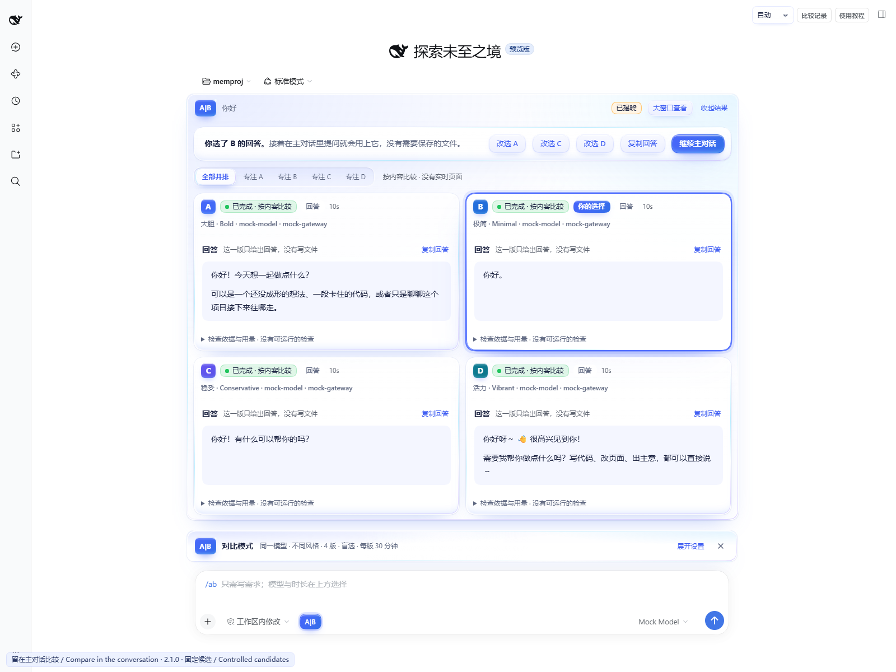

[](#demo)

<div align="center">

<a id="agentcompare"></a>
<a id="agent-compare-dsh-agent-compare--鲸挑细选"></a>

# AgentCompare · 鲸挑细选

[](https://github.com/lijiaqi-AI-Product-Manager/dsh-agent-compare/stargazers)
[](https://www.npmjs.com/package/dsh-agent-compare)
[](https://dshmarket.com/categories/workflow/)

[](https://www.dsh.so/artifact/dsh-agent-compare/)
[](https://www.dsh.so/artifact/dsh-agent-compare/)

[](https://www.npmjs.com/package/dsh-agent-compare)
[](https://github.com/lijiaqi-AI-Product-Manager/dsh-agent-compare/actions/workflows/ci.yml)
[](https://github.com/lijiaqi-AI-Product-Manager/dsh-agent-compare/blob/main/LICENSE)
[](https://github.com/lijiaqi-AI-Product-Manager/dsh-agent-compare/blob/main/docs/demo.md)

<sub><a href="https://github.com/lijiaqi-AI-Product-Manager/dsh-agent-compare/blob/main/docs/npm-total-downloads.md">Metrics and ranking sources</a></sub>

[中文](https://github.com/lijiaqi-AI-Product-Manager/dsh-agent-compare/blob/main/README.md) · **English** · [日本語](https://github.com/lijiaqi-AI-Product-Manager/dsh-agent-compare/blob/main/README.ja.md) · [한국어](https://github.com/lijiaqi-AI-Product-Manager/dsh-agent-compare/blob/main/README.ko.md) · [Español](https://github.com/lijiaqi-AI-Product-Manager/dsh-agent-compare/blob/main/README.es.md) · [Português (Brasil)](https://github.com/lijiaqi-AI-Product-Manager/dsh-agent-compare/blob/main/README.pt-BR.md) · [Français](https://github.com/lijiaqi-AI-Product-Manager/dsh-agent-compare/blob/main/README.fr.md) · [Deutsch](https://github.com/lijiaqi-AI-Product-Manager/dsh-agent-compare/blob/main/README.de.md)

**One idea. More ways to bring it to life.**

**鲸挑细选 · AgentCompare** is a comparison plugin for [DeepSeek Harness](https://github.com/deepseek-ai/deepseek-harness) (DSH), installed as `dsh-agent-compare`. Send one task in the main conversation, compare 2–4 answers, files or runnable pages, then keep the version that fits your idea. Works in **DSH Desktop + Web**, with Chinese and English interfaces.

<p align="center"><a href="#demo">Watch the 45-second demo</a> · <a href="#install">Install on Desktop or Web</a> · <a href="#support">Check compatibility</a></p>

<a id="demo"></a>
<a id="watch-a-whole-big-fat-fish-race"></a>

</div>

## See a comparison in action

[](https://github.com/lijiaqi-AI-Product-Manager/dsh-agent-compare/blob/main/docs/media/comparison-workflow.mp4)

A controlled-candidate recording in a real DSH host: whales and live steps, interactive pages, a pick of C with reasons, then saving the result and continuing the conversation. Waiting is cut; the remaining footage plays at its original speed.

[Full video · 45 seconds](https://github.com/lijiaqi-AI-Product-Manager/dsh-agent-compare/blob/main/docs/media/comparison-workflow.mp4) · [Recording conditions and results](https://github.com/lijiaqi-AI-Product-Manager/dsh-agent-compare/blob/main/docs/demo.md) · [Full GIF](https://github.com/lijiaqi-AI-Product-Manager/dsh-agent-compare/blob/main/docs/media/comparison-preview.gif)

These screenshots and animations show controlled candidates in a real DSH host. They demonstrate the actual interface and workflow; model quality and timing are described separately.

[](https://raw.githubusercontent.com/lijiaqi-AI-Product-Manager/dsh-agent-compare/main/assets/readme/gallery-2.0/02-live-comparison.png)

Use all four pages directly, with each reply given the same standing as its page. Open Steps to inspect the thoughts and tool calls the host provides.

<details>
<summary>The four steps</summary>

[](https://raw.githubusercontent.com/lijiaqi-AI-Product-Manager/dsh-agent-compare/main/assets/readme/comparison-workflow.webp)

Set versions and styles → run in parallel → try and choose → review and continue. The workflow graphic is a product illustration.

</details>

<a id="install"></a>

## Install

### DSH Desktop

1. Install `dsh-agent-compare` from **Plugins → Add plugin** in the app.
2. In **Plugins → Installed**, check that AgentCompare is enabled, then quit DSH completely and reopen it.
3. Click **A|B** at the bottom left of the main composer, choose versions and styles, then send your task.

### Self-hosted DSH Web

Interface languages: Simplified Chinese and English, selectable in DSH Desktop and Web.

These commands target a self-managed DSH Web profile. The desktop application's `desktop` profile is app-managed; use its Plugins page.

Install the npm package into the default Web profile (the npm badge above shows registry status):

```bash
dsh plugin --profile web add dsh-agent-compare
```

For another self-managed profile, replace `web` with its actual name.

**Restart fully after an update.** Quit DSH Desktop completely and reopen it. For Web, restart the relevant DSH service and reload the page. Refreshing the interface alone can leave the old backend running; a version mismatch now shows a restart notice.

<details>
<summary>Build and install from source</summary>

Or build from source and install:

```bash
git clone https://github.com/lijiaqi-AI-Product-Manager/dsh-agent-compare.git
```

```bash
cd dsh-agent-compare
npm ci
npm pack
```

```bash
dsh plugin --profile web add ./dsh-agent-compare-3.4.1.tgz
```

</details>

<a id="use"></a>

## Your first comparison

After restarting DSH, enable **A|B at the bottom left of the conversation composer**:

1. A settings strip opens above the existing input. Choose **one model · different styles** (the default, reusing the current model) or **different models · one style** (a configured model for each version, all with the same style).
2. Choose 2, 3 or 4 versions, and blind or open. With one model, pick a style for each version or describe your own in one line. The strip notes that more versions use more.
3. Select a per-version generation limit (5–120 minutes) and the **main-conversation context** every version sees: none, the recent exchanges (3 by default) or messages you tick. The strip shows the bounded excerpt they will receive, with truncation disclosed. Settings are retained for this conversation across reopening.
4. Write the task in the original composer and send. No flags to type. Mode switching changes only its command chip, preserving the draft, references, and attachments. Unsupported attachment submissions are refused by the host while retaining the originals.
5. The conversation renders a persistent A|B card with **answers, files or runnable web pages**. Live pages support clicking and typing. In a new conversation without a chat timeline, the same record appears above the composer. Adaptive views support direct interaction. Matching desktop/phone sizes are available, and you can focus one version (press 1–4 in the card, 0 for all). With three or four versions, **Set aside** the ones you have ruled out so the rest move up side by side. Expand the card for closer inspection.
6. Choose a version or **None of these**. A blind pick reveals models and styles; an open comparison shows them from the start. For project changes that pass checks, **Review and adopt** shows the target, differences and preflight before a separate write confirmation. Outside Git, save into a new folder. Answers require no file adoption. **Continue conversation** returns to the composer, retaining the choice and recovery record.

The example selector offers a smaller search-and-clear case or the full filtering/mobile case and remembers the choice. It creates a separate repository in the same conversation, preserving unrelated drafts; adoption targets that example repository. Every version uses the configured real model and consumes usage. Smaller scope is not a fixed-time guarantee. [Example scope and timing](https://github.com/lijiaqi-AI-Product-Manager/dsh-agent-compare/blob/main/docs/first-use.md).

Use **comparison records** and **tutorial** at the upper right of new or existing conversations. History retains the task, checks, choice, adoption and undo. When previews stop, verification screenshots remain available.

[Records, restarts and recovery](https://github.com/lijiaqi-AI-Product-Manager/dsh-agent-compare/blob/main/docs/runs-and-recovery.en.md) · [Supported scope](#compatibility) · [Custom acceptance](#repository-acceptance-agent-comparejson)

Results, your pick, adoption and undo enter this conversation's memory. You can then ask how the comparison went, or keep working on the adopted version. After the reveal and before adopting, you can switch to another finished version; when none is usable, use **Compare again**. See [conversation memory and context](docs/conversation-memory.md#english).

[Windows process compatibility settings](docs/windows-process-compat.en.md) offer automatic/off controls that preserve host confinement and show observed hooks after reveal.

In 1.3.0, A|B works in any folder. A folder outside Git, including the DSH default workspace, compares each version's pages, files or answers from an empty folder and saves the pick into a new folder there. Subfolder projects, non-Vite Node projects and static sites are supported too. See [folders and project types](docs/workspaces-and-projects.md#english).

<a id="ui"></a>
<a id="gallery"></a>

## Interface and experience

On a phone, choose the mode, number of versions and blind or open comparison. Check the project and shared context, then type in the conversation. Open More settings for styles, time limits and the built-in example. When you return to a comparison, opening settings folds the earlier result. Reopen it to continue with the same pages and draft.

In short windows, scroll the settings panel while the draft and Send stay in view. In a low landscape window, use Expand settings to change options.

When typing `/ab`, put `--` before a prompt that mentions option names. For example, `/ab --versions 2 -- Explain the --example option` requests two explanations.

On a wide screen, select Align pages to bring live previews to the same starting height. Select it again to restore the original layout. Anything typed in a preview stays there.

Choose a style by its swatch on mobile. On desktop, open the steps to see what each version just did. Blind comparisons reveal model and style after your pick. Before applying changes, review each file with line numbers.

<details>
<summary>See the 3.3.0 interface</summary>


</details>

- **Blue liquid glass.** Distinct glass surfaces separate settings, candidates and review. With reduced motion enabled, selections and reveals switch directly.
- **A Big Fat Fish keeps you company.** One blue DeepSeek whale per version fills with blue water as it goes while two lights trace its edge. Thoughts rise over its head; poke it and it answers, keep poking and it spins, wobbles and splashes.
- **Start with the latest step.** The card header shows the latest action during generation. Open Steps to read recorded thoughts, tool calls and their available timings.
- **Reply and result side by side.** An answer stands alone; a page shares the card with its reply, and in focus the reply sits to the left of the page.
- **Four blues for A–D.** In a blind comparison you only see A–D; styles and models are revealed after the pick, with a sweep of light across the cards.
- **Easy to tell it's running.** Two comets race around a running comparison, and each page can be used the moment it starts.
- **Desktop, browser and phone widths**, with Chinese and English interfaces.

Steps contain only information the model and host provide. Long records retain their beginning and end; shortened text is marked, and style names are masked before a blind pick. The whale’s water level represents a processing stage, not a quality score or an exact completion percentage.

[](https://raw.githubusercontent.com/lijiaqi-AI-Product-Manager/dsh-agent-compare/main/assets/readme/whale-closeup.webp)

<p align="center"><sub>Whale close-up: controlled candidates; the scripted model waits 9 s per step so there is time to watch; cut, otherwise original speed.</sub></p>

[](https://raw.githubusercontent.com/lijiaqi-AI-Product-Manager/dsh-agent-compare/main/assets/readme/gallery-2.0/05-saved-result.png)

In focus, the reply sits beside the page. Keep reasons for the pick, save or review the changes, then return to the same conversation.

<details>
<summary>More real views: answers, settings, English and phone width</summary>

[](https://raw.githubusercontent.com/lijiaqi-AI-Product-Manager/dsh-agent-compare/main/assets/readme/gallery-2.0/03-main-conversation.png)

[](https://raw.githubusercontent.com/lijiaqi-AI-Product-Manager/dsh-agent-compare/main/assets/readme/gallery-2.0/04-comparison-settings.png)

[](https://raw.githubusercontent.com/lijiaqi-AI-Product-Manager/dsh-agent-compare/main/assets/readme/13-english-answers.webp)

<p align="center"><a href="https://raw.githubusercontent.com/lijiaqi-AI-Product-Manager/dsh-agent-compare/main/assets/readme/14-phone-answer.webp"></a></p>

</details>

[More real views: answers, settings, English and phone width](https://github.com/lijiaqi-AI-Product-Manager/dsh-agent-compare/blob/main/docs/storefront-gallery.md)

<a id="tasks"></a>
<a id="what-it-is-for"></a>

## What it is for

| Your task | What you compare |
|---|---|
| An answer, analysis or copy | Different approaches and wording, formatted side by side with one-click copy. |
| Scripts, documents or other files | The files and replies each version produces; save the pick to a new folder. |
| Pages and interface changes | Use runnable pages, inspect shared acceptance checks, then review before adoption. |

<details>
<summary>Model, style and task-selection details</summary>

UI and interaction tasks, where quality is judged by using it and tests can only tell whether something was delivered: search and filters, form flows, landing pages, dashboard layouts, component redesigns. Bug fixes and refactors with one right answer are better served by a single agent plus tests.

Both modes run 2–4 versions, blind or open:

| Mode | Same for every version | Different |
|---|---|---|
| One model · different styles (default) | model, task, acceptance | the style (by default Conservative + Bold for two, plus Minimal for three, plus Vibrant for four) |
| Different models · one style | task, acceptance, style (Balanced by default) | the model (one configured in DSH per version, no repeats) |

<a id="styles"></a>

Eight styles in three groups. Every style must still deliver every requirement of the task:

| Group | Style | For a page or a project change | For an answer or written files |
|---|---|---|---|
| Approach | Conservative | Reuse existing components and patterns; smallest change | Conventional and direct |
| | Bold | Rethink layout and interaction | A fresh, creative angle |
| Look | Minimal | Few elements, generous whitespace, clear at a glance | Only what is asked |
| | Polished | Professional finish, clear hierarchy, complete states | Structured and thorough |
| | Vibrant | Colour, motion and personality | Warm tone, vivid examples |
| Priority | Friendly | Beginner-friendly, accessible, phone-first | Step by step, plain words |
| | Rigorous | Validation, edge cases and tests | States assumptions, covers exceptions |
| | Lean | Little code, fast to load, no dependencies | As short as possible |

A custom style is a one-line description of up to 120 characters. It is given to every version as a description of the style and cannot change the task or the rules. A style can be chosen more than once, which runs the same brief several times.

A blind comparison shuffles the chosen styles across A–D at the start and reveals them after the pick. An open comparison keeps them in order as A–D and shows them while you compare.

</details>

<a id="support"></a>

## Support and practical limits

[](https://github.com/lijiaqi-AI-Product-Manager/dsh-agent-compare/blob/main/package.json)
[](https://github.com/lijiaqi-AI-Product-Manager/dsh-agent-compare/blob/main/package.json)

| Host and scope | Verification |
| --- | --- |
| Windows · DSH 0.2.2-rc.2 / rc.3 · Node 26.13.0 · 2026-11-18 | The 3.2.0 Windows host test covered installation, command checks and a Vite preview. |
| Edge 157 · 390 / 1440 px | [View the new interface in Edge with a sample conversation](#ui) |

- Live pages need a runnable web project; answers and files can also be compared. See the project guide for plain folders, repositories and subfolders.
- Each version consumes model usage. Time and cost depend on the task and model; running in parallel does not guarantee a lower bill or a shorter wait.
- Review before adoption and keep undo/recovery records. A working copy is not a full virtual machine: DSH provides the write boundary, reading and network access are not isolated, and Windows reports the actual level of enforcement.
- Outside Git, versions start from empty copies and do not read existing files. To change existing content, enable Git in the settings strip first. Results save into a new subfolder.

[Project types and plain folders](https://github.com/lijiaqi-AI-Product-Manager/dsh-agent-compare/blob/main/docs/workspaces-and-projects.md) · [Package-manager matrix](https://github.com/lijiaqi-AI-Product-Manager/dsh-agent-compare/blob/main/docs/package-managers.md) · [Full compatibility and Safari limits](https://github.com/lijiaqi-AI-Product-Manager/dsh-agent-compare/blob/main/README.en.md#compatibility)

[Plugin directories and installation](https://github.com/lijiaqi-AI-Product-Manager/dsh-agent-compare/blob/main/docs/distribution.en.md) · [Listing and review status](https://github.com/lijiaqi-AI-Product-Manager/dsh-agent-compare/issues/4)

<a id="details"></a>

## Further reading: checks, recovery and advanced settings

### What it does for you

- Every version starts from **the same baseline**, including uncommitted work, without touching your index or files.
- Each candidate requests the host's write policy rooted in its own copy; the host's enforcement limits are disclosed.
- Independent dependency files, checks and preview environments per version, running in parallel; eligible npm projects with unchanged manifests can use independent copies of the private warm installation.
- **One fixed, content-bound acceptance**: a candidate that edits the test script, configs or existing tests does not count as passing.
- Adoption checks the result **together with what you changed meanwhile**, and stops when the checked target changes before a pending write.

### How it works

1. **Baseline** — snapshot the working tree through a private temporary index (uncommitted and untracked files included, ignored ones excluded).
2. **Bound acceptance** — derive the checks from the baseline (`typecheck` / `lint` / `test` / `build` scripts plus a page check) and record the script bodies, content hashes of verification files (`tsconfig*`, Vite/Vitest config, lint config, existing tests, `.agent-compare.json`), the lockfile and runtime. A committed `.agent-compare.json` can add step-by-step interaction checks.
3. **Owned copies** — one branchless `git worktree` per candidate under the plugin home (`~/.dsh/agent-compare/w/<run>/<candidate>`), with an owner mark in its git admin dir.
4. **Candidate sessions** — each candidate is its own DSH session whose directory is its copy. The session requests `workspace-write` for that root before it runs; approvals are pinned to `never`. This uses the host's enforcement, including its platform limitations below. Each has a generation time limit (5 / 15 / 30 / 60 / 90 / 120 minutes in the interface, 30 by default). When it runs out, the agent is stopped and what it wrote is still sealed and verified. While it works, the card's **Steps** list its thoughts, tool calls and words live, and say how long it has been quiet. It is done when its turn ends with nothing queued; background work of other plugins in its session is not waited for.
5. **Seal** — the session is closed and the change frozen as a commit plus a full binary patch (SHA-256); `node_modules` is always excluded.
6. **Verify** — copy equals the sealed tree → **frozen install** (a failure fails; there is no unlocked retry) → acceptance commands (up to three at a time) → serve the **build output** with `vite preview` → page acceptance in a fresh headless browser context (loads, no console errors, scripted steps, desktop and phone screenshots) → the copy still equals the sealed tree. When the build fails, only a dev-server preview is offered, marked "for observation only". The page can be used in the card as soon as it is served, while acceptance continues.
   - For an npm project with a lockfile, no root install scripts and no local packages, the baseline's manifest is installed once with the same frozen command in a private folder of the run (`~/.dsh/agent-compare/d/<run>`) while the versions generate. A version whose manifest files (`package.json`, the lockfile, `.npmrc`) are byte-identical gets its own copy of that result instead of installing again; anything else installs as before. The folder is removed once every version has been verified.
   - The build-output sequence above describes Vite. Other Node projects use their applicable scripts; plain static pages need no install or build. Answers and files can be compared by content, without claiming checks that were not run.
7. **Verdict** — adoption requires recorded checks without failures or timeouts, unchanged verification definitions and a checked tree matching the sealed tree. An unrun scripted page acceptance blocks direct adoption. A skipped basic page-load check remains an explicit warning, not a verified check. Dependency changes and missing lockfiles are also disclosed.
8. **Pick** — 2–4 cards show answers, files or live pages, with independent iframes when a page is available. Blind comparisons label them A–D and shuffle styles at the start; the pick reveals styles, actual models and available usage. Open comparisons show them from the start. Applicable check results show whether your pick matches what the checks favoured.
9. **Adopt** (adoptable candidates only):
   - Compute the exact tree your checkout will have: your current files plus the candidate's touched paths. If you edited any of those paths since the baseline, stop — nothing is written.
   - If you changed other files meanwhile, **rehearse** that combination in a scratch copy with the full acceptance; if it fails, stop — nothing is written.
   - Recheck the checkout, HEAD and staged entries after rehearsal and before each file write or deletion. A detected change stops adoption; only earlier attempted paths are considered for rollback, preserving later user edits.
   - Persist a recovery journal (pre-adopt snapshot, expected tree, HEAD and staged-state fingerprints) and hold a repository lock before the first write.
   - Prepare candidate bytes with the repository's eol/filter settings, retain the actual original files, and publish through links that cannot replace an existing path. An edit or new file at the handoff boundary stops the operation while retaining both contents. Verify the checkout **equals the rehearsed tree** and HEAD and the index are unchanged. Nothing is committed.
   - A failed write is rolled back automatically; an interrupted one is offered for recovery the next time the panel opens. Undo is available later unless you edited those files (they are listed, never overwritten).
   - A candidate that did not pass can only be saved as a branch (one commit, no checkout switch) for inspection.
10. **Continue** — after a successful adoption, copies and previews are released and the panel offers "continue from this result": the next task starts from what you just adopted. History is browsed separately.

### Isolation and safety: what is and is not guaranteed

Candidate sealing and verification resolve the owned Git administration from the original repository, check reciprocal links and owner marks, and use explicit Git directory/worktree arguments. Changed, linked, oversized or missing pointer metadata blocks further capture or preview reopening; ambiguous copies are retained during cleanup. Ambient Git repository/index/config selectors are ignored, while intentional private indexes remain supported. These checks protect lifecycle operations from Git pointer redirection; the host sandbox remains responsible for project processes.

| Area | How | Limit |
|---|---|---|
| Candidate writes | The candidate session's directory is its copy; DSH's sandbox enforces it up front | DSH marks its Windows sandbox as partial; platform temp areas may be writable |
| Project commands | Installation, checks, initial preview and reopened preview use the host's `workspace-write` policy; ambient child variables use its canonical scrub | Missing confinement fails without an unconfined retry. Partial enforcement is recorded and shown; this is not read or network isolation |
| Your project | Compared with the baseline while candidates run and shown in the panel | Differences are reported without attributing their source; adoption checks for overlap |
| Concurrent editing | Checks the checkout and raw-file fingerprints, retains original files before publishing with no-replace links, and preserves conflicting content during undo and recovery | The repository lock does not lock external editors. Handoff is per file; wait before editing affected paths or rearranging directories. This is not a sandbox against same-permission processes |
| Acceptance | Script bodies, configs and test files are hash-bound; the copy is checked before and after | Requirements that cannot be checked automatically are left to you, never claimed as verified |
| Dependencies | Frozen installation when a lockfile exists, or an independent copy of a private frozen installation with identical manifests | Projects without a lockfile get an unlocked install, with a warning; a failed warm copy uses the candidate's normal installation without weakening lockfile checks |
| Processes | A recorded preview is stopped only when its command line proves it is ours; preview file writes use the same host policy | Network access and process visibility are **not** isolated |
| Browser state | Each preview launch gets a fresh random `.localhost` hostname; the server stays on `127.0.0.1`. Host probes connect directly to loopback and require a successful HTTP status | Embedded cookies follow browser policy. Login, external backends and shared databases are outside the current scope; an external tab may use different storage. Reopening resets page state, while comparison records and screenshots remain |
| Embedded navigation | Preview frames permit scripts and forms but cannot navigate the top-level comparison window | This is not a complete hostile-code sandbox; opened pages and network requests still use the browser's policies |
| Cleanup | Deletes only registered worktrees of that repository with a matching owner mark | Anything else is kept and listed |
| Retained originals | A self-ignored `.agent-compare-transfer-*` directory in the project retains raw files and a durable journal. Its location is available in the result, and preview cleanup keeps it | Direct application requires ordinary files, at most 10,000 paths, 128 MiB total original/replacement bytes and hard-link support. Symlinks, special files and unsupported filesystems can use branch adoption. Keep these directories until recovery is complete |
| Older records | Records from 0.1 are shown read-only | Nothing acts on their recorded paths or pids |

If the host has no session factory (`ctx.agents.create`), AgentCompare falls back to the 0.1 subagent path (`isolation: shared-root`): copies live inside the repository under `.agents/worktrees`, and escapes are only detected afterwards. The panel and the run record state which one is in use.

The current Windows host restricts named-pipe stdio in confined grandchildren. npm lifecycle scripts use foreground output without changing the project's script permissions. Private files capture esbuild version checks and Vite's optional `net use` probe; the esbuild service uses the host's public anonymous-pipe primitives and inherits the same restricted token. Other tools requiring nested named pipes may still fail; they are not retried with wider permissions. File-read access and network access remain outside this boundary.

### Configuration (optional)

Append an id-targeted entry to the profile's `cordis.patch.yml`:

```yaml
- id: agent-compare
  name: dsh-agent-compare
  config:
    generationMinutes: 20
```

| Key | Default | Meaning |
|---|---|---|
| `generationMinutes` | `30` | Per-candidate generation budget |
| `maxActiveRuns` | `1` | Comparisons generating at the same time |
| `isolation` | `own-root` | `shared-root` is the experimental 0.1 path |
| `home` | `~/.dsh/agent-compare` | Records, patches, screenshots and copies |

### Repository acceptance: `.agent-compare.json`

Commit it at the repository root (the baseline version is used; a candidate editing it does not count):

```json
{
  "scripts": ["test:e2e"],
  "browser": {
    "path": "/",
    "steps": [
      { "label": "8 products at first", "expectCount": "[data-testid=product-card]", "min": 8, "max": 8 },
      { "fill": "input[type=search]", "text": "lamp" },
      { "expectCount": "[data-testid=product-card]", "min": 1, "max": 1 },
      { "click": "button:has-text(\"Clear\")" },
      { "viewport": { "width": 390, "height": 844 } },
      { "expectVisible": "input[type=search]" }
    ]
  }
}
```

Step kinds: `fill`, `click`, `press`, `expectVisible`, `expectCount`, `expectText`, `viewport`; selectors are Playwright selectors. A complete example: [examples/vite-react-demo/.agent-compare.json](https://github.com/lijiaqi-AI-Product-Manager/dsh-agent-compare/blob/main/examples/vite-react-demo/.agent-compare.json).

The definition is validated before generation. Unknown fields, unavailable scripts, malformed steps, and cross-origin page paths are rejected. Binding includes root JS/TS helpers, `scripts/`, `tools/`, `config/`, known configuration and existing tests. New verification configuration and changes to package scripts, including lifecycle hooks, also prevent direct adoption. Protect additional baseline data or helpers with `"protectedFiles": ["custom/fixture.json"]`; each entry must name an existing repository-relative file.

Binding does not infer every file an arbitrary program can read dynamically. Programmatic acceptance describes the configured checks; other quality requirements still need hands-on use and source review.

### Compatibility

| Item | Status |
|---|---|
| DSH 0.2.1-rc.3 desktop, Windows 11 | Historical compatibility case: real-model generation, verification, choice and adoption completed; candidate sessions requested their own copy's write boundary and shell commands ran |
| DSH 0.2.1-rc.5, Web UI, Windows 11 | Production command, real child sessions, live previews, adoption, refreshed history, and adopted-result context in the next main-session request; local scripted adapter |
| Linux, Ubuntu CI, DSH 0.2.1-rc.5 | Core regressions and real host confinement, environment scrub, frozen install, build, preview reopening and cancellation passed; no complete external-model delivery case yet |
| DSH next channel | Separate Windows/Linux/macOS native runtime canaries print the resolved version; see [CI](https://github.com/lijiaqi-AI-Product-Manager/dsh-agent-compare/actions/workflows/ci.yml). This is separate from full model-delivery acceptance |
| macOS | Current source adds native full regression, Chromium interface, actual DSH and package-manager checks. Safari live comparison remains separate in [#115](https://github.com/lijiaqi-AI-Product-Manager/dsh-agent-compare/issues/115); Chromium results do not replace it |
| 1.2.0 baseline | Windows/Linux/macOS pin DSH 0.2.1-rc.5 and 0.2.2-rc.1; Playwright 1.65.0, Vite 8.3.6 and pnpm 12.18.0. See the execution matrix and current CI for passing combinations and limits |
| Node | 26.13.0 is the primary development baseline; current 22/24 maintenance releases also have CI compatibility jobs |
| Projects | Answers, files and web pages; folders outside Git, repositories with or without commits, repository subfolders, Vite, non-Vite Node projects and static sites. See [folders and project types](docs/workspaces-and-projects.md#english), and the [execution matrix](docs/package-managers.md) for complete package-manager checks and known limitations |

### Verified (maintained through current CI and the cases below)

The cases below retain their original source and tool versions. 1.2.0 scripts use the baseline above; historical run numbers are not presented as new-version measurements.

Current results are available in [CI](https://github.com/lijiaqi-AI-Product-Manager/dsh-agent-compare/actions/workflows/ci.yml). The reproducible runtime check also exercised DSH 0.2.1-rc.5 with Node 26.13 and Vite 8.3.5 on Windows: adjacent writes denied, child environment scrubbed, frozen installation, typecheck/build, two preview starts and cancelled writes stopped. Windows correctly reported partial enforcement.

To repeat that check using the official current host in a separate dependency directory:

```bash
npm install --prefix .runtime-checks/host-sdk --ignore-scripts --no-audit --no-fund @deepseek-ai/dsh@latest
npm run test:runtime
```

The host dependency directory is ignored and excluded from the plugin package. This runtime check uses a controlled example and does not request a model.

- Automated regressions (see the current CI results for the count), including real git, frozen npm installs, builds and preview processes (temporary paths contain spaces), plus unit and host-contract tests. Regressions cover: a rewritten test script passes its check but is not adoptable; failing checks; dependency changes without a lockfile update fail the frozen install with no unlocked retry; generation budget; exact adoption with HEAD and index untouched and resources released; rehearsal that adopts and keeps your other changes, or blocks without writing when the combination fails; overlap; recovery after an interrupted write; the repository lock; cleanup refusing directories it cannot prove it owns; stale-record saves; read-only legacy records; process ownership by command line; and the candidate session contract (directory = copy, sandbox `workspace-write`, approvals `never`, a stop before start, reported token usage).
- Adoption regressions preserve edits made during rehearsal or journal persistence, stop on concurrent HEAD/index changes, guard replacements and deletions, preserve ignored files at addition paths, and roll back only attempted paths. Retrying after resolving an overlap still supports adoption and undo.
- Startup regressions reserve capacity before asynchronous preparation, permit retry after an initial-save failure and preserve history on identifier collisions. Shutdown drains pending starts, active candidates and journaled adoption. History tests page through 65 actual record files without changing their bytes.
- Browser assertions cover composer controls and persisted settings, separate run identities, two interactive previews, blank-conversation navigation and reopening, source review, adoption confirmation, return-to-composer focus, responsive states, and dialog keyboard behaviour. History navigation covers 72 sample entries, pagination, search, late responses, older backends, retry and read-only issue filtering. Light/dark interface states pass the automated WCAG 2 A/AA and 2.1 AA rules. These checks use labelled sample runs.
- `node scripts/smoke.mjs`: the built-in case with scripted agents on React 19.3.1, Vite 8.3.5, and Playwright Chromium 156.0.8078.4. The complete version passes 12/12 acceptance steps; the one missing the clear button passes 9/12 and is not adoptable. Notes are edited after the baseline, so adoption must rehearse the combined result and preserve the updated notes. With `--escape B`, a write outside the copy is detected.
- DSH 0.2.1-rc.5, isolated profile: the production command consumes a five-minute generation setting, creates two actual candidate sessions, serves both apps, and completes review and adoption. After reload and returning to normal conversation, a local scripted adapter observes the adopted result in the real main-session request. New and existing header controls remain available, with no page errors. No external model request is made in this check.
- Development and example dependency audits report zero known advisories. Backend coverage is reported separately by `npm run test:coverage`; browser and native-host integration checks are separate layers and are not included in that percentage.

- Real model (DSH 0.2.1-rc.3 desktop, deepseek-flash, built-in case): both candidate session headers record their own copy as `cwd`, with `sandbox/mode` `workspace-write` and `approval/policy` `never`; `pwsh` runs inside the candidates (the 0.1 `SetNamedSecurityInfoW` error is gone); token usage comes from the session logs. Neither candidate declared completion within 30 minutes. One had written its whole change, and the shared acceptance run on its copy afterwards passed the frozen install, typecheck, build and 12/12 page steps — which is why 0.2.0-alpha.2 verifies written work when the time limit is reached.

- A full real-model round (DSH 0.2.1-rc.3 desktop, deepseek-flash, one model with two strategies, 60-minute limit): each candidate generated for about 42 minutes, using about 2.64M and 2.94M tokens; both passed typecheck, build and page acceptance; B was picked and adopted into the working tree (`src/App.tsx`, `src/styles.css`), uncommitted, with index and HEAD unchanged.
- In-conversation runs (DSH 0.2.1-rc.3 runtime, test profile): `/ab` appears in the command menu; the composer's A|B button turns the draft into `/ab …`, which is executed as the command; the session log records `command/run` (`ab` and its arguments) and `command/done` (with the run id); when generation finishes, a note describing the result is queued into that conversation for the model's next step; the host accepted every registration (composer button, command card, tool card, header button).
- Packed-plugin interface checks (DSH 0.2.1-rc.3 Web UI, isolated profile): graphical submission through the resident composer, two real Vite previews with search and clear interaction, choice, adoption review and working-tree writes, persisted result notes in the next-step inbox, reload recovery of the adopted record, and return to ordinary conversation. This check used fixed scripted candidates, without a model request.

### Not verified yet

- The desktop shell's final appearance after updating, and the latest host's "adopt, then ask for the next change" flow with an external model provider. Request-context delivery has been checked with the local scripted adapter.
- Historical Windows cases recorded long tool calls and inter-step waits, sometimes exceeding 30 minutes per comparison. The contributing costs have not been isolated and cannot be attributed to a particular plugin or service; the current host still needs performance measurements with an external model.
- The full native Safari platform matrix and browsers’ private modes. Automated WebKit checks do not replace native Safari acceptance; see #115 for the recorded Safari results and remaining limits. Verified candidate-state separation still follows browser policies for embedded cookies and external tabs, rather than providing a complete browser security boundary.
- Provider behaviour in two-model mode.

### Known limitations

- Answers and files are compared by their content. Live previews and page checks need a runnable web project; other languages' tests run only when the baseline's package scripts run them.
- In a folder outside Git, every version starts from an empty folder and does not read the files already there. To change existing files, enable Git in that folder from the settings strip first; the home folder, drive roots, system folders and folders over 5,000 files or 300 MB are refused.
- Each version consumes model usage and needs an independent copy, dependency files and, when relevant, a preview. Eligible npm projects can copy a private frozen installation. Actual total usage depends on the models, task and number of versions, rather than a guaranteed fixed multiple; larger projects also need more disk space and memory.
- Release 1.3.0 and earlier list a record with three or four versions as one to handle and do not act on it; after upgrading it reads normally.
- npm 12 installation policy can block dependency scripts; projects requiring native installation steps must first allow them under their own policy.
- One comparison says nothing about a model's or style's overall quality.

### Development

Use Node 26.13.0 (`.nvmrc`) and npm 12.2.2. The compiler and test baseline is TypeScript 7, React 19.3, and Vitest 5. The distributed client reuses the React runtime supplied by DSH.

```bash
npm ci && npm run typecheck && npm test
```

```bash
npx playwright-core install --only-shell chromium
npm run test:ui
npm run test:coverage
npm run smoke
```

```bash
node scripts/preview-ui.mjs
```

See [CONTRIBUTING.md](https://github.com/lijiaqi-AI-Product-Manager/dsh-agent-compare/blob/main/CONTRIBUTING.md) and [CHANGELOG.md](https://github.com/lijiaqi-AI-Product-Manager/dsh-agent-compare/blob/main/CHANGELOG.md).

<a id="whats-new"></a>

## What's new

**3.4.1** · Find a comparison using its original folder name or full project path. Long paths take one line above the composer and expand for copying. If a selected message changes or disappears, choose it again before sending. Long excerpts keep both ends. Switching files keeps the selected file in view, and answers and code blocks can be copied directly from the comparison dialog.

**3.3.1** · Programmatic status reads now work when candidate results are still pending. If the composer is busy, the guide keeps your draft in place and lets you retry.

**3.3.0** · Style swatches, stage expressions, line-by-line review and history grouped by date.

**3.2.1** · Page text checks wait up to five seconds for rendered feedback. Queued results reach their original conversation in update order, up to five per conversation step.

**3.2.0** · Mobile settings now open in two levels, and live pages can be aligned on wide screens. All eight guides lead from the demo straight to installation and the first comparison.

<details>
<summary>Changes in 3.1.1 and earlier releases</summary>

**3.1.1:** The Chinese compatibility entry mirrors the complete guide. An offline check verifies the README npm selects from the actual archive, preventing a section index from becoming the package landing page. Comparison and adoption behavior is unchanged.


**New in 3.1.0:**
- **Steps, live and afterwards.** Each version has a **Steps** button from the start, showing thoughts, tool calls and replies provided by the model and host. Its newest three steps also scroll under the whale while it works. Long records retain the first 40 and latest 280 items and mark omissions or shortened text. Before a blind pick, words that name a style show as ▒▒.
- **The reply, shown directly.** A version that only answers shows just its answer. A version that built a page or wrote files shows its reply with the same standing: above the page side by side, and to the left of the page when that version is in focus. The reply appears as soon as the version finishes, before its page.
- **Pages shown directly.** Static pages are served by the plugin itself, without a separate process for the desktop app to stop, and are interactive once the preview is ready. HTML file results can also open in a sandboxed page, with their source one click away.
- **Results sooner.** Completion is confirmed after a version's turn ends with nothing queued, without waiting for other plugins to release its whole session. This took 0.35–0.6 seconds on the recorded test host; the old backend's desktop cases took 41–44 seconds. Eligible npm projects can prepare a frozen installation while the versions work, with an independent copy for each unchanged manifest; other versions use their normal installation; checks run in parallel and a served page can be used immediately. Four Vite pages took about 24–30 seconds in the controlled recording setup. These measurements are not timing guarantees for other models or machines.
- **Waiting is fun.** Each working version shows DeepSeek's blue whale logo, pale at first and filling with blue water as the version gets further, while two lights run around its edge. Now and then a thought rises over its head: what it is doing, an idea, or an invitation to poke it. It spouts at every step and turns toward the pointer, and pokes in a row make it jump, spin, wobble and splash, with a new line each time. Two comets race around a running comparison (a fallback covers older engines; reduced motion keeps them still), over slowly flowing blue light.
- **Four blues for A–D.** Version labels are four different blues.
- **A reminder to restart DSH.** DSH swaps in a plugin's new interface at once but keeps running the backend it loaded at start. When the two differ, AgentCompare asks you to quit and reopen DSH instead of quietly missing steps and replies.
- **A Chinese name.** The official Chinese name is 鲸挑细选; the nickname is 大肥鱼赛马.
- **Also includes 2.1.0, which was not published on its own:** greetings and questions can be compared as replies without requiring a page; brighter, clearer liquid glass, lighter buttons and sliding controls; in both themes, the text in the 21 tested interface states measured at least 4.5:1.

**New in 2.0.0:**
- **A new blue liquid-glass interface.** Aurora and star dust behind glass panels, a glass lens that slides between options and liquid progress; a burst of light when you pick and a sweep of light at the reveal. Dark mode, reduced motion and high-contrast mode are supported.
- **Say why it won.** After the pick, tap a few reasons (layout, look and colour, feel in use…) or add a line; later changes in the main conversation keep those strengths.
- **Quick sets.** One tap sets the number of versions and their styles: Classic pair, Three looks, Three priorities, Four directions.
- **2–4 versions, with styles.** Eight presets or a one-line custom style; different models can share one style.
- **Blind or open comparison.** Try each version, set it aside and restore it; use 1–4 to focus and 0 to show all.
- **Answers, files and live pages.** Read formatted Markdown and copy answers, code, file contents or saved paths. Your pick is clearly marked.
- **Stay in the conversation.** Comparisons, picks, adoption and undo enter the current conversation's memory so you can keep working.
- **Desktop + Web, Chinese + English.** Reuse configured models; review changes before confirming adoption, with undo and recovery available.

Since 1.3.0, any folder works, including repository subfolders, non-Vite Node projects and static sites, and answers and files can be compared too. See the [changelog](https://github.com/lijiaqi-AI-Product-Manager/dsh-agent-compare/blob/main/CHANGELOG.md#200) for scope and limits.

</details>

<details>
<summary>About the name</summary>

Its Chinese name is **鲸挑细选** (*jīng tiāo xì xuǎn*), a pun on 精挑细选, "picked with care", where 鲸 means whale: 2–4 DeepSeek whales take on the same task, and you keep the best. Its nickname is **大肥鱼赛马**, "the Big Fat Fish race": Chinese users call DeepSeek's whale the Big Fat Fish, and here several of them race on one track while you call the winner.

</details>

## License

MIT

<!-- project-growth:start -->

## Project growth

**Maintenance notice:** The maintainer reports that November 11 UTC maintenance, improvements and fixes included a temporary withdrawal from most plugin marketplaces, reducing distribution and requests that day. [Maintenance and distribution notice](https://github.com/lijiaqi-AI-Product-Manager/dsh-agent-compare/blob/main/docs/maintenance-update-2026-11-11.en.md).

<a href="https://www.npmjs.com/package/dsh-agent-compare">
<picture>
  <source media="(max-width: 600px) and (prefers-color-scheme: dark)" srcset="https://raw.githubusercontent.com/lijiaqi-AI-Product-Manager/dsh-agent-compare/main/assets/statistics/npm-total-mobile-dark.svg">
  <source media="(max-width: 600px)" srcset="https://raw.githubusercontent.com/lijiaqi-AI-Product-Manager/dsh-agent-compare/main/assets/statistics/npm-total-mobile-light.svg">
  <source media="(prefers-color-scheme: dark)" srcset="https://raw.githubusercontent.com/lijiaqi-AI-Product-Manager/dsh-agent-compare/main/assets/statistics/npm-total-dark.svg">
  
</picture>
</a>

Lifetime official npm download requests across all public versions, starting at first publication. The card states the available cutoff; repeated and automated requests may be included.

[Lifetime definition and automatic refresh](https://github.com/lijiaqi-AI-Product-Manager/dsh-agent-compare/blob/main/docs/npm-total-downloads.md)

The Star badge reads GitHub with about five minutes of caching. Cumulative npm requests refresh daily at 19:00 Asia/Shanghai; execution may be delayed.

<!-- project-growth:end -->
