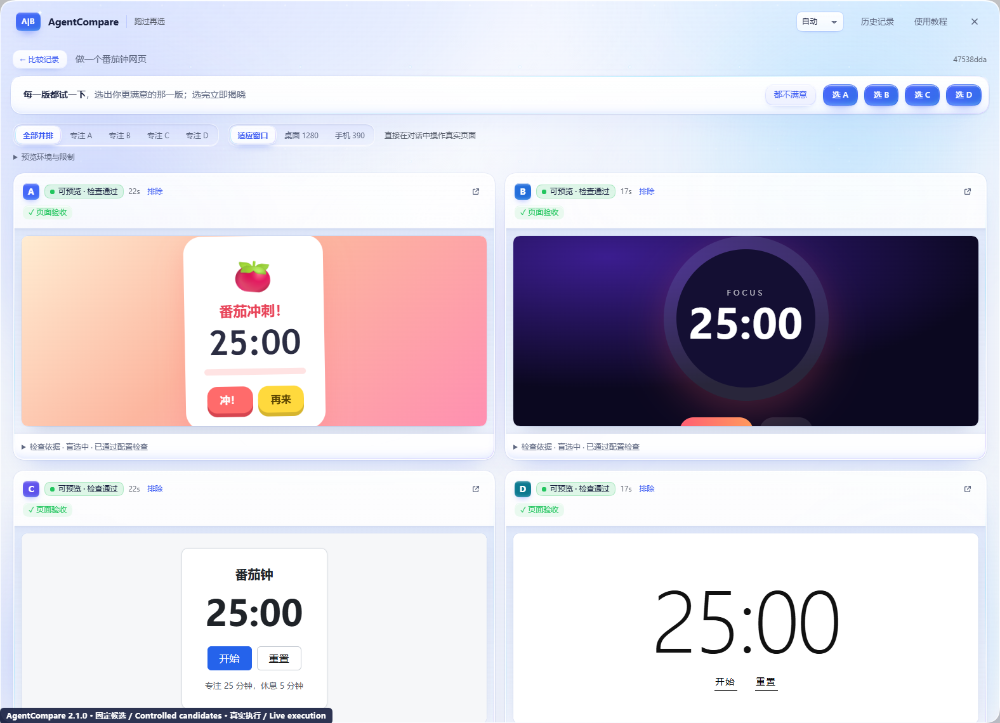
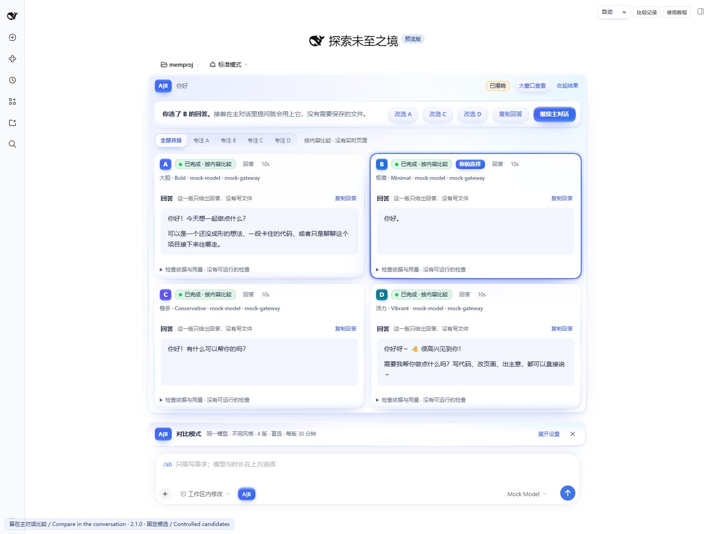
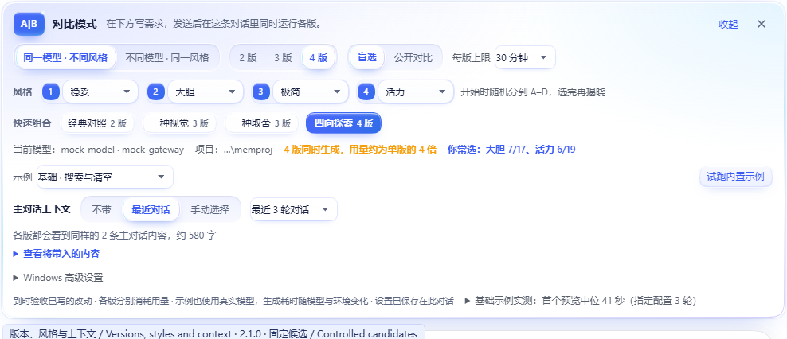
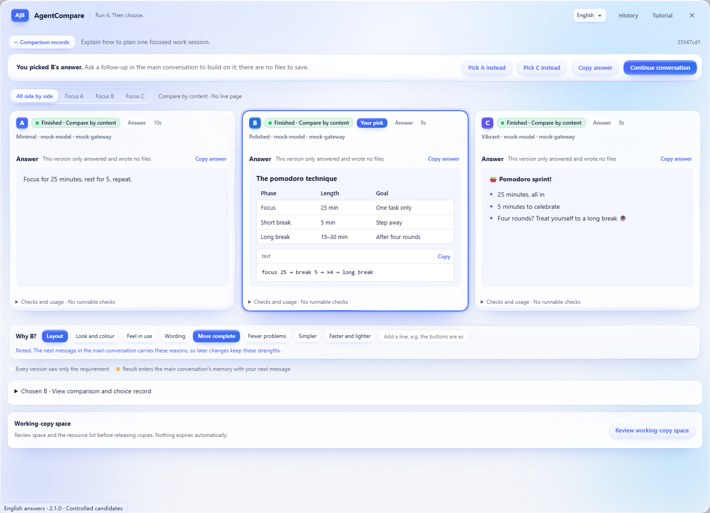
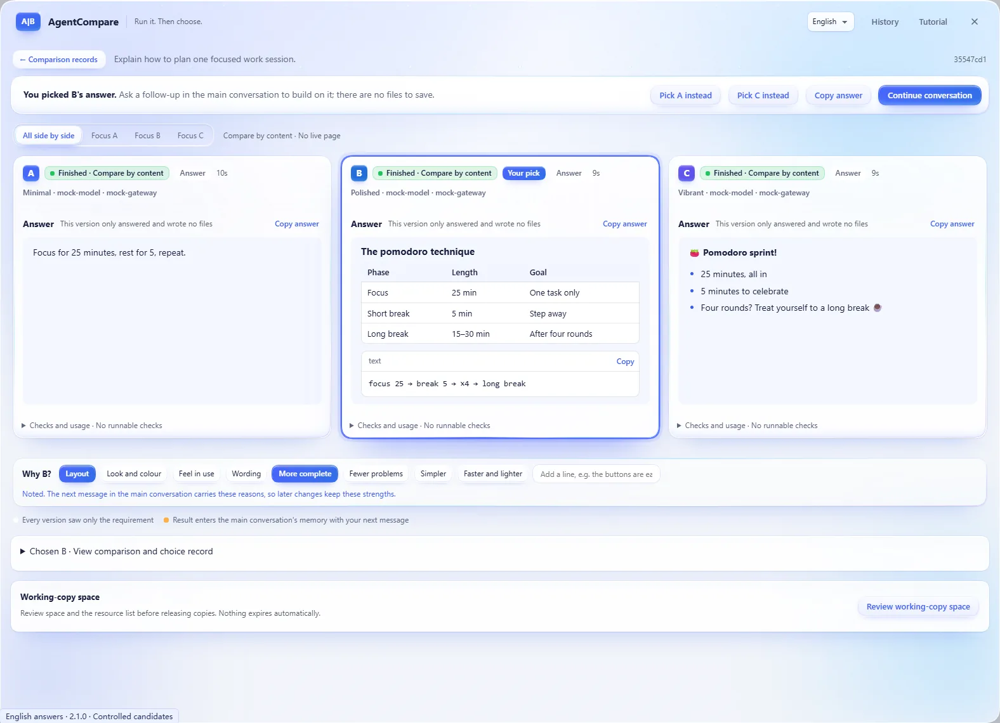
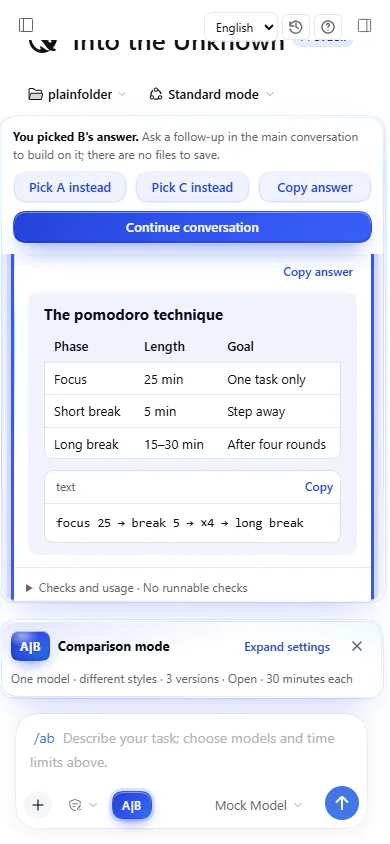
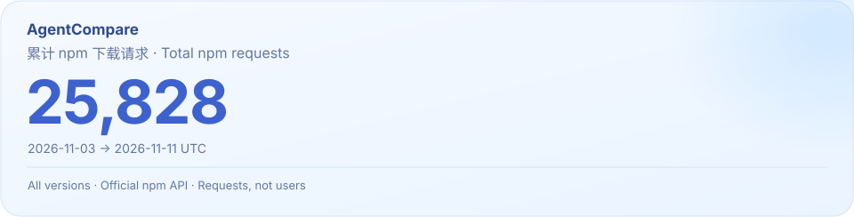

[](#install)

# AgentCompare

[](https://github.com/lijiaqi-AI-Product-Manager/dsh-agent-compare/stargazers)
[](https://www.npmjs.com/package/dsh-agent-compare)

[](https://github.com/lijiaqi-AI-Product-Manager/dsh-agent-compare/blob/main/package.json)
[](https://www.npmjs.com/package/dsh-agent-compare)
[](https://github.com/lijiaqi-AI-Product-Manager/dsh-agent-compare/actions/workflows/ci.yml)
[](https://github.com/lijiaqi-AI-Product-Manager/dsh-agent-compare/blob/main/package.json)
[](https://github.com/lijiaqi-AI-Product-Manager/dsh-agent-compare/blob/main/docs/demo.md)
[](https://github.com/lijiaqi-AI-Product-Manager/dsh-agent-compare/blob/main/LICENSE)

[中文](https://github.com/lijiaqi-AI-Product-Manager/dsh-agent-compare/blob/main/README.md) · [English](https://github.com/lijiaqi-AI-Product-Manager/dsh-agent-compare/blob/main/README.en.md) · [日本語](https://github.com/lijiaqi-AI-Product-Manager/dsh-agent-compare/blob/main/README.ja.md) · [한국어](https://github.com/lijiaqi-AI-Product-Manager/dsh-agent-compare/blob/main/README.ko.md) · **Español** · [Português (Brasil)](https://github.com/lijiaqi-AI-Product-Manager/dsh-agent-compare/blob/main/README.pt-BR.md) · [Français](https://github.com/lijiaqi-AI-Product-Manager/dsh-agent-compare/blob/main/README.fr.md) · [Deutsch](https://github.com/lijiaqi-AI-Product-Manager/dsh-agent-compare/blob/main/README.de.md)

**Una tarea. De 2 a 4 implementaciones en ejecución. Elige estilos, compara a ciegas o a la vista y adopta.**

**DSH 桌面端 + 浏览器 / Desktop + Web**

<p align="center"><a href="#install">安装 / Install</a> · <a href="#demo">真实演示 / Recorded demo</a></p>

> **2.1.0 · Versión estable.** DSH Desktop y Web, con interfaz en chino e inglés. Compara respuestas, archivos o páginas web en la conversación principal desde cualquier carpeta, reutilizando los modelos configurados.

**Novedades de 2.1.0:**
- **Un saludo o una pregunta recibe respuestas.** El tipo de resultado lo decide la petición, no la carpeta: saluda o pregunta dentro de un proyecto que se puede compilar y cada versión responde en su propio estilo para compararlas en paralelo, sin construir una página; si pides cambiar el proyecto, se implementa como antes.
- **Vidrio líquido más claro y luminoso.** El azul es más claro; el espacio de trabajo queda un nivel por debajo del vidrio, con luz suave desde arriba. El vidrio tiene tres grosores (fino, grueso y casi sólido), con un borde brillante y un toque de cian y lila en los cantos; solo la barra de acciones flotante y la barra de ajustes desenfocan lo que hay detrás.
- **Botones y texto más ligeros.** El azul sólido se reserva para la acción principal, la opción elegida y las letras de versión; los demás botones son de vidrio azul pálido con texto azul en peso normal.
- **Controles que se deslizan.** El filtro «Needs attention only» del historial es un interruptor deslizante; los controles segmentados se asientan en una ranura y elegir una opción ya no desplaza a las vecinas. Las casillas y los desplegables comparten un mismo estilo de vidrio.
- **Legible en todas partes.** Contraste medido glifo a glifo en 19 estados de la interfaz por tema: todo el texto alcanza al menos 4.5:1. Las versiones en paralelo tienen la misma altura.

**Novedades de 2.0.0:** compara **2, 3 o 4 versiones** a la vez. Cada versión puede tener un **estilo** (alcance: conservador, audaz; aspecto: minimalista, pulido, vibrante; prioridad: amigable, riguroso, ligero; o una línea propia). Compara **a ciegas** (estilos revelados al elegir) o **a la vista** (estilos visibles desde el inicio). Con tres o cuatro versiones puedes **apartar** las que descartas para ver el resto en paralelo, y en la tarjeta las teclas 1–4 enfocan una versión.
- **Nueva interfaz de vidrio líquido azul.** Aurora y polvo de estrellas tras paneles de vidrio, una lente de vidrio que se desliza entre opciones y progreso líquido; un destello al elegir y un barrido de luz al revelar. Compatible con modo oscuro, movimiento reducido y alto contraste.
- **Di por qué ganó.** Tras elegir, marca algunos motivos (diseño, color y acabado, sensación de uso…) o añade una línea; los cambios posteriores en la conversación principal conservan esas virtudes.
- **Combinaciones rápidas.** Un toque fija el número de versiones y sus estilos: Par clásico, Tres estéticas, Tres prioridades, Cuatro direcciones.
- **2–4 versiones con estilos.** Ocho estilos predefinidos o una descripción de una línea; varios modelos pueden compartir un estilo.
- **Comparación a ciegas o abierta.** Prueba cada versión, apártala y restáurala; 1–4 enfoca una versión y 0 muestra todas.
- **Respuestas, archivos y páginas reales.** Lee Markdown y copia respuestas, código, archivos o rutas. Tu elección queda señalada.
- **Continúa en la conversación.** Comparaciones, elecciones, adopciones y deshacer quedan en la memoria de la conversación actual.
- **Desktop + Web, interfaz en chino e inglés.** Reutiliza modelos configurados, revisa los cambios antes de adoptarlos y conserva deshacer y recuperación.

AgentCompare es un complemento de [DeepSeek Harness](https://github.com/deepseek-ai/deepseek-harness), DSH. De 2 a 4 agentes trabajan sobre copias independientes del mismo proyecto. El complemento instala dependencias, compila, sirve cada aplicación y aplica criterios comunes de verificación. Puedes usar las páginas antes de elegir una o ninguna; en una comparación a ciegas, el modelo y el estilo se revelan al elegir. Antes de incorporar una propuesta, comprueba cómo encaja con el estado actual de tu proyecto.

[插件目录与安装](https://github.com/lijiaqi-AI-Product-Manager/dsh-agent-compare/blob/main/docs/distribution.md) · [Plugin directories and installation](https://github.com/lijiaqi-AI-Product-Manager/dsh-agent-compare/blob/main/docs/distribution.en.md) · [Listing status / 收录状态](https://github.com/lijiaqi-AI-Product-Manager/dsh-agent-compare/issues/4)

[](https://raw.githubusercontent.com/lijiaqi-AI-Product-Manager/dsh-agent-compare/main/assets/readme/comparison-workflow.webp)

<p align="center"><sub>功能示意 / Product illustrations · <a href="#demo">查看真实演示 / Watch the recorded workflow</a></sub></p>

<a id="gallery"></a>

## La interfaz actual

Capturas reales de DSH con candidatos controlados. La portada y el flujo son ilustraciones del producto.

<details>
<summary>Open four interface views / 展开实际界面</summary>









</details>

[Las 8 imágenes y las condiciones de captura](https://github.com/lijiaqi-AI-Product-Manager/dsh-agent-compare/blob/main/docs/storefront-gallery.md)

<a id="demo"></a>

## Ver el flujo completo

[](https://github.com/lijiaqi-AI-Product-Manager/dsh-agent-compare/blob/main/docs/media/comparison-workflow.mp4)

Grabación con candidatos fijos en un host DSH real, a partir del código candidato de 2.1.0 y con la interfaz en chino. Cuatro versiones crean una página pomodoro en una carpeta normal, y las cuatro páginas en vivo se pueden usar. Se apartan dos, el resto se compara en paralelo, la elección revela cada estilo y el resultado se guarda en una carpeta nueva antes de seguir la conversación. El vídeo omite las esperas y mantiene el resto a velocidad normal. Se ocultan las rutas locales.

Tras elegir, se marcan dos motivos (diseño y más simple), que llegan a la siguiente petición de la conversación principal.

[Vídeo completo (28 segundos)](https://github.com/lijiaqi-AI-Product-Manager/dsh-agent-compare/blob/main/docs/media/comparison-workflow.mp4) · [Condiciones y resultados](https://github.com/lijiaqi-AI-Product-Manager/dsh-agent-compare/blob/main/docs/demo.md)

<details>
<summary>English answers · 390 px</summary>

<p align="center"> </p>

</details>

<a id="install"></a>

## Instalación

La interfaz está disponible en chino simplificado e inglés, seleccionables en DSH Desktop y Web.

Los comandos siguientes corresponden a un perfil DSH Web gestionado por el usuario. El perfil `desktop` lo gestiona la aplicación de escritorio; utiliza su página de complementos.

La referencia de desarrollo es Node 26.13.0 y npm 12.2.2. Las comprobaciones actuales usan el paquete oficial DSH 0.2.1-rc.5. Identifica el perfil de DSH que utilizas.

Instala el paquete npm en el perfil Web predeterminado. La insignia de npm indica el estado de publicación:

```bash
dsh plugin --profile web add dsh-agent-compare@2.1.0
```

Para otro perfil autogestionado, sustituye `web` por su nombre real.

También puedes compilar e instalar desde el código fuente:

```bash
git clone https://github.com/lijiaqi-AI-Product-Manager/dsh-agent-compare.git
cd dsh-agent-compare
npm ci
npm pack
```

Sustituye `<your-profile>` por el nombre real de tu perfil:

```bash
dsh plugin --profile <your-profile> add ./dsh-agent-compare-2.1.0.tgz
```

Reinicia DSH. Antes de actualizar, termina las comparaciones activas y cierra las instancias antiguas que comparten sus registros. No se admite que distintas versiones modifiquen los mismos registros simultáneamente.

## Primera comparación

1. Pulsa **A|B**, abajo a la izquierda del cuadro de conversación. Los ajustes aparecen sobre el cuadro existente.
2. El modo predeterminado reutiliza el modelo actual con dos estrategias. No exige una segunda cuenta. El modo de dos modelos permite elegir dos de los que ya configuraste en DSH.
3. Elige en pantalla el límite de generación por propuesta: 5–120 minutos, 30 de forma predeterminada. Escribe únicamente lo que necesitas y envíalo. No tienes que escribir parámetros.
4. La conversación muestra el progreso y dos aplicaciones interactivas. Puedes usar vistas de escritorio y móvil, centrar A o B y abrir una ventana de inspección más grande.
5. Selecciona `选 A`, `选 B` o `都不满意` —A, B o ninguna—. Después se revelan la estrategia o el modelo real, las comprobaciones y el uso disponible.
6. Usa `审查并采用` para revisar el repositorio de destino y las condiciones previas. Una confirmación separada escribe los cambios. `继续主对话` vuelve al cuadro original y sale del modo de comparación.

`试跑内置示例` crea una tienda de ejemplo en otro repositorio; no modifica tu proyecto. La incorporación del resultado también apunta a ese ejemplo. `比较记录` abre el historial y `使用教程` la guía; ambos controles aparecen en conversaciones nuevas y existentes.

## Qué merece comparar

Búsquedas, filtros, formularios, páginas de presentación, paneles y rediseños de componentes: tareas cuya calidad se aprecia al utilizarlas. Para errores con una respuesta clara o refactorizaciones mecánicas suele ser mejor un agente con pruebas.

Con un modelo se comparan una estrategia que conserva la estructura y otra que replantea la interacción. Con dos modelos se mantienen la tarea, las instrucciones y la verificación. Ambos parten del mismo código. Una elección no demuestra que un modelo sea mejor en general.

## Ejecución y criterios comunes

En un repositorio Git, incluso sin commits, una instantánea mediante un index privado incluye los cambios sin commit y los archivos no rastreados, salvo los excluidos. En una carpeta fuera de Git, ambas versiones empiezan en un espacio de trabajo privado y vacío, y la elegida puede guardarse en una subcarpeta nueva. El HEAD y el index originales se conservan. Cada propuesta tiene su propio worktree y sesión; los cambios se guardan como un parche binario con hash.

Las comprobaciones se toman del estado inicial: `typecheck`, `lint`, `test`, `build` y la verificación de página configurada. Con archivo de bloqueo se usa una instalación congelada; un fallo no provoca un reintento sin bloqueo. Cambiar las pruebas o su configuración para aprobar una propuesta no la convierte en apta para incorporación directa.

Un [`.agent-compare.json` en la raíz](https://github.com/lijiaqi-AI-Product-Manager/dsh-agent-compare/blob/main/examples/vite-react-demo/.agent-compare.json) permite fijar acciones y expectativas comunes: escribir, pulsar, comprobar texto, visibilidad, cantidades y tamaño de pantalla. La definición se valida antes de generar. Si una aceptación explícita de la página no se ejecuta, se bloquea la incorporación directa. Cuando solo falta la comprobación básica de carga, se indica como advertencia. Responder por HTTP, compilar, cumplir una función y gustarte son resultados distintos.

## Incorporación, deshacer y recuperación

Se combina tu árbol de trabajo actual con los archivos modificados por la propuesta. Los solapamientos detectados detienen la operación. Si cambiaste otros archivos, la combinación se ensaya en una copia temporal. Antes de escribir se vuelven a comprobar el contenido, HEAD e index y se guarda un registro de recuperación.

La incorporación al árbol de trabajo no crea commits, no hace push y no cambia de rama. Incluye archivos nuevos, eliminados y binarios. Una propuesta que no cumple los criterios puede guardarse en una rama para inspeccionarla. Al deshacer o recuperar una operación interrumpida, los cambios posteriores detectados se conservan como conflictos.

El bloqueo del repositorio coordina operaciones del complemento; no bloquea tu editor. Pausa la edición durante la breve fase de escritura.

## Historial y estado de la página

El historial muestra todas las conversaciones de forma predeterminada, con filtro por conversación, búsqueda por tarea, repositorio o identificador y páginas de 30 registros. Se conservan el resultado, la elección y la incorporación. Las notas se entregan a la misma conversación y se reintentan si no está disponible. No se inyectan todos los logs largos en el contexto principal.

Los registros dañados o antiguos quedan en modo de solo lectura con una explicación. Tras reiniciar, una imagen guardada se distingue de una aplicación en ejecución. Si la copia sigue disponible, puedes reabrir la vista previa. Cada apertura usa un nombre `.localhost` nuevo y separa las cookies y el almacenamiento por origen de las propuestas. El estado temporal de la página se reinicia; los registros y las capturas permanecen.

## Compatibilidad y límites

Un worktree no es una barrera de seguridad completa. Se utiliza la política de escritura de DSH; Windows informa **partial**. No se aíslan las lecturas de archivos ni la red. Las cookies en marcos siguen las políticas del navegador y una pestaña externa puede utilizar otro contexto de almacenamiento. No se cubren inicio de sesión, backends externos ni bases de datos compartidas.

Las pruebas nativas cubren Windows, Linux y macOS. Consulta la [matriz detallada](https://github.com/lijiaqi-AI-Product-Manager/dsh-agent-compare/blob/main/README.en.md#compatibility) para las combinaciones verificadas de npm, pnpm y Yarn y las limitaciones de Windows/PnP. Safari nativo se valida por separado; las pruebas con respuestas controladas no miden la calidad ni el rendimiento de modelos externos.

## Tiempo, coste y evidencia

Cada propuesta consume generación. El paralelismo no garantiza menos tiempo o coste. Puedes detener una o ambas; al agotarse el tiempo se comprueban los cambios ya escritos. Si el proveedor no devuelve uso, se muestra como desconocido, nunca como coste cero.

La [CI](https://github.com/lijiaqi-AI-Product-Manager/dsh-agent-compare/actions/workflows/ci.yml) cubre Windows/Linux, Node y navegador. Parte de las integraciones actuales ejecuta sesiones, herramientas y aplicaciones reales con un adaptador local de respuestas fijas: demuestra la ejecución del sistema, no la calidad de un modelo externo. Los casos históricos con modelos reales corresponden a DSH 0.2.1-rc.3. No son una clasificación general ni una promesa de rendimiento.

## Colaboración y licencia

En un [Issue](https://github.com/lijiaqi-AI-Product-Manager/dsh-agent-compare/issues), incluye versiones, sistema operativo, pasos, resultado esperado y observado. Evita credenciales, código privado y rutas locales completas. Consulta [CONTRIBUTING.md](https://github.com/lijiaqi-AI-Product-Manager/dsh-agent-compare/blob/main/CONTRIBUTING.md) y [CHANGELOG.md](https://github.com/lijiaqi-AI-Product-Manager/dsh-agent-compare/blob/main/CHANGELOG.md).

```bash
npm ci
npm run typecheck
npm test
npm run test:ui
```

Licencia [MIT](https://github.com/lijiaqi-AI-Product-Manager/dsh-agent-compare/blob/main/LICENSE). Si te ayuda a obtener un resultado útil, puedes apoyar con una Star o un caso reproducible. Compartir y dar una Star es opcional.

<!-- project-growth:start -->

## Evolución del proyecto

**Aviso de mantenimiento:** Según el responsable, el mantenimiento, las mejoras y las correcciones del 11 de noviembre UTC incluyeron una retirada temporal de la mayoría de los mercados, reduciendo la distribución y las solicitudes de ese día. [Aviso de mantenimiento y distribución (inglés)](https://github.com/lijiaqi-AI-Product-Manager/dsh-agent-compare/blob/main/docs/maintenance-update-2026-11-11.en.md).

<a href="https://www.npmjs.com/package/dsh-agent-compare">
<picture>
  <source media="(max-width: 600px) and (prefers-color-scheme: dark)" srcset="https://raw.githubusercontent.com/lijiaqi-AI-Product-Manager/dsh-agent-compare/main/assets/statistics/npm-total-mobile-dark.svg">
  <source media="(max-width: 600px)" srcset="https://raw.githubusercontent.com/lijiaqi-AI-Product-Manager/dsh-agent-compare/main/assets/statistics/npm-total-mobile-light.svg">
  <source media="(prefers-color-scheme: dark)" srcset="https://raw.githubusercontent.com/lijiaqi-AI-Product-Manager/dsh-agent-compare/main/assets/statistics/npm-total-dark.svg">
  
</picture>
</a>

Solicitudes acumuladas de npm desde la primera publicación, para todas las versiones públicas. La tarjeta indica la fecha de corte; puede incluir tráfico repetido o automatizado.

[Definición del total y actualización automática](https://github.com/lijiaqi-AI-Product-Manager/dsh-agent-compare/blob/main/docs/npm-total-downloads.md)

<!-- project-growth:end -->
