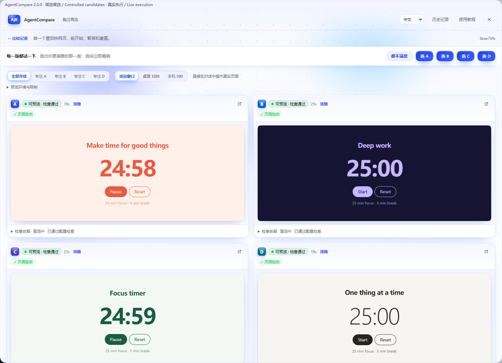

[](#demo)

<div align="center">

<a id="agentcompare"></a>
<a id="agent-compare-dsh-agent-compare--鲸挑细选"></a>

# AgentCompare · 鲸挑细选

[](https://github.com/lijiaqi-AI-Product-Manager/dsh-agent-compare/stargazers)
[](https://www.npmjs.com/package/dsh-agent-compare)
[](https://dshmarket.com/categories/workflow/)

[](https://www.dsh.so/artifact/dsh-agent-compare/)
[](https://www.dsh.so/artifact/dsh-agent-compare/)

[](https://www.npmjs.com/package/dsh-agent-compare)
[](https://github.com/lijiaqi-AI-Product-Manager/dsh-agent-compare/actions/workflows/ci.yml)
[](https://github.com/lijiaqi-AI-Product-Manager/dsh-agent-compare/blob/main/LICENSE)
[](https://github.com/lijiaqi-AI-Product-Manager/dsh-agent-compare/blob/main/docs/demo.md)

<sub><a href="https://github.com/lijiaqi-AI-Product-Manager/dsh-agent-compare/blob/main/docs/npm-total-downloads.md">Métricas y fuentes de clasificación</a></sub>

[中文](https://github.com/lijiaqi-AI-Product-Manager/dsh-agent-compare/blob/main/README.md) · [English](https://github.com/lijiaqi-AI-Product-Manager/dsh-agent-compare/blob/main/README.en.md) · [日本語](https://github.com/lijiaqi-AI-Product-Manager/dsh-agent-compare/blob/main/README.ja.md) · [한국어](https://github.com/lijiaqi-AI-Product-Manager/dsh-agent-compare/blob/main/README.ko.md) · **Español** · [Português (Brasil)](https://github.com/lijiaqi-AI-Product-Manager/dsh-agent-compare/blob/main/README.pt-BR.md) · [Français](https://github.com/lijiaqi-AI-Product-Manager/dsh-agent-compare/blob/main/README.fr.md) · [Deutsch](https://github.com/lijiaqi-AI-Product-Manager/dsh-agent-compare/blob/main/README.de.md)

**¡Una misma idea, más formas de hacerla realidad!**

**鲸挑细选 · AgentCompare** es un complemento de comparación para [DeepSeek Harness](https://github.com/deepseek-ai/deepseek-harness) (DSH), instalado como `dsh-agent-compare`. Envía una tarea en la conversación principal, compara entre 2 y 4 respuestas, archivos o páginas ejecutables y elige la versión que encaja con tu idea. Funciona en **DSH Desktop + Web**, con interfaces en chino e inglés.

<p align="center"><a href="#demo">Ver la demo de 45 segundos</a> · <a href="#install">Instalar en Desktop o Web</a> · <a href="#support">Consultar la compatibilidad</a></p>

<a id="demo"></a>
<a id="ver-una-carrera-del-pez-gordo-completa"></a>

</div>

## Mira una comparación en acción

[](https://github.com/lijiaqi-AI-Product-Manager/dsh-agent-compare/blob/main/docs/media/comparison-workflow.mp4)

Grabación con candidatos controlados en un host DSH real: ballenas y pasos en directo, páginas interactivas, elección de C con motivos, guardado y vuelta a la conversación. Se recortan las esperas; el resto conserva su velocidad original.

[Vídeo completo · 45 segundos](https://github.com/lijiaqi-AI-Product-Manager/dsh-agent-compare/blob/main/docs/media/comparison-workflow.mp4) · [Condiciones y resultados](https://github.com/lijiaqi-AI-Product-Manager/dsh-agent-compare/blob/main/docs/demo.md) · [GIF completo](https://github.com/lijiaqi-AI-Product-Manager/dsh-agent-compare/blob/main/docs/media/comparison-preview.gif)

Estas capturas y animaciones muestran candidatos controlados en un host DSH real. Enseñan la interfaz y el flujo reales; la calidad y los tiempos del modelo se describen por separado.

[](https://raw.githubusercontent.com/lijiaqi-AI-Product-Manager/dsh-agent-compare/main/assets/readme/gallery-2.0/02-live-comparison.png)

Usa las cuatro páginas directamente y lee cada respuesta junto a su resultado. Abre Steps para consultar el razonamiento y las llamadas a herramientas que proporciona el host.

<details>
<summary>La comparación en cuatro pasos</summary>

[](https://raw.githubusercontent.com/lijiaqi-AI-Product-Manager/dsh-agent-compare/main/assets/readme/comparison-workflow.webp)

Configura versiones y estilos → ejecuta en paralelo → prueba y elige → revisa y continúa. El diagrama es una ilustración del producto.

</details>

<a id="install"></a>

## Instalación

### DSH Desktop

1. Instala `dsh-agent-compare` desde **Plugins → Add plugin** en la aplicación.
2. En **Plugins → Installed**, comprueba que AgentCompare esté activado. Cierra DSH por completo y vuelve a abrirlo.
3. Pulsa **A|B** abajo a la izquierda del editor principal, elige versiones y estilos y envía la tarea.

### DSH Web autohospedado

La interfaz está disponible en chino simplificado e inglés, seleccionables en DSH Desktop y Web.

Los comandos siguientes corresponden a un perfil DSH Web gestionado por el usuario. El perfil `desktop` lo gestiona la aplicación de escritorio; utiliza su página de complementos.

La referencia de desarrollo es Node 26.13.0 y npm 12.2.2. Las comprobaciones actuales usan el paquete oficial DSH 0.2.1-rc.5 / 0.2.2-rc.1. Identifica el perfil de DSH que utilizas.

Instala el paquete npm en el perfil Web predeterminado. La insignia de npm indica el estado de publicación:

```bash
dsh plugin --profile web add dsh-agent-compare
```

Para otro perfil autogestionado, sustituye `web` por su nombre real.

**Reinicia por completo tras actualizar.** Cierra DSH Desktop completamente y vuelve a abrirlo. En Web, reinicia el servicio DSH correspondiente y recarga la página. Recargar solo la interfaz puede dejar activo el backend anterior; si las versiones difieren, aparece un aviso.

<details>
<summary>Compilar e instalar desde el código</summary>

También puedes compilar e instalar desde el código fuente:

```bash
git clone https://github.com/lijiaqi-AI-Product-Manager/dsh-agent-compare.git
cd dsh-agent-compare
npm ci
npm pack
```

Este comando instala el archivo en el perfil web `web`.

```bash
dsh plugin --profile web add ./dsh-agent-compare-3.3.1.tgz
```

</details>

Reinicia DSH. Antes de actualizar, termina las comparaciones activas y cierra las instancias antiguas que comparten sus registros. No se admite que distintas versiones modifiquen los mismos registros simultáneamente.

<a id="use"></a>
<a id="primera-comparación"></a>

## Primera comparación

1. Pulsa **A|B**, abajo a la izquierda del cuadro de conversación. Los ajustes se abren sobre el cuadro existente.
2. Elige 2–4 versiones. El modo predeterminado reutiliza el modelo actual con estilos distintos; puedes seleccionar cada estilo o describirlo en una línea. Si usas modelos distintos, elige entre los ya configurados en DSH.
3. Elige comparación a ciegas o abierta, el límite por versión (5–120 minutos) y el contexto de conversación compartido. Escribe la petición en el cuadro habitual y envíala.
4. Cada tarjeta muestra el progreso y su respuesta, archivos o página. Las páginas en ejecución son interactivas. Puedes cambiar el tamaño de escritorio/móvil, enfocar con 1–4 y volver a todas con 0; con 3–4 versiones puedes apartar las descartadas.
5. Usa «Choose A», por ejemplo, o «None of these» para no elegir ninguna. A ciegas, los modelos y estilos se revelan al elegir; en comparación abierta están visibles desde el principio.
6. Para cambios del proyecto, «Review and adopt» muestra diferencias y comprobaciones antes de una confirmación separada. Fuera de Git puedes guardar en una carpeta nueva. Una respuesta no requiere aplicar archivos. «Continue conversation» vuelve al diálogo conservando la elección.

`试跑内置示例` crea una tienda de ejemplo en otro repositorio; no modifica tu proyecto. La incorporación del resultado también apunta a ese ejemplo. `比较记录` abre el historial y `使用教程` la guía; ambos controles aparecen en conversaciones nuevas y existentes.

Puedes no compartir contexto, incluir intercambios recientes o seleccionar mensajes. El valor predeterminado son los últimos 3 intercambios; puedes revisar el extracto antes de enviarlo. El contenido largo se recorta con una indicación visible. Todas las versiones reciben el mismo extracto, y el resultado y los motivos de elección vuelven a la conversación original.

<a id="ui"></a>
<a id="gallery"></a>

## Interfaz y experiencia

En el móvil, elige el modo, el número de versiones y si la comparación será a ciegas. Revisa el proyecto y el contexto que se compartirá antes de escribir en la conversación. «More settings» reúne los estilos, el límite de tiempo y el ejemplo. Al volver a una comparación, abrir los ajustes pliega el resultado anterior. Al abrirlo de nuevo se conservan las páginas y el borrador.

En ventanas bajas puedes desplazarte por los ajustes sin perder de vista el borrador ni el botón de envío. En horizontal, pulsa «Expand settings» para abrir las opciones.

Si tu petición menciona opciones de `/ab`, escribe `--` antes del texto. Por ejemplo, `/ab --versions 2 -- Explica la opción --example` pide dos explicaciones.

En una pantalla ancha, pulsa «Align pages» para que las páginas interactivas empiecen a la misma altura. Vuelve a pulsarlo para recuperar la disposición original conservando lo escrito en cada página.

En el móvil, elige un estilo para cada versión con las muestras visuales. En el escritorio, abre los pasos para ver su última acción. En una comparación a ciegas, el modelo y el estilo se revelan después de elegir. Antes de aplicar los cambios puedes revisar cada archivo con números de línea.

<details>
<summary>Ver la interfaz de la versión 3.3.0</summary>


</details>

- **Cristal líquido azul.** Distintas capas separan los ajustes, las versiones y la revisión. Con movimiento reducido, la selección y la revelación cambian de inmediato.
- **Un pez gordo te acompaña.** Una ballena azul de DeepSeek por versión se llena de agua azul a medida que avanza mientras dos luces recorren su borde. Le suben pensamientos sobre la cabeza; tócala y te contesta, sigue tocándola y gira, se tambalea y salpica.
- **Empieza por la última acción.** Mientras se genera una versión, su cabecera muestra la acción más reciente. Abre los pasos para ver las reflexiones, llamadas a herramientas y tiempos registrados.
- **Respuesta y resultado con el mismo peso.** Una respuesta se muestra sola; una página comparte la tarjeta con su respuesta, y al enfocar una versión la respuesta queda a la izquierda de la página.
- **Cuatro azules para A–D.** En una comparación a ciegas solo ves A–D; los estilos y modelos se revelan tras elegir, con un barrido de luz sobre las tarjetas.
- **Se nota que está en marcha.** Dos cometas recorren el borde de una comparación en curso, y cada página se puede usar en cuanto arranca.
- **Escritorio, navegador y ancho de móvil**, con interfaz en chino e inglés.

Los pasos muestran la información que proporcionan el modelo y el host. Los registros largos conservan el principio y el final, con los recortes indicados; los nombres de estilo se ocultan antes de una elección a ciegas. El nivel de agua indica una etapa, no calidad ni un porcentaje exacto.

[](https://raw.githubusercontent.com/lijiaqi-AI-Product-Manager/dsh-agent-compare/main/assets/readme/whale-closeup.webp)

<p align="center"><sub>Primer plano de las ballenas: candidatos fijos; el modelo guionizado espera 9 s por paso para que dé tiempo a verlo; con cortes, el resto a velocidad normal.</sub></p>

[](https://raw.githubusercontent.com/lijiaqi-AI-Product-Manager/dsh-agent-compare/main/assets/readme/gallery-2.0/05-saved-result.png)

Al enfocar una versión, la respuesta queda junto a la página. Guarda los motivos, conserva el resultado o revisa los cambios y vuelve a la misma conversación.

<details>
<summary>Más vistas reales: respuestas, ajustes, inglés y móvil</summary>

[](https://raw.githubusercontent.com/lijiaqi-AI-Product-Manager/dsh-agent-compare/main/assets/readme/gallery-2.0/03-main-conversation.png)

[](https://raw.githubusercontent.com/lijiaqi-AI-Product-Manager/dsh-agent-compare/main/assets/readme/gallery-2.0/04-comparison-settings.png)

[](https://raw.githubusercontent.com/lijiaqi-AI-Product-Manager/dsh-agent-compare/main/assets/readme/13-english-answers.webp)

<p align="center"><a href="https://raw.githubusercontent.com/lijiaqi-AI-Product-Manager/dsh-agent-compare/main/assets/readme/14-phone-answer.webp"></a></p>

</details>

[Más vistas reales: respuestas, ajustes, inglés y móvil](https://github.com/lijiaqi-AI-Product-Manager/dsh-agent-compare/blob/main/docs/storefront-gallery.md)

<a id="tasks"></a>
<a id="qué-merece-comparar"></a>

## Qué merece comparar

| Tu tarea | Qué comparas |
|---|---|
| Una respuesta, análisis o texto | Distintos enfoques y redacciones, con formato en paralelo y copia directa. |
| Scripts, documentos u otros archivos | Los archivos y respuestas de cada versión; guarda tu elección en una carpeta nueva. |
| Páginas y cambios de interfaz | Prueba páginas ejecutables, consulta los criterios comunes y revisa antes de incorporar. |

<details>
<summary>Detalles de modelos, estilos y elección de tareas</summary>

Búsquedas, filtros, formularios, páginas de presentación, paneles y rediseños de componentes: tareas cuya calidad se aprecia al utilizarlas. Para errores con una respuesta clara o refactorizaciones mecánicas suele ser mejor un agente con pruebas.

Con un mismo modelo, asignas estilos distintos a 2–4 versiones: ocho preajustes o una instrucción propia de una línea. Para comparar modelos, eliges 2–4 de los configurados en DSH y mantienes la tarea, el estilo y las comprobaciones. En Git parten del mismo estado de código; fuera de Git, de copias vacías. Una elección no demuestra que un modelo sea mejor en general.

</details>

<a id="support"></a>

## Compatibilidad y límites de uso

[](https://github.com/lijiaqi-AI-Product-Manager/dsh-agent-compare/blob/main/package.json)
[](https://github.com/lijiaqi-AI-Product-Manager/dsh-agent-compare/blob/main/package.json)

| Entorno y alcance | Verificación |
| --- | --- |
| Windows · DSH 0.2.2-rc.2 / rc.3 · Node 26.13.0 · 2026-11-18 | La prueba de la versión 3.2.0 en Windows cubrió la instalación de dependencias, la ejecución de comprobaciones y una vista previa de Vite. |
| Edge 157 · 390 / 1440 px | [Ver la interfaz en Edge con una conversación de ejemplo](#ui) |

- Las páginas en directo requieren un proyecto web ejecutable; también puedes comparar respuestas y archivos. La guía distingue carpetas normales, repositorios y subcarpetas.
- Cada versión consume uso del modelo. El tiempo y el coste dependen de la tarea y del modelo; ejecutar en paralelo no garantiza menor coste ni espera.
- Revisa antes de incorporar y conserva los registros de deshacer y recuperación. Una copia de trabajo no es una máquina virtual completa: DSH impone la escritura, no se aíslan lectura ni red y Windows indica el nivel real de restricción.
- Fuera de Git, las versiones empiezan en copias vacías y no leen archivos existentes. Para modificarlos, activa Git primero en los ajustes. El resultado se guarda en una subcarpeta nueva.

[Proyectos y carpetas normales](https://github.com/lijiaqi-AI-Product-Manager/dsh-agent-compare/blob/main/docs/workspaces-and-projects.md) · [Matriz de gestores](https://github.com/lijiaqi-AI-Product-Manager/dsh-agent-compare/blob/main/docs/package-managers.md) · [Compatibilidad y límites de Safari](https://github.com/lijiaqi-AI-Product-Manager/dsh-agent-compare/blob/main/README.en.md#compatibility)

[Directorios e instalación](https://github.com/lijiaqi-AI-Product-Manager/dsh-agent-compare/blob/main/docs/distribution.en.md) · [Estado de solicitudes y revisiones](https://github.com/lijiaqi-AI-Product-Manager/dsh-agent-compare/issues/4)

<a id="details"></a>

## Más detalles: validación, recuperación y ajustes avanzados

### Ejecución y criterios comunes

En un repositorio Git, incluso sin commits, una instantánea mediante un index privado incluye los cambios sin commit y los archivos no rastreados, salvo los excluidos. En una carpeta fuera de Git, todas las versiones empiezan en un espacio de trabajo privado y vacío, y la elegida puede guardarse en una subcarpeta nueva. El HEAD y el index originales se conservan. Cada propuesta tiene su propio worktree y sesión; los cambios se guardan como un parche binario con hash.

Las comprobaciones se toman del estado inicial: `typecheck`, `lint`, `test`, `build` y la verificación de página configurada. Con archivo de bloqueo se usa una instalación congelada; un fallo no provoca un reintento sin bloqueo. Cambiar las pruebas o su configuración para aprobar una propuesta no la convierte en apta para incorporación directa.

Un [`.agent-compare.json` en la raíz](https://github.com/lijiaqi-AI-Product-Manager/dsh-agent-compare/blob/main/examples/vite-react-demo/.agent-compare.json) permite fijar acciones y expectativas comunes: escribir, pulsar, comprobar texto, visibilidad, cantidades y tamaño de pantalla. La definición se valida antes de generar. Si una aceptación explícita de la página no se ejecuta, se bloquea la incorporación directa. Cuando solo falta la comprobación básica de carga, se indica como advertencia. Responder por HTTP, compilar, cumplir una función y gustarte son resultados distintos.

La instalación anticipada se limita a proyectos con un archivo de bloqueo npm, sin otro gestor declarado, scripts de instalación en la raíz ni dependencias locales. Solo una versión cuyos manifiestos coinciden con la base recibe su propia copia. Si no cumple los requisitos, cambia los manifiestos o falla la copia, usa su instalación normal sin relajar el bloqueo.

### Incorporación, deshacer y recuperación

Se combina tu árbol de trabajo actual con los archivos modificados por la propuesta. Los solapamientos detectados detienen la operación. Si cambiaste otros archivos, la combinación se ensaya en una copia temporal. Antes de escribir se vuelven a comprobar el contenido, HEAD e index y se guarda un registro de recuperación.

La incorporación al árbol de trabajo no crea commits, no hace push y no cambia de rama. Incluye archivos nuevos, eliminados y binarios. Una propuesta que no cumple los criterios puede guardarse en una rama para inspeccionarla. Al deshacer o recuperar una operación interrumpida, los cambios posteriores detectados se conservan como conflictos.

El bloqueo del repositorio coordina operaciones del complemento; no bloquea tu editor. Pausa la edición durante la breve fase de escritura.

### Historial y estado de la página

El historial muestra todas las conversaciones de forma predeterminada, con filtro por conversación, búsqueda por tarea, repositorio o identificador y páginas de 30 registros. Se conservan el resultado, la elección y la incorporación. Las notas se entregan a la misma conversación y se reintentan si no está disponible. No se inyectan todos los logs largos en el contexto principal.

Los registros dañados o antiguos quedan en modo de solo lectura con una explicación. Tras reiniciar, una imagen guardada se distingue de una aplicación en ejecución. Si la copia sigue disponible, puedes reabrir la vista previa. Cada apertura usa un nombre `.localhost` nuevo y separa las cookies y el almacenamiento por origen de las propuestas. El estado temporal de la página se reinicia; los registros y las capturas permanecen.

### Compatibilidad y límites

Un worktree no es una barrera de seguridad completa. Se utiliza la política de escritura de DSH; Windows informa **partial**. No se aíslan las lecturas de archivos ni la red. Las cookies en marcos siguen las políticas del navegador y una pestaña externa puede utilizar otro contexto de almacenamiento. No se cubren inicio de sesión, backends externos ni bases de datos compartidas.

Las pruebas nativas cubren Windows, Linux y macOS. Consulta la [matriz detallada](https://github.com/lijiaqi-AI-Product-Manager/dsh-agent-compare/blob/main/README.en.md#compatibility) para las combinaciones verificadas de npm, pnpm y Yarn y las limitaciones de Windows/PnP. Safari nativo se valida por separado; las pruebas con respuestas controladas no miden la calidad ni el rendimiento de modelos externos.

### Tiempo, coste y evidencia

Cada propuesta consume generación. El paralelismo no garantiza menos tiempo o coste. Puedes detener una versión o toda la comparación; al agotarse el tiempo se comprueban los cambios ya escritos. Si el proveedor no devuelve uso, se muestra como desconocido, nunca como coste cero.

La [CI](https://github.com/lijiaqi-AI-Product-Manager/dsh-agent-compare/actions/workflows/ci.yml) cubre Windows/Linux, Node y navegador. Parte de las integraciones actuales ejecuta sesiones, herramientas y aplicaciones reales con un adaptador local de respuestas fijas: demuestra la ejecución del sistema, no la calidad de un modelo externo. Los casos históricos con modelos reales corresponden a DSH 0.2.1-rc.3. No son una clasificación general ni una promesa de rendimiento.

<a id="whats-new"></a>

## Novedades por versión

**3.3.1** · La consulta de estado funciona aunque haya resultados pendientes. Si el cuadro de mensaje está ocupado, la guía conserva el borrador y permite reintentar.

**3.3.0** · Muestras de estilos, expresiones por etapa, revisión línea a línea e historial agrupado por fecha.

**3.2.1** · La comprobación de texto espera hasta cinco segundos a que aparezca la respuesta de la página. Los resultados pendientes llegan a la conversación original por orden de actualización, hasta cinco por paso.

**3.2.0** · Los ajustes del móvil se dividen en dos niveles y las páginas en directo pueden alinearse en pantallas anchas. Las ocho guías llevan de la demo a la instalación y a la primera comparación.

<details>
<summary>Cambios de 3.1.1 y versiones anteriores</summary>

**3.1.1:** La entrada de compatibilidad en chino refleja la guía completa. Una comprobación sin conexión verifica el README que npm elige del archivo real, para que la página del paquete no muestre solo un índice. La comparación y la adopción no cambian.


**Novedades de 3.1.0:**
- **Cada paso a la vista, en vivo y después.** En cuanto una versión empieza, su tarjeta tiene un botón **Steps**. Al abrirlo aparece el trabajo en orden: razonamientos con lo que tardaron, llamadas a herramientas (leer o editar un archivo, ejecutar un comando…; cada una se abre con su entrada y su salida) y lo que se escribió entre pasos. Mientras trabaja, sus tres pasos más recientes también pasan en vivo bajo la ballena, y al terminar cada paso queda a un clic. En una comparación a ciegas, las palabras que nombran un estilo aparecen como ▒▒.
- **La respuesta, a la vista.** Una versión que solo responde muestra solo su respuesta. Una versión que construyó una página o escribió archivos muestra su respuesta con el mismo peso: encima de la página en paralelo y a la izquierda de la página cuando esa versión está enfocada. La respuesta aparece en cuanto la versión termina, antes que su página.
- **Las páginas, a la vista.** Las páginas estáticas las sirve el propio complemento: se pueden usar en cuanto se escriben, sin un proceso aparte que la aplicación de escritorio pueda detener. Si aun así una página no puede servirse, un resultado HTML se muestra igualmente como página, con su código a un clic.
- **Resultados antes.** Se empieza a confirmar la finalización cuando termina el turno de cada versión y no quedan mensajes en cola, sin esperar a que otros complementos liberen toda la sesión. En el host de prueba registrado fueron 0,35–0,6 s; los casos de escritorio con el backend anterior tardaban 41–44 s. Los proyectos npm aptos pueden preparar una instalación fija durante la generación y entregar una copia independiente a cada versión sin cambios de dependencias. Las comprobaciones van en paralelo y la página se puede usar al arrancar. En la grabación con candidatos fijos, las cuatro páginas Vite estuvieron disponibles en unos 24–30 s desde el envío. No es una evaluación de velocidad o calidad de modelos externos ni una garantía para otras máquinas.
- **Esperar es divertido.** Cada versión en marcha muestra la ballena azul de DeepSeek, pálida al principio, que se llena de agua azul a medida que avanza, mientras dos luces recorren su borde. De vez en cuando le sube un pensamiento sobre la cabeza: lo que está haciendo, una idea o una invitación a tocarla. Lanza un chorro en cada paso y se gira hacia el puntero; varios toques seguidos la hacen saltar, girar, tambalearse y salpicar, con una frase nueva cada vez. Dos cometas recorren el borde de una comparación en curso (hay una alternativa para motores antiguos; con movimiento reducido se quedan quietos), sobre una luz azul que fluye despacio.
- **Cuatro azules para A–D.** Las etiquetas de las versiones son cuatro azules distintos.
- **Un aviso para reiniciar DSH.** DSH cambia al momento la interfaz de un complemento, pero mantiene el servidor que cargó al iniciar. Cuando no coinciden, AgentCompare te pide cerrar y volver a abrir DSH, en vez de perder en silencio los pasos y las respuestas.
- **Nombre en chino.** El nombre oficial es «鲸挑细选» y el apodo, «大肥鱼赛马».
- **Incluye también 2.1.0, que no se publicó por separado:** los saludos y las preguntas se pueden comparar como respuestas, sin exigir una página; vidrio líquido más claro y luminoso, botones más ligeros y controles que se deslizan; en ambos temas, el texto de los 21 estados de interfaz comprobados alcanzó al menos 4.5:1.

**Novedades de 2.0.0:** compara **2, 3 o 4 versiones** a la vez. Cada versión puede tener un **estilo** (alcance: conservador, audaz; aspecto: minimalista, pulido, vibrante; prioridad: amigable, riguroso, ligero; o una línea propia). Compara **a ciegas** (estilos revelados al elegir) o **a la vista** (estilos visibles desde el inicio). Con tres o cuatro versiones puedes **apartar** las que descartas para ver el resto en paralelo, y en la tarjeta las teclas 1–4 enfocan una versión.
- **Nueva interfaz de vidrio líquido azul.** Aurora y polvo de estrellas tras paneles de vidrio, una lente de vidrio que se desliza entre opciones y progreso líquido; un destello al elegir y un barrido de luz al revelar. Compatible con modo oscuro, movimiento reducido y alto contraste.
- **Di por qué ganó.** Tras elegir, marca algunos motivos (diseño, color y acabado, sensación de uso…) o añade una línea; los cambios posteriores en la conversación principal conservan esas virtudes.
- **Combinaciones rápidas.** Un toque fija el número de versiones y sus estilos: Par clásico, Tres estéticas, Tres prioridades, Cuatro direcciones.
- **2–4 versiones con estilos.** Ocho estilos predefinidos o una descripción de una línea; varios modelos pueden compartir un estilo.
- **Comparación a ciegas o abierta.** Prueba cada versión, apártala y restáurala; 1–4 enfoca una versión y 0 muestra todas.
- **Respuestas, archivos y páginas reales.** Lee Markdown y copia respuestas, código, archivos o rutas. Tu elección queda señalada.
- **Continúa en la conversación.** Comparaciones, elecciones, adopciones y deshacer quedan en la memoria de la conversación actual.
- **Desktop + Web, interfaz en chino e inglés.** Reutiliza modelos configurados, revisa los cambios antes de adoptarlos y conserva deshacer y recuperación.

</details>

<details>
<summary>Sobre el nombre</summary>

Su nombre en chino es **鲸挑细选** (*jīng tiāo xì xuǎn*), un juego con 精挑细选, «elegido con cuidado», donde 鲸 significa ballena: 2–4 ballenas de DeepSeek abordan la misma tarea y tú te quedas con la mejor. Su apodo es **大肥鱼赛马**, «la carrera del pez gordo»: en China llaman «pez gordo» a la ballena de DeepSeek, y aquí varios corren en la misma pista mientras tú decides el ganador.

</details>

## Colaboración y licencia

En un [Issue](https://github.com/lijiaqi-AI-Product-Manager/dsh-agent-compare/issues), incluye versiones, sistema operativo, pasos, resultado esperado y observado. Evita credenciales, código privado y rutas locales completas. Consulta [CONTRIBUTING.md](https://github.com/lijiaqi-AI-Product-Manager/dsh-agent-compare/blob/main/CONTRIBUTING.md) y [CHANGELOG.md](https://github.com/lijiaqi-AI-Product-Manager/dsh-agent-compare/blob/main/CHANGELOG.md).

```bash
npm ci
npm run typecheck
npm test
npm run test:ui
```

Licencia [MIT](https://github.com/lijiaqi-AI-Product-Manager/dsh-agent-compare/blob/main/LICENSE). Si te ayuda a obtener un resultado útil, puedes apoyar con una Star o un caso reproducible. Compartir y dar una Star es opcional.

<!-- project-growth:start -->

## Evolución del proyecto

**Aviso de mantenimiento:** Según el responsable, el mantenimiento, las mejoras y las correcciones del 11 de noviembre UTC incluyeron una retirada temporal de la mayoría de los mercados, reduciendo la distribución y las solicitudes de ese día. [Aviso de mantenimiento y distribución (inglés)](https://github.com/lijiaqi-AI-Product-Manager/dsh-agent-compare/blob/main/docs/maintenance-update-2026-11-11.en.md).

<a href="https://www.npmjs.com/package/dsh-agent-compare">
<picture>
  <source media="(max-width: 600px) and (prefers-color-scheme: dark)" srcset="https://raw.githubusercontent.com/lijiaqi-AI-Product-Manager/dsh-agent-compare/main/assets/statistics/npm-total-mobile-dark.svg">
  <source media="(max-width: 600px)" srcset="https://raw.githubusercontent.com/lijiaqi-AI-Product-Manager/dsh-agent-compare/main/assets/statistics/npm-total-mobile-light.svg">
  <source media="(prefers-color-scheme: dark)" srcset="https://raw.githubusercontent.com/lijiaqi-AI-Product-Manager/dsh-agent-compare/main/assets/statistics/npm-total-dark.svg">
  
</picture>
</a>

Solicitudes acumuladas de npm desde la primera publicación, para todas las versiones públicas. La tarjeta indica la fecha de corte; puede incluir tráfico repetido o automatizado.

[Definición del total y actualización automática](https://github.com/lijiaqi-AI-Product-Manager/dsh-agent-compare/blob/main/docs/npm-total-downloads.md)

La insignia Star consulta GitHub con unos cinco minutos de caché. Las solicitudes acumuladas de npm se actualizan a diario a las 19:00 de China (UTC+8); la ejecución puede retrasarse.

<!-- project-growth:end -->
