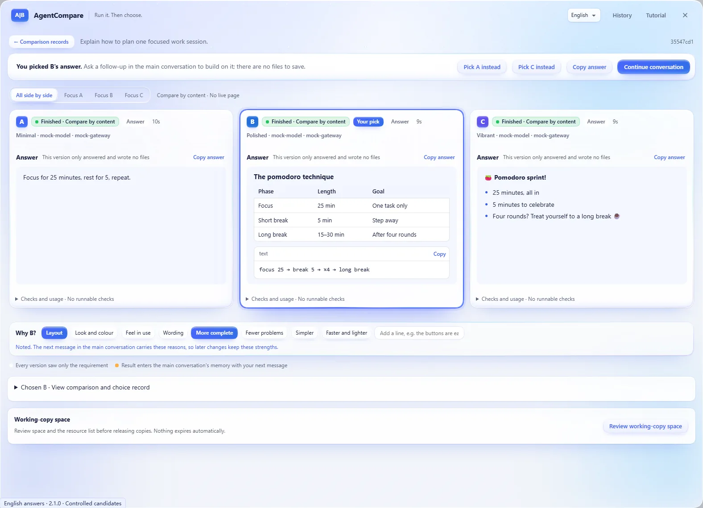
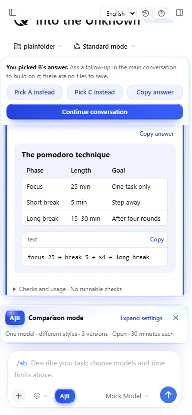

<p align="center">
  <a href="#install"></a>
</p>

# AgentCompare

[](https://github.com/lijiaqi-AI-Product-Manager/dsh-agent-compare/blob/main/package.json)
[](https://www.npmjs.com/package/dsh-agent-compare)
[](https://github.com/lijiaqi-AI-Product-Manager/dsh-agent-compare/actions/workflows/ci.yml)
[](https://github.com/lijiaqi-AI-Product-Manager/dsh-agent-compare/blob/main/package.json)
[](https://github.com/lijiaqi-AI-Product-Manager/dsh-agent-compare/blob/main/docs/demo.md)
[](https://github.com/lijiaqi-AI-Product-Manager/dsh-agent-compare/blob/main/LICENSE)

[中文](https://github.com/lijiaqi-AI-Product-Manager/dsh-agent-compare/blob/main/README.md) · [English](https://github.com/lijiaqi-AI-Product-Manager/dsh-agent-compare/blob/main/README.en.md) · [日本語](https://github.com/lijiaqi-AI-Product-Manager/dsh-agent-compare/blob/main/README.ja.md) · [한국어](https://github.com/lijiaqi-AI-Product-Manager/dsh-agent-compare/blob/main/README.ko.md) · [Español](https://github.com/lijiaqi-AI-Product-Manager/dsh-agent-compare/blob/main/README.es.md) · [Português (Brasil)](https://github.com/lijiaqi-AI-Product-Manager/dsh-agent-compare/blob/main/README.pt-BR.md) · **Français** · [Deutsch](https://github.com/lijiaqi-AI-Product-Manager/dsh-agent-compare/blob/main/README.de.md)

**Une demande. De 2 à 4 réalisations exécutées. Choisissez des styles, comparez à l'aveugle ou à découvert, puis adoptez.**

**DSH 桌面端 + 浏览器 / Desktop + Web**

<p align="center"><a href="#install">安装 / Install</a> · <a href="#demo">真实演示 / Recorded demo</a></p>

> **2.0.0 · Version stable.** DSH Desktop et Web, avec interface en chinois et en anglais. Comparez réponses, fichiers ou pages web dans la conversation principale depuis tout dossier, avec vos modèles configurés.

**Nouveautés de la version 2.0.0 :** comparez **2, 3 ou 4 versions** à la fois. Chaque version peut recevoir un **style** (ampleur : prudent, audacieux ; apparence : minimaliste, soigné, vivant ; priorité : accessible, rigoureux, léger ; ou une ligne personnalisée). Comparez **à l'aveugle** (styles révélés au choix) ou **à découvert** (styles affichés dès le début). Avec trois ou quatre versions, **mettez de côté** celles que vous écartez pour comparer les autres côte à côte ; dans la carte, les touches 1 à 4 mettent une version au premier plan.
- **2 à 4 versions avec des styles.** Huit préréglages ou une description en une ligne ; plusieurs modèles peuvent partager un style.
- **Comparaison aveugle ou ouverte.** Essayez chaque version, écartez-la puis restaurez-la ; 1–4 isole une version et 0 les affiche toutes.
- **Réponses, fichiers et pages actives.** Lisez le Markdown et copiez réponses, code, fichiers ou chemins. Votre choix est clairement indiqué.
- **Poursuivez dans la conversation.** Comparaisons, choix, adoption et annulation restent dans la mémoire de la conversation actuelle.
- **Desktop + Web, interface chinoise et anglaise.** Réutilisez les modèles configurés et examinez les changements avant l'adoption, avec annulation et récupération.

AgentCompare est une extension de [DeepSeek Harness](https://github.com/deepseek-ai/deepseek-harness), ou DSH. De 2 à 4 agents réalisent la même tâche dans des copies indépendantes du projet. L'extension installe les dépendances, compile, sert chaque application et leur applique des critères communs. Vous manipulez les pages avant d'en choisir une ou aucune ; à l'aveugle, le modèle et le style sont révélés au choix. Avant l'adoption, la proposition est vérifiée avec l'état actuel de votre projet.

[插件目录与安装](https://github.com/lijiaqi-AI-Product-Manager/dsh-agent-compare/blob/main/docs/distribution.md) · [Plugin directories and installation](https://github.com/lijiaqi-AI-Product-Manager/dsh-agent-compare/blob/main/docs/distribution.en.md) · [Listing status / 收录状态](https://github.com/lijiaqi-AI-Product-Manager/dsh-agent-compare/issues/4)

<p align="center">
  <a href="https://raw.githubusercontent.com/lijiaqi-AI-Product-Manager/dsh-agent-compare/main/assets/readme/comparison-workflow.webp"></a>
</p>

<p align="center"><sub>功能示意 / Product illustrations · <a href="#demo">查看真实演示 / Watch the recorded workflow</a></sub></p>

<a id="demo"></a>

## Voir le parcours complet

[](https://github.com/lijiaqi-AI-Product-Manager/dsh-agent-compare/blob/main/docs/media/comparison-workflow.mp4)

Enregistrement à candidats fixes dans un hôte DSH réel, à partir du code candidat de la 2.0.0, avec l'interface chinoise. Quatre versions créent une page pomodoro dans un dossier ordinaire, et les quatre pages en direct sont utilisables. Deux sont mises de côté, les autres se comparent côte à côte, le choix révèle chaque style et le résultat est enregistré dans un nouveau dossier avant de reprendre la conversation. La vidéo coupe les attentes et garde le reste à vitesse normale. Les chemins locaux sont masqués.

[Vidéo complète (11 secondes)](https://github.com/lijiaqi-AI-Product-Manager/dsh-agent-compare/blob/main/docs/media/comparison-workflow.mp4) · [Conditions et résultats](https://github.com/lijiaqi-AI-Product-Manager/dsh-agent-compare/blob/main/docs/demo.md)

<details>
<summary>English answers · 390 px</summary>

<p align="center"> </p>

</details>

<a id="install"></a>

## Installation

L’interface est disponible en chinois simplifié et en anglais, au choix dans DSH Desktop et Web.

Les commandes ci-dessous concernent un profil DSH Web géré par l’utilisateur. Le profil `desktop` est géré par l’application de bureau ; utilisez sa page de plugins.

La référence de développement est Node 26.13.0 et npm 12.2.2. Les vérifications actuelles utilisent le paquet officiel DSH 0.2.1-rc.5. Repérez le profil DSH que vous utilisez déjà.

Installez le paquet npm dans le profil Web par défaut. Le badge npm indique son état de publication :

```bash
dsh plugin --profile web add dsh-agent-compare@2.0.0
```

Pour un autre profil autogéré, remplacez `web` par son nom réel.

Vous pouvez aussi compiler et installer depuis les sources :

```bash
git clone https://github.com/lijiaqi-AI-Product-Manager/dsh-agent-compare.git
cd dsh-agent-compare
npm ci
npm pack
```

Remplacez `<your-profile>` par le nom réel de votre profil :

```bash
dsh plugin --profile <your-profile> add ./dsh-agent-compare-2.0.0.tgz
```

Redémarrez DSH. Avant une mise à jour, terminez les comparaisons actives et fermez les anciennes instances qui partagent leurs fichiers. Les modifications simultanées par plusieurs versions de l'extension ne sont pas prises en charge.

## Première comparaison

1. Cliquez sur **A|B**, en bas à gauche du champ de conversation. Les réglages s'ouvrent au-dessus du champ existant.
2. Le mode par défaut réutilise le modèle courant avec deux stratégies ; aucun second compte n'est nécessaire. Le mode à deux modèles propose ceux déjà configurés dans DSH.
3. Choisissez à l'écran la durée maximale de génération par proposition : 5 à 120 minutes, 30 par défaut. Saisissez uniquement votre demande et envoyez-la, sans paramètres à mémoriser.
4. La carte de conversation affiche la progression et deux applications interactives. Des vues bureau et mobile, un affichage centré sur A ou B et une grande fenêtre sont disponibles.
5. Choisissez avec `选 A`, `选 B` ou `都不满意` — A, B ou aucune. La stratégie ou le modèle réel, les résultats et l'usage disponible sont révélés après le choix.
6. `审查并采用` ouvre l'examen du dépôt cible et des conditions préalables. Une confirmation distincte écrit les fichiers. `继续主对话` quitte le mode de comparaison et rend le focus au champ initial.

`试跑内置示例` crée une boutique dans un dépôt distinct et ne touche pas à votre projet. L'adoption vise ce dépôt d'exemple. Les commandes `比较记录` — historique — et `使用教程` — guide — sont présentes dans les nouvelles conversations comme dans les anciennes.

## Quelles tâches comparer ?

Recherche, filtres, formulaires, pages de présentation, tableaux de bord et refontes de composants : des tâches dont la qualité se juge aussi à l'usage. Pour un défaut à réponse précise ou une transformation mécanique, un seul agent avec des tests est généralement préférable.

Avec un modèle, une stratégie conserve davantage l'existant et l'autre repense l'interaction. Avec deux modèles, demande, instructions et critères restent communs. Les deux partent du même état de code. Un choix ne constitue pas un classement général des modèles.

## Exécution et critères communs

Dans un dépôt Git, même sans commit, un index privé capture les changements non commités et les fichiers non suivis, hors exclusions. Dans un dossier hors Git, les deux versions partent d'un espace de travail privé et vide, et la version choisie peut être enregistrée dans un nouveau sous-dossier. Le HEAD et l'index d'origine sont préservés. Chaque proposition possède son worktree et sa session ; sa différence est conservée sous forme de patch binaire avec empreinte.

Les contrôles proviennent de la base : `typecheck`, `lint`, `test`, `build` et les vérifications de page configurées. Un fichier de verrouillage impose une installation figée ; un échec ne déclenche pas de repli vers une installation non figée. Modifier les tests ou leur configuration pour faire passer sa propre proposition n'autorise pas son adoption directe.

Un [`.agent-compare.json` à la racine](https://github.com/lijiaqi-AI-Product-Manager/dsh-agent-compare/blob/main/examples/vite-react-demo/.agent-compare.json) permet de fixer saisies, clics, texte, visibilité, nombres d'éléments et dimensions. Sa définition est validée avant la génération. Une vérification explicite d'acceptation de page non exécutée bloque l'adoption directe. Si seul le contrôle élémentaire de chargement manque, un avertissement le signale. Réponse HTTP, compilation, fonctionnalité et préférence personnelle sont des résultats distincts.

## Adoption, annulation et reprise

L'adoption combine l'arbre de travail actuel et les chemins modifiés par la proposition. Les chevauchements détectés arrêtent l'opération. Si d'autres fichiers ont changé, la combinaison est répétée et vérifiée dans une copie temporaire. Le contenu, HEAD et l'index sont revérifiés avant l'écriture ; un journal de récupération est conservé.

L'adoption dans l'arbre de travail ne crée pas automatiquement de commit, ne pousse rien et ne change pas de branche. Elle prend en compte ajouts, suppressions et fichiers binaires. Une proposition qui ne remplit pas les critères peut être enregistrée dans une branche d'inspection. Lors d'une annulation ou d'une reprise après interruption, les modifications ultérieures détectées restent des conflits à examiner.

Le verrou du dépôt coordonne les opérations de l'extension, sans verrouiller votre éditeur. Suspendez vos modifications pendant la courte phase d'écriture.

## Historique et état des pages

L'historique affiche toutes les conversations par défaut, avec filtre sur la conversation courante, recherche par demande, dépôt ou identifiant et pages de 30 entrées. Résultat, choix et adoption sont conservés. Les notes sont transmises à la même conversation et réessayées si elle est indisponible. Les longs journaux ne sont pas injectés intégralement dans le contexte principal.

Les anciens fichiers ou enregistrements endommagés restent en lecture seule avec une explication. Après un redémarrage, les captures sont identifiées comme des images statiques, pas des applications actives. Une copie conservée peut être relancée. Chaque ouverture utilise une nouvelle adresse `.localhost`, séparant cookies et stockage par origine entre propositions. L'état temporaire de la page est réinitialisé ; l'historique et les captures restent disponibles.

## Compatibilité et limites

Un worktree n'est pas une frontière de sécurité complète. La politique d'écriture de DSH est utilisée ; Windows la signale comme **partial**. Lectures de fichiers et réseau ne sont pas isolés. Les cookies intégrés suivent les politiques du navigateur ; un onglet externe peut employer un autre contexte de stockage. Connexion à un compte, services backend externes et bases partagées sont hors périmètre.

Les tests natifs couvrent Windows, Linux et macOS. La [matrice détaillée](https://github.com/lijiaqi-AI-Product-Manager/dsh-agent-compare/blob/main/README.en.md#compatibility) distingue les configurations npm, pnpm et Yarn vérifiées et les limites Windows/PnP. Safari natif est validé séparément ; les réponses contrôlées des tests ne mesurent pas la qualité ni les performances de modèles externes.

## Durée, coût et preuves

Chaque proposition consomme de la génération. Le parallélisme ne garantit ni gain de temps ni économie. Vous pouvez arrêter une proposition ou les deux. À l'échéance, les modifications déjà écrites sont vérifiées. Si l'usage n'est pas fourni, il est indiqué comme inconnu, jamais comme nul.

La [CI](https://github.com/lijiaqi-AI-Product-Manager/dsh-agent-compare/actions/workflows/ci.yml) couvre Windows/Linux, Node et le navigateur. Certaines intégrations actuelles exécutent de vraies sessions, outils et applications avec un adaptateur local à réponses fixes. Elles vérifient l'exécution du système, pas la qualité d'un modèle externe. Les cas historiques avec un modèle réel correspondent à DSH 0.2.1-rc.3 et ne constituent ni classement ni promesse de performance.

## Contribution et licence

Dans une [Issue](https://github.com/lijiaqi-AI-Product-Manager/dsh-agent-compare/issues), indiquez les versions, le système, les étapes et les résultats attendu et observé. Ne publiez pas de secrets, code privé ou chemins locaux complets. Voir [CONTRIBUTING.md](https://github.com/lijiaqi-AI-Product-Manager/dsh-agent-compare/blob/main/CONTRIBUTING.md) et [CHANGELOG.md](https://github.com/lijiaqi-AI-Product-Manager/dsh-agent-compare/blob/main/CHANGELOG.md).

```bash
npm ci
npm run typecheck
npm test
npm run test:ui
```

Licence [MIT](https://github.com/lijiaqi-AI-Product-Manager/dsh-agent-compare/blob/main/LICENSE). Si le résultat vous aide, une Star ou un cas reproductible peut soutenir le projet. Le partage et les Stars restent facultatifs.

<!-- project-growth:start -->

## Évolution du projet

L’historique des Stars est actualisé chaque jour. Les dates de mise à jour sont en UTC ; celles des Stars suivent les agrégats GitHub. Les demandes quotidiennes de téléchargement sur npm sont également affichées.

<a href="https://github.com/lijiaqi-AI-Product-Manager/dsh-agent-compare/stargazers">
<picture>
  <source media="(max-width: 600px) and (prefers-color-scheme: dark)" srcset="https://raw.githubusercontent.com/lijiaqi-AI-Product-Manager/lijiaqi-AI-Product-Manager/main/assets/growth/dsh-agent-compare/stars-mobile-dark.svg">
  <source media="(max-width: 600px)" srcset="https://raw.githubusercontent.com/lijiaqi-AI-Product-Manager/lijiaqi-AI-Product-Manager/main/assets/growth/dsh-agent-compare/stars-mobile-light.svg">
  <source media="(prefers-color-scheme: dark)" srcset="https://raw.githubusercontent.com/lijiaqi-AI-Product-Manager/lijiaqi-AI-Product-Manager/main/assets/growth/dsh-agent-compare/stars-dark.svg">
  
</picture>
</a>

<a href="https://www.npmjs.com/package/dsh-agent-compare">
<picture>
  <source media="(max-width: 600px) and (prefers-color-scheme: dark)" srcset="https://raw.githubusercontent.com/lijiaqi-AI-Product-Manager/lijiaqi-AI-Product-Manager/main/assets/growth/dsh-agent-compare/downloads-mobile-dark.svg">
  <source media="(max-width: 600px)" srcset="https://raw.githubusercontent.com/lijiaqi-AI-Product-Manager/lijiaqi-AI-Product-Manager/main/assets/growth/dsh-agent-compare/downloads-mobile-light.svg">
  <source media="(prefers-color-scheme: dark)" srcset="https://raw.githubusercontent.com/lijiaqi-AI-Product-Manager/lijiaqi-AI-Product-Manager/main/assets/growth/dsh-agent-compare/downloads-dark.svg">
  
</picture>
</a>

Les demandes incluent les accès répétés et automatisés ; elles ne correspondent pas à des utilisateurs uniques ou actifs.

[Sources des données et définition des indicateurs](https://github.com/lijiaqi-AI-Product-Manager/lijiaqi-AI-Product-Manager/blob/main/docs/growth.md)

<!-- project-growth:end -->
