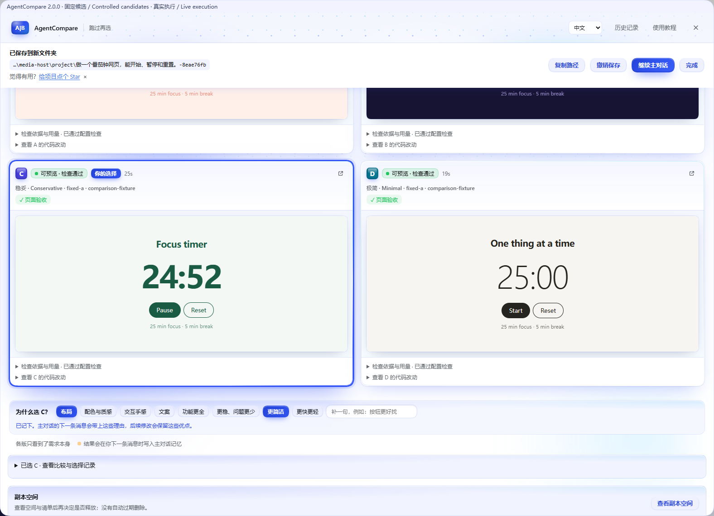

[](#demo)

<div align="center">

<a id="agentcompare"></a>
<a id="agent-compare-dsh-agent-compare--鲸挑细选"></a>

# AgentCompare · 鲸挑细选

[](https://github.com/lijiaqi-AI-Product-Manager/dsh-agent-compare/stargazers)
[](https://www.npmjs.com/package/dsh-agent-compare)
[](https://dshmarket.com/categories/workflow/)

[](https://www.dsh.so/artifact/dsh-agent-compare/)
[](https://www.dsh.so/artifact/dsh-agent-compare/)

[](https://www.npmjs.com/package/dsh-agent-compare)
[](https://github.com/lijiaqi-AI-Product-Manager/dsh-agent-compare/actions/workflows/ci.yml)
[](https://github.com/lijiaqi-AI-Product-Manager/dsh-agent-compare/blob/main/LICENSE)
[](https://github.com/lijiaqi-AI-Product-Manager/dsh-agent-compare/blob/main/docs/demo.md)

<sub><a href="https://github.com/lijiaqi-AI-Product-Manager/dsh-agent-compare/blob/main/docs/npm-total-downloads.md">Métriques et sources des classements</a></sub>

[中文](https://github.com/lijiaqi-AI-Product-Manager/dsh-agent-compare/blob/main/README.md) · [English](https://github.com/lijiaqi-AI-Product-Manager/dsh-agent-compare/blob/main/README.en.md) · [日本語](https://github.com/lijiaqi-AI-Product-Manager/dsh-agent-compare/blob/main/README.ja.md) · [한국어](https://github.com/lijiaqi-AI-Product-Manager/dsh-agent-compare/blob/main/README.ko.md) · [Español](https://github.com/lijiaqi-AI-Product-Manager/dsh-agent-compare/blob/main/README.es.md) · [Português (Brasil)](https://github.com/lijiaqi-AI-Product-Manager/dsh-agent-compare/blob/main/README.pt-BR.md) · **Français** · [Deutsch](https://github.com/lijiaqi-AI-Product-Manager/dsh-agent-compare/blob/main/README.de.md)

**Une même idée, plus de façons de lui donner vie !**

**鲸挑细选 · AgentCompare** est un plugin de comparaison pour [DeepSeek Harness](https://github.com/deepseek-ai/deepseek-harness) (DSH), installé sous le nom `dsh-agent-compare`. Envoyez une demande dans la conversation principale, comparez 2 à 4 réponses, fichiers ou pages exécutables, puis gardez la version qui correspond à votre idée. Il fonctionne dans **DSH Desktop + Web**, avec une interface en chinois ou en anglais.

<p align="center"><a href="#demo">Voir la démo de 45 secondes</a> · <a href="#install">Installer sur Desktop ou Web</a> · <a href="#support">Vérifier la compatibilité</a></p>

<a id="demo"></a>
<a id="voir-une-course-des-gros-poissons-en-entier"></a>

</div>

## Voir une comparaison en action

[](https://github.com/lijiaqi-AI-Product-Manager/dsh-agent-compare/blob/main/docs/media/comparison-workflow.mp4)

Enregistrement avec des candidats contrôlés dans un véritable hôte DSH : baleines et étapes en direct, pages interactives, choix de C avec ses raisons, enregistrement puis retour à la conversation. Les attentes sont coupées ; le reste est à vitesse réelle.

[Vidéo complète · 45 secondes](https://github.com/lijiaqi-AI-Product-Manager/dsh-agent-compare/blob/main/docs/media/comparison-workflow.mp4) · [Conditions et résultats](https://github.com/lijiaqi-AI-Product-Manager/dsh-agent-compare/blob/main/docs/demo.md) · [GIF complet](https://github.com/lijiaqi-AI-Product-Manager/dsh-agent-compare/blob/main/docs/media/comparison-preview.gif)

Ces captures et animations montrent des candidats contrôlés dans un véritable hôte DSH. Elles présentent l’interface et le parcours réels ; qualité et durée du modèle sont décrites séparément.

[](https://raw.githubusercontent.com/lijiaqi-AI-Product-Manager/dsh-agent-compare/main/assets/readme/gallery-2.0/02-live-comparison.png)

Utilisez directement les quatre pages et lisez chaque réponse à côté du résultat. Ouvrez Steps pour consulter les réflexions et appels d’outils fournis par l’hôte.

<details>
<summary>La comparaison en quatre étapes</summary>

[](https://raw.githubusercontent.com/lijiaqi-AI-Product-Manager/dsh-agent-compare/main/assets/readme/comparison-workflow.webp)

Définir les versions et les styles → exécuter en parallèle → essayer et choisir → vérifier et continuer. Le schéma est une illustration du produit.

</details>

<a id="install"></a>

## Installation

### DSH Desktop

1. Installez `dsh-agent-compare` via **Plugins → Add plugin** dans l’application.
2. Dans **Plugins → Installed**, vérifiez qu’AgentCompare est activé. Quittez complètement DSH, puis rouvrez-le.
3. Cliquez sur **A|B** en bas à gauche de la zone de saisie principale, choisissez versions et styles, puis envoyez la demande.

### DSH Web auto-hébergé

L’interface est disponible en chinois simplifié et en anglais, au choix dans DSH Desktop et Web.

Les commandes ci-dessous concernent un profil DSH Web géré par l’utilisateur. Le profil `desktop` est géré par l’application de bureau ; utilisez sa page de plugins.

La référence de développement est Node 26.13.0 et npm 12.2.2. Les vérifications actuelles utilisent le paquet officiel DSH 0.2.1-rc.5 / 0.2.2-rc.1. Repérez le profil DSH que vous utilisez déjà.

Installez le paquet npm dans le profil Web par défaut. Le badge npm indique son état de publication :

```bash
dsh plugin --profile web add dsh-agent-compare
```

Pour un autre profil autogéré, remplacez `web` par son nom réel.

**Redémarrez complètement après la mise à jour.** Quittez entièrement DSH Desktop, puis rouvrez-le. Pour Web, redémarrez le service DSH concerné et rechargez la page. Un simple rechargement peut conserver l’ancien backend ; un écart de versions déclenche désormais un message.

<details>
<summary>Compiler et installer depuis les sources</summary>

Vous pouvez aussi compiler et installer depuis les sources :

```bash
git clone https://github.com/lijiaqi-AI-Product-Manager/dsh-agent-compare.git
cd dsh-agent-compare
npm ci
npm pack
```

Cette commande installe l’archive dans le profil Web `web`.

```bash
dsh plugin --profile web add ./dsh-agent-compare-3.3.1.tgz
```

</details>

Redémarrez DSH. Avant une mise à jour, terminez les comparaisons actives et fermez les anciennes instances qui partagent leurs fichiers. Les modifications simultanées par plusieurs versions de l'extension ne sont pas prises en charge.

<a id="use"></a>
<a id="première-comparaison"></a>

## Première comparaison

1. Cliquez sur **A|B**, en bas à gauche du champ de conversation. Les réglages s’ouvrent au-dessus du champ existant.
2. Choisissez 2 à 4 versions. Le mode par défaut réutilise le modèle courant avec des styles différents ; choisissez chaque style ou décrivez-le en une ligne. Pour des modèles différents, utilisez ceux déjà configurés dans DSH.
3. Réglez le mode aveugle ou ouvert, la limite par version (5 à 120 minutes) et le contexte partagé. Saisissez votre demande dans le champ habituel, puis envoyez-la.
4. Chaque carte affiche la progression et une réponse, des fichiers ou une page. Les pages en cours sont manipulables. Choisissez une largeur bureau/mobile, utilisez 1–4 pour cibler une version et 0 pour toutes ; avec 3–4 versions, mettez de côté celles écartées.
5. Utilisez « Choose A », par exemple, ou « None of these » pour n’en choisir aucune. À l’aveugle, modèles et styles se révèlent au choix ; à découvert, ils sont visibles dès le début.
6. Pour modifier le projet, « Review and adopt » présente les différences et vérifications avant une confirmation distincte. Hors Git, enregistrez dans un nouveau dossier. Une réponse seule ne nécessite aucune application de fichiers. « Continue conversation » revient au dialogue en conservant le choix.

`试跑内置示例` crée une boutique dans un dépôt distinct et ne touche pas à votre projet. L'adoption vise ce dépôt d'exemple. Les commandes `比较记录` — historique — et `使用教程` — guide — sont présentes dans les nouvelles conversations comme dans les anciennes.

Vous pouvez ne partager aucun contexte, inclure les échanges récents ou sélectionner des messages. Par défaut, les 3 derniers échanges sont inclus ; l’extrait est consultable avant l’envoi. Les textes longs sont tronqués avec une indication visible. Toutes les versions reçoivent le même extrait ; le résultat et les raisons du choix rejoignent la conversation d’origine.

<a id="ui"></a>
<a id="gallery"></a>

## Interface et expérience

Sur téléphone, choisissez le mode, le nombre de versions et la comparaison à l’aveugle ou à découvert. Vérifiez le projet et le contexte partagé, puis saisissez votre demande dans la conversation. « More settings » donne accès aux styles, à la durée limite et à l’exemple. À la reprise d’une comparaison, ouvrir les réglages replie le résultat précédent. Rouvrez-le pour retrouver les pages et votre brouillon.

Dans une fenêtre basse, les réglages défilent séparément et le champ de saisie et le bouton d’envoi restent visibles. En mode paysage sur petit écran, « Expand settings » permet de rouvrir les réglages.

Si votre demande contient des noms d’options de `/ab`, placez `--` avant son texte. Par exemple, `/ab --versions 2 -- Explique l’option --example` demande deux explications.

Sur grand écran, « Align pages » place les pages interactives à la même hauteur. Un second clic rétablit la disposition initiale et conserve la saisie dans chaque page.

Sur mobile, choisissez le style de chaque version à partir des aperçus. Sur ordinateur, ouvrez les étapes pour voir sa dernière action. En comparaison à l’aveugle, le modèle et le style sont révélés après votre choix. Avant d’appliquer les modifications, examinez chaque fichier avec ses numéros de ligne.

<details>
<summary>Voir l’interface de la version 3.3.0</summary>


</details>

- **Verre liquide bleu.** Des surfaces distinctes séparent les réglages, les versions et la révision. Quand la réduction des animations est activée, le choix et la révélation apparaissent immédiatement.
- **Un gros poisson vous tient compagnie.** Une baleine bleue DeepSeek par version se remplit d'eau bleue à mesure qu'elle avance, pendant que deux lumières parcourent son bord. Des pensées montent au-dessus de sa tête ; une pichenette et elle répond, encore et elle tourne, vacille et éclabousse.
- **Commencer par la dernière action.** Pendant la génération, l’en-tête de la carte indique l’action la plus récente. Ouvrez les étapes pour consulter les réflexions, les appels aux outils et les durées enregistrées.
- **Réponse et résultat à égalité.** Une réponse s'affiche seule ; une page partage la carte avec sa réponse, et quand une version est mise en avant, la réponse est à gauche de la page.
- **Quatre bleus pour A–D.** À l'aveugle, vous ne voyez que A–D ; styles et modèles sont révélés après le choix, avec un balayage de lumière sur les cartes.
- **On voit que ça tourne.** Deux comètes font le tour d'une comparaison en cours, et chaque page est utilisable dès son démarrage.
- **Bureau, navigateur et largeur de téléphone**, avec une interface en chinois et en anglais.

Les étapes affichent les informations fournies par le modèle et l’hôte. Les longs journaux gardent leur début et leur fin, avec les coupures signalées ; les noms de styles sont masqués avant un choix à l’aveugle. Le niveau d’eau représente une étape, pas une note de qualité ni un pourcentage exact.

[](https://raw.githubusercontent.com/lijiaqi-AI-Product-Manager/dsh-agent-compare/main/assets/readme/whale-closeup.webp)

<p align="center"><sub>Gros plan sur les baleines : candidats fixes ; le modèle scripté attend 9 s par étape pour laisser le temps de voir ; avec des coupes, le reste à vitesse normale.</sub></p>

[](https://raw.githubusercontent.com/lijiaqi-AI-Product-Manager/dsh-agent-compare/main/assets/readme/gallery-2.0/05-saved-result.png)

Au premier plan, la réponse est placée à côté de la page. Gardez les raisons du choix, enregistrez ou vérifiez les modifications, puis retrouvez la même conversation.

<details>
<summary>Autres vues réelles : réponses, réglages, anglais et largeur mobile</summary>

[](https://raw.githubusercontent.com/lijiaqi-AI-Product-Manager/dsh-agent-compare/main/assets/readme/gallery-2.0/03-main-conversation.png)

[](https://raw.githubusercontent.com/lijiaqi-AI-Product-Manager/dsh-agent-compare/main/assets/readme/gallery-2.0/04-comparison-settings.png)

[](https://raw.githubusercontent.com/lijiaqi-AI-Product-Manager/dsh-agent-compare/main/assets/readme/13-english-answers.webp)

<p align="center"><a href="https://raw.githubusercontent.com/lijiaqi-AI-Product-Manager/dsh-agent-compare/main/assets/readme/14-phone-answer.webp"></a></p>

</details>

[Autres vues réelles : réponses, réglages, anglais et largeur mobile](https://github.com/lijiaqi-AI-Product-Manager/dsh-agent-compare/blob/main/docs/storefront-gallery.md)

<a id="tasks"></a>
<a id="quelles-tâches-comparer-"></a>

## Quelles tâches comparer ?

| Votre tâche | Ce que vous comparez |
|---|---|
| Réponse, analyse ou texte | Des approches et formulations différentes, mises en forme côte à côte et copiables. |
| Scripts, documents ou autres fichiers | Les fichiers et réponses de chaque version ; enregistrez votre choix dans un nouveau dossier. |
| Pages et modifications d’interface | Essayez les pages exécutables, consultez les critères communs et vérifiez avant adoption. |

<details>
<summary>Détails des modèles, styles et choix des tâches</summary>

Recherche, filtres, formulaires, pages de présentation, tableaux de bord et refontes de composants : des tâches dont la qualité se juge aussi à l'usage. Pour un défaut à réponse précise ou une transformation mécanique, un seul agent avec des tests est généralement préférable.

Avec le même modèle, attribuez des styles différents à 2–4 versions : huit préréglages ou une consigne personnelle en une ligne. Pour comparer des modèles, choisissez-en 2–4 parmi ceux configurés dans DSH, avec la même demande, le même style et les mêmes vérifications. Dans Git, ils partent du même état du code ; hors Git, de copies vides. Un choix ne constitue pas un classement général des modèles.

</details>

<a id="support"></a>

## Compatibilité et limites d’utilisation

[](https://github.com/lijiaqi-AI-Product-Manager/dsh-agent-compare/blob/main/package.json)
[](https://github.com/lijiaqi-AI-Product-Manager/dsh-agent-compare/blob/main/package.json)

| Environnement et portée | Vérification |
| --- | --- |
| Windows · DSH 0.2.2-rc.2 / rc.3 · Node 26.13.0 · 2026-11-18 | Le test de la version 3.2.0 sous Windows couvre l’installation des dépendances, les commandes de vérification et l’aperçu Vite. |
| Edge 157 · 390 / 1440 px | [Voir l’interface dans Edge avec un exemple de conversation](#ui) |

- Les pages en direct nécessitent un projet Web exécutable ; réponses et fichiers peuvent aussi être comparés. Le guide distingue dossiers ordinaires, dépôts et sous-dossiers.
- Chaque version consomme de l’usage du modèle. Durée et coût varient selon la tâche et le modèle ; le parallèle ne garantit pas un coût ou une attente réduits.
- Vérifiez avant adoption et conservez les traces d’annulation et de reprise. Une copie de travail n’est pas une machine virtuelle complète : DSH impose la limite d’écriture, lecture et réseau ne sont pas isolés, et Windows indique la restriction réelle.
- Hors de Git, les versions démarrent dans des copies vides et ne lisent pas les fichiers existants. Pour les modifier, activez d’abord Git dans les réglages. Le résultat est enregistré dans un nouveau sous-dossier.

[Projets et dossiers ordinaires](https://github.com/lijiaqi-AI-Product-Manager/dsh-agent-compare/blob/main/docs/workspaces-and-projects.md) · [Matrice des gestionnaires](https://github.com/lijiaqi-AI-Product-Manager/dsh-agent-compare/blob/main/docs/package-managers.md) · [Compatibilité et limites de Safari](https://github.com/lijiaqi-AI-Product-Manager/dsh-agent-compare/blob/main/README.en.md#compatibility)

[Annuaires et installation](https://github.com/lijiaqi-AI-Product-Manager/dsh-agent-compare/blob/main/docs/distribution.en.md) · [État des demandes et évaluations](https://github.com/lijiaqi-AI-Product-Manager/dsh-agent-compare/issues/4)

<a id="details"></a>

## Pour aller plus loin : vérifications, reprise et réglages avancés

### Exécution et critères communs

Dans un dépôt Git, même sans commit, un index privé capture les changements non commités et les fichiers non suivis, hors exclusions. Dans un dossier hors Git, les versions partent d'un espace de travail privé et vide, et la version choisie peut être enregistrée dans un nouveau sous-dossier. Le HEAD et l'index d'origine sont préservés. Chaque proposition possède son worktree et sa session ; sa différence est conservée sous forme de patch binaire avec empreinte.

Les contrôles proviennent de la base : `typecheck`, `lint`, `test`, `build` et les vérifications de page configurées. Un fichier de verrouillage impose une installation figée ; un échec ne déclenche pas de repli vers une installation non figée. Modifier les tests ou leur configuration pour faire passer sa propre proposition n'autorise pas son adoption directe.

Un [`.agent-compare.json` à la racine](https://github.com/lijiaqi-AI-Product-Manager/dsh-agent-compare/blob/main/examples/vite-react-demo/.agent-compare.json) permet de fixer saisies, clics, texte, visibilité, nombres d'éléments et dimensions. Sa définition est validée avant la génération. Une vérification explicite d'acceptation de page non exécutée bloque l'adoption directe. Si seul le contrôle élémentaire de chargement manque, un avertissement le signale. Réponse HTTP, compilation, fonctionnalité et préférence personnelle sont des résultats distincts.

L’installation anticipée concerne les projets dotés d’un fichier de verrouillage npm, sans autre gestionnaire déclaré, scripts d’installation à la racine ni dépendances locales. Seules les versions dont les manifestes correspondent à la base reçoivent leur propre copie. Sinon, en cas de modification ou d’échec de copie, chaque version effectue son installation normale sans assouplir le verrouillage.

### Adoption, annulation et reprise

L'adoption combine l'arbre de travail actuel et les chemins modifiés par la proposition. Les chevauchements détectés arrêtent l'opération. Si d'autres fichiers ont changé, la combinaison est répétée et vérifiée dans une copie temporaire. Le contenu, HEAD et l'index sont revérifiés avant l'écriture ; un journal de récupération est conservé.

L'adoption dans l'arbre de travail ne crée pas automatiquement de commit, ne pousse rien et ne change pas de branche. Elle prend en compte ajouts, suppressions et fichiers binaires. Une proposition qui ne remplit pas les critères peut être enregistrée dans une branche d'inspection. Lors d'une annulation ou d'une reprise après interruption, les modifications ultérieures détectées restent des conflits à examiner.

Le verrou du dépôt coordonne les opérations de l'extension, sans verrouiller votre éditeur. Suspendez vos modifications pendant la courte phase d'écriture.

### Historique et état des pages

L'historique affiche toutes les conversations par défaut, avec filtre sur la conversation courante, recherche par demande, dépôt ou identifiant et pages de 30 entrées. Résultat, choix et adoption sont conservés. Les notes sont transmises à la même conversation et réessayées si elle est indisponible. Les longs journaux ne sont pas injectés intégralement dans le contexte principal.

Les anciens fichiers ou enregistrements endommagés restent en lecture seule avec une explication. Après un redémarrage, les captures sont identifiées comme des images statiques, pas des applications actives. Une copie conservée peut être relancée. Chaque ouverture utilise une nouvelle adresse `.localhost`, séparant cookies et stockage par origine entre propositions. L'état temporaire de la page est réinitialisé ; l'historique et les captures restent disponibles.

### Compatibilité et limites

Un worktree n'est pas une frontière de sécurité complète. La politique d'écriture de DSH est utilisée ; Windows la signale comme **partial**. Lectures de fichiers et réseau ne sont pas isolés. Les cookies intégrés suivent les politiques du navigateur ; un onglet externe peut employer un autre contexte de stockage. Connexion à un compte, services backend externes et bases partagées sont hors périmètre.

Les tests natifs couvrent Windows, Linux et macOS. La [matrice détaillée](https://github.com/lijiaqi-AI-Product-Manager/dsh-agent-compare/blob/main/README.en.md#compatibility) distingue les configurations npm, pnpm et Yarn vérifiées et les limites Windows/PnP. Safari natif est validé séparément ; les réponses contrôlées des tests ne mesurent pas la qualité ni les performances de modèles externes.

### Durée, coût et preuves

Chaque proposition consomme de la génération. Le parallélisme ne garantit ni gain de temps ni économie. Vous pouvez arrêter une proposition ou les deux. À l'échéance, les modifications déjà écrites sont vérifiées. Si l'usage n'est pas fourni, il est indiqué comme inconnu, jamais comme nul.

La [CI](https://github.com/lijiaqi-AI-Product-Manager/dsh-agent-compare/actions/workflows/ci.yml) couvre Windows/Linux, Node et le navigateur. Certaines intégrations actuelles exécutent de vraies sessions, outils et applications avec un adaptateur local à réponses fixes. Elles vérifient l'exécution du système, pas la qualité d'un modèle externe. Les cas historiques avec un modèle réel correspondent à DSH 0.2.1-rc.3 et ne constituent ni classement ni promesse de performance.

<a id="whats-new"></a>

## Nouveautés par version

**3.3.1** · La consultation du statut fonctionne même si des résultats sont en attente. Si la zone de saisie est occupée, le guide conserve le brouillon et permet de réessayer.

**3.3.0** · Aperçus de styles, expressions par étape, examen ligne par ligne et historique regroupé par date.

**3.2.1** · La vérification du texte attend jusqu’à cinq secondes que la page affiche le résultat d’une action. Les résultats en attente rejoignent leur conversation d’origine dans l’ordre de leur mise à jour, à raison de cinq au plus par étape.

**3.2.0** · Les réglages mobiles sont répartis sur deux niveaux et les pages interactives peuvent être alignées sur grand écran. Les huit guides mènent de la démo à l’installation et à la première comparaison.

<details>
<summary>Évolutions de la version 3.1.1 et des versions précédentes</summary>

**3.1.1 :** L’entrée de compatibilité en chinois reprend le guide complet. Un contrôle hors ligne vérifie le README choisi par npm dans l’archive réelle, pour éviter une page de paquet limitée à un sommaire. La comparaison et l’adoption restent identiques.


**Nouveautés de la version 3.1.0 :**
- **Chaque étape sous les yeux, en direct et après coup.** Dès qu'une version commence, sa carte a un bouton **Steps**. Ouvert, il montre le travail dans l'ordre : réflexions avec leur durée, appels d'outils (lire ou modifier un fichier, lancer une commande… chacun s'ouvre sur son entrée et sa sortie) et ce qui a été écrit entre deux étapes. Pendant le travail, les trois dernières étapes défilent aussi en direct sous la baleine, et une fois la version terminée, chaque étape reste à un clic. Dans une comparaison à l'aveugle, les mots qui nomment un style s'affichent en ▒▒.
- **La réponse, directement affichée.** Une version qui ne fait que répondre n'affiche que sa réponse. Une version qui a construit une page ou écrit des fichiers affiche sa réponse avec le même poids : au-dessus de la page côte à côte, et à gauche de la page quand cette version est mise en avant. La réponse apparaît dès que la version a terminé, avant sa page.
- **Les pages, directement affichées.** Les pages statiques sont servies par l'extension elle-même : elles s'ouvrent dès qu'elles sont écrites, sans processus séparé que l'application de bureau pourrait arrêter. Si une page ne peut toujours pas être servie, un résultat HTML s'affiche quand même comme une page, son code source à un clic.
- **Des résultats plus tôt.** La confirmation commence dès que le tour de chaque version se termine sans message en attente, sans attendre que les autres extensions libèrent toute la session. Sur l’hôte de test enregistré, cela prenait 0,35–0,6 s ; les cas de bureau avec l’ancien backend prenaient 41–44 s. Les projets npm éligibles peuvent préparer une installation figée pendant la génération et fournir une copie indépendante à chaque version sans changement de dépendances. Les vérifications sont parallèles et la page est utilisable dès son démarrage. Dans l’enregistrement à candidats fixes, les quatre pages Vite étaient disponibles environ 24–30 s après l’envoi. Ce n’est ni une mesure de la vitesse ou de la qualité des modèles externes ni une garantie pour d’autres machines.
- **L'attente devient amusante.** Chaque version en cours affiche la baleine bleue de DeepSeek, pâle au début, qui se remplit d'eau bleue à mesure que la version avance pendant que deux lumières parcourent son bord. De temps en temps, une pensée monte au-dessus de sa tête : ce qu'elle fait, une idée, ou une invitation à la taquiner. Elle souffle un jet à chaque pas et se tourne vers le pointeur ; plusieurs pichenettes d'affilée la font sauter, tourner, vaciller et éclabousser, avec une nouvelle réplique à chaque fois. Deux comètes font le tour d'une comparaison en cours (un mode de repli couvre les anciens moteurs ; la réduction des animations les immobilise), sur une lumière bleue qui s'écoule lentement.
- **Quatre bleus pour A–D.** Les étiquettes des versions sont quatre bleus différents.
- **Un rappel pour redémarrer DSH.** DSH remplace aussitôt l'interface d'une extension mais garde le serveur chargé au démarrage. Quand les deux diffèrent, AgentCompare vous demande de quitter puis de rouvrir DSH, au lieu de perdre en silence les étapes et les réponses.
- **Un nom chinois.** Le nom officiel est « 鲸挑细选 », le surnom « 大肥鱼赛马 ».
- **Inclut aussi la 2.1.0, qui n'a pas été publiée seule :** les salutations et les questions peuvent être comparées comme réponses, sans exiger de page ; un verre liquide plus clair et plus lumineux, des boutons plus légers et des contrôles qui glissent ; dans les deux thèmes, le texte des 21 états d’interface vérifiés atteignait au moins 4.5:1.

**Nouveautés de la version 2.0.0 :** comparez **2, 3 ou 4 versions** à la fois. Chaque version peut recevoir un **style** (ampleur : prudent, audacieux ; apparence : minimaliste, soigné, vivant ; priorité : accessible, rigoureux, léger ; ou une ligne personnalisée). Comparez **à l'aveugle** (styles révélés au choix) ou **à découvert** (styles affichés dès le début). Avec trois ou quatre versions, **mettez de côté** celles que vous écartez pour comparer les autres côte à côte ; dans la carte, les touches 1 à 4 mettent une version au premier plan.
- **Nouvelle interface en verre liquide bleu.** Aurore et poussière d'étoiles derrière des panneaux de verre, une lentille de verre qui glisse entre les options et une progression liquide ; un éclat de lumière au choix et un balayage lumineux à la révélation. Mode sombre, mouvement réduit et contraste élevé pris en charge.
- **Dites pourquoi elle l'emporte.** Après le choix, cochez quelques raisons (mise en page, couleurs et matière, sensation d'usage…) ou ajoutez une ligne ; les modifications suivantes dans la conversation principale conservent ces qualités.
- **Ensembles rapides.** Un geste règle le nombre de versions et leurs styles : Duo classique, Trois apparences, Trois priorités, Quatre directions.
- **2 à 4 versions avec des styles.** Huit préréglages ou une description en une ligne ; plusieurs modèles peuvent partager un style.
- **Comparaison aveugle ou ouverte.** Essayez chaque version, écartez-la puis restaurez-la ; 1–4 isole une version et 0 les affiche toutes.
- **Réponses, fichiers et pages actives.** Lisez le Markdown et copiez réponses, code, fichiers ou chemins. Votre choix est clairement indiqué.
- **Poursuivez dans la conversation.** Comparaisons, choix, adoption et annulation restent dans la mémoire de la conversation actuelle.
- **Desktop + Web, interface chinoise et anglaise.** Réutilisez les modèles configurés et examinez les changements avant l'adoption, avec annulation et récupération.

</details>

<details>
<summary>À propos du nom</summary>

Son nom chinois est **鲸挑细选** (*jīng tiāo xì xuǎn*), un jeu de mots sur 精挑细选, « trié sur le volet », où 鲸 veut dire baleine : 2 à 4 baleines DeepSeek s'attaquent à la même tâche et vous gardez la meilleure. Son surnom est **大肥鱼赛马**, « la course des gros poissons » : en Chine, on surnomme la baleine de DeepSeek « le gros poisson », et ici plusieurs courent sur la même piste pendant que vous désignez le gagnant.

</details>

## Contribution et licence

Dans une [Issue](https://github.com/lijiaqi-AI-Product-Manager/dsh-agent-compare/issues), indiquez les versions, le système, les étapes et les résultats attendu et observé. Ne publiez pas de secrets, code privé ou chemins locaux complets. Voir [CONTRIBUTING.md](https://github.com/lijiaqi-AI-Product-Manager/dsh-agent-compare/blob/main/CONTRIBUTING.md) et [CHANGELOG.md](https://github.com/lijiaqi-AI-Product-Manager/dsh-agent-compare/blob/main/CHANGELOG.md).

```bash
npm ci
npm run typecheck
npm test
npm run test:ui
```

Licence [MIT](https://github.com/lijiaqi-AI-Product-Manager/dsh-agent-compare/blob/main/LICENSE). Si le résultat vous aide, une Star ou un cas reproductible peut soutenir le projet. Le partage et les Stars restent facultatifs.

<!-- project-growth:start -->

## Évolution du projet

**Avis de maintenance :** Selon le responsable, la maintenance, les améliorations et les corrections du 11 novembre UTC ont entraîné un retrait temporaire de la plupart des marchés, réduisant la distribution et les demandes ce jour-là. [Avis de maintenance et de distribution (anglais)](https://github.com/lijiaqi-AI-Product-Manager/dsh-agent-compare/blob/main/docs/maintenance-update-2026-11-11.en.md).

<a href="https://www.npmjs.com/package/dsh-agent-compare">
<picture>
  <source media="(max-width: 600px) and (prefers-color-scheme: dark)" srcset="https://raw.githubusercontent.com/lijiaqi-AI-Product-Manager/dsh-agent-compare/main/assets/statistics/npm-total-mobile-dark.svg">
  <source media="(max-width: 600px)" srcset="https://raw.githubusercontent.com/lijiaqi-AI-Product-Manager/dsh-agent-compare/main/assets/statistics/npm-total-mobile-light.svg">
  <source media="(prefers-color-scheme: dark)" srcset="https://raw.githubusercontent.com/lijiaqi-AI-Product-Manager/dsh-agent-compare/main/assets/statistics/npm-total-dark.svg">
  
</picture>
</a>

Demandes npm cumulées depuis la première publication, toutes versions publiques confondues. La carte indique la date de clôture ; les accès répétés ou automatisés peuvent être inclus.

[Définition du cumul et actualisation automatique](https://github.com/lijiaqi-AI-Product-Manager/dsh-agent-compare/blob/main/docs/npm-total-downloads.md)

Le badge Star lit GitHub avec environ cinq minutes de cache. Le cumul des requêtes npm est actualisé chaque jour à 19 h en Chine (UTC+8) ; une exécution peut être retardée.

<!-- project-growth:end -->
