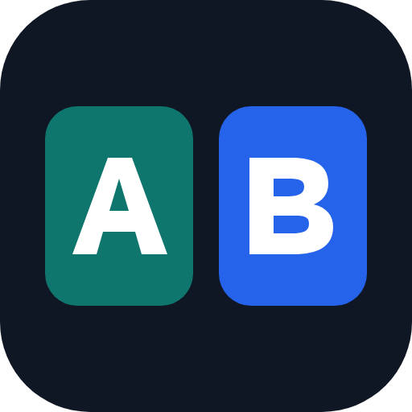

<p align="center"></p>

# AgentCompare

[](https://github.com/lijiaqi-AI-Product-Manager/dsh-agent-compare/blob/main/package.json)
[](https://www.npmjs.com/package/dsh-agent-compare)
[](https://github.com/lijiaqi-AI-Product-Manager/dsh-agent-compare/actions/workflows/ci.yml)
[](https://github.com/lijiaqi-AI-Product-Manager/dsh-agent-compare/blob/main/package.json)
[](https://github.com/lijiaqi-AI-Product-Manager/dsh-agent-compare/blob/main/docs/demo.md)
[](https://github.com/lijiaqi-AI-Product-Manager/dsh-agent-compare/blob/main/LICENSE)

[中文](https://github.com/lijiaqi-AI-Product-Manager/dsh-agent-compare/blob/main/README.md) · [English](https://github.com/lijiaqi-AI-Product-Manager/dsh-agent-compare/blob/main/README.en.md) · **日本語** · [한국어](https://github.com/lijiaqi-AI-Product-Manager/dsh-agent-compare/blob/main/README.ko.md) · [Español](https://github.com/lijiaqi-AI-Product-Manager/dsh-agent-compare/blob/main/README.es.md) · [Português (Brasil)](https://github.com/lijiaqi-AI-Product-Manager/dsh-agent-compare/blob/main/README.pt-BR.md) · [Français](https://github.com/lijiaqi-AI-Product-Manager/dsh-agent-compare/blob/main/README.fr.md) · [Deutsch](https://github.com/lijiaqi-AI-Product-Manager/dsh-agent-compare/blob/main/README.de.md)

**同じ依頼を、動く二つの実装へ。試して選び、選択後に正体を確認。**

> **0.2.0-alpha.18 · プレビュー版。** 対象は Git リポジトリ直下のローカル Vite フロントエンドです。現在の DSH モデルを再利用します。

AgentCompare は [DeepSeek Harness](https://github.com/deepseek-ai/deepseek-harness)（DSH）のプラグインです。一つのフロントエンド課題から独立した二つの実装を作り、依存関係のインストール、ビルド、共通の検証を実行します。実際のページを操作して A、B、または「どちらも選ばない」を選択できます。採用前には、現在のプロジェクトと組み合わせた状態を検証します。

[插件目录与安装](https://github.com/lijiaqi-AI-Product-Manager/dsh-agent-compare/blob/main/docs/distribution.md) · [Plugin directories and installation](https://github.com/lijiaqi-AI-Product-Manager/dsh-agent-compare/blob/main/docs/distribution.en.md)

## 操作の流れを見る

[](https://github.com/lijiaqi-AI-Product-Manager/dsh-agent-compare/blob/main/docs/media/comparison-workflow.mp4)

固定した候補によるフロー例です。画面は中国語。アプリの実行、共通チェック、採用は実際に行い、待機部分を編集しています。ローカルパスは非表示です。

[動画全編（28秒）](https://github.com/lijiaqi-AI-Product-Manager/dsh-agent-compare/blob/main/docs/media/comparison-workflow.mp4) · [条件と結果](https://github.com/lijiaqi-AI-Product-Manager/dsh-agent-compare/blob/main/docs/demo.md)

## インストール

以下のコマンドは自分で起動する DSH Web 用です。デスクトップ版の `desktop` プロファイルはアプリが管理するため、アプリのプラグイン画面を利用してください。

Node 26.13.0 と npm 12.2.1 が開発基準です。公式の最新 DSH パッケージ 0.2.1-rc.5 で動作確認しています。既存の DSH プロファイル名を確認してください。

npm のプレビュー版を既定の Web プロファイルに追加します。公開状態は上部の npm バッジで確認できます。

```bash
dsh plugin --profile web add dsh-agent-compare@0.2.0-alpha.18
```

別の自己管理プロファイルを使う場合は、`web` を実際の名前に置き換えてください。

ソースからビルドして導入することもできます。

```bash
git clone https://github.com/lijiaqi-AI-Product-Manager/dsh-agent-compare.git
cd dsh-agent-compare
npm ci
npm pack
```

`<your-profile>` を実際に使っているプロファイル名に置き換えます。

```bash
dsh plugin --profile <your-profile> add ./dsh-agent-compare-0.2.0-alpha.18.tgz
```

DSH を再起動します。同じ記録を使う古いプラグインの実行は、更新前に終了してください。旧版と新版による同時変更はサポートしません。

## 最初の比較

1. 会話の入力欄左下にある **A|B** をクリックします。設定は入力欄の上に表示されます。
2. 既定は「同じモデル、二つの戦略」です。現在のモデル設定を再利用するため、二つ目のモデル用アカウントは不要です。「二つのモデル」を選ぶ場合も、DSH に設定済みのモデルから選択します。
3. 各実装の生成上限を画面で選びます。5～120 分、既定は 30 分です。依頼文だけを通常の入力欄に書いて送信します。オプションの手入力は不要です。
4. 会話内のカードで進捗と二つの実行ページを確認します。デスクトップ／スマートフォン表示、A または B への集中表示、拡大画面を利用できます。
5. `选 A`、`选 B`、`都不满意` で選択します。選択後に実際のモデルまたは戦略、検証結果、取得できた使用量が表示されます。
6. 採用する場合は `审查并采用` から対象リポジトリと事前確認を読み、別の確認操作で反映します。`继续主对话` で通常の会話へ戻れます。

`试跑内置示例` は別のサンプル商店リポジトリを作成します。あなたのプロジェクトには触れず、採用先もそのサンプルです。右上の `比较记录` と `使用教程` は、新規会話と既存会話の両方から利用できます。

## 向いている課題

検索・絞り込み、フォーム、ランディングページ、ダッシュボード、コンポーネントの再設計など、操作して品質を比較したい課題に向いています。答えが明確な不具合修正や機械的なリファクタリングは、単一のエージェントとテストのほうが適しています。

同じモデルでは「既存構造を活かす」と「操作方法を見直す」という二つの戦略を使います。二つのモデルでは同じ依頼と指示を使います。いずれも同じコード基準点と共通の検証を利用します。一度の比較は、モデル全体の順位を意味しません。

## 検証とコードの状態

Git に少なくとも一つのコミットが必要です。未コミット・未追跡の内容も、除外対象を除いて専用 index でスナップショット化します。元の HEAD と index を変更せず、各実装は個別の worktree とセッションを使います。差分はハッシュ付きのバイナリパッチとして保存されます。

基準点の `typecheck`、`lint`、`test`、`build` と、設定されたページ検証を両方に適用します。ロックファイルがあれば固定インストールを行い、失敗時に非固定インストールへ切り替えません。検証スクリプトや設定を変更して自分だけを合格にすることは、直接採用の根拠になりません。

根にある [`.agent-compare.json` の実例](https://github.com/lijiaqi-AI-Product-Manager/dsh-agent-compare/blob/main/examples/vite-react-demo/.agent-compare.json)で、入力、クリック、表示件数、文字列、画面幅などを共通条件として追加できます。定義は生成前に検証・固定されます。明示したページ受け入れ条件が未実行なら直接採用できません。基本的なページ読み込み確認だけが実行できなかった場合は、未検証の警告が表示されます。ビルド成功、ページ表示、要件達成、個人の好みは別の結果です。

## 採用・取り消し・復旧

採用では現在のプロジェクトと選択した差分を組み合わせます。変更箇所が重複する場合は停止します。他のファイルを編集していた場合は、一時コピーで組み合わせを再検証します。書き込み前には HEAD、index、対象内容を再確認し、復旧記録を保存します。

作業ツリーへの採用は、自動コミット、push、ブランチ切り替えを行いません。バイナリ、新規作成、削除も差分に含まれます。検証を満たさない実装は、確認用ブランチとして保存できます。取り消しや中断からの復旧では、その後の編集を検出すると競合として残します。

リポジトリロックはプラグイン同士を調整するもので、外部エディターをロックしません。実際の書き込み中は編集を一時停止してください。

## 履歴と実行環境

履歴は全会話を既定表示し、現在の会話、検索、30 件単位のページ送りに対応します。結果・選択・採用の説明は会話へ届けられ、会話が利用できない場合は再試行されます。長いログをすべて主会話へ入れません。破損した記録や旧形式は理由付きの読み取り専用として保持します。

再起動後は停止したプレビューと保存済みスクリーンショットを区別します。コピーが残っていればプレビューを再開できます。スクリーンショットは静的記録であり、実行中のページではありません。各起動には新しい `.localhost` アドレスを使い、実装間の Cookie とオリジンストレージを分けます。再開時にページ内の一時状態はリセットされますが、比較記録と画像は残ります。

worktree は完全な安全サンドボックスではありません。DSH の書き込み制約を使い、Windows の制約は **partial** として表示します。読み取りとネットワークは隔離しません。埋め込みページの Cookie はブラウザーの制限を受け、外部タブでは保存領域が異なる場合があります。ログイン、外部バックエンド、共有データベースは現在の対象外です。

## 時間・費用・確認済みの範囲

二つの実装にはそれぞれ生成コストがかかり、並列化が必ず安く、速くなるとは限りません。一方または両方を停止できます。上限時には、すでに書いた変更を検証します。使用量が返らない場合は「不明」であり、ゼロとは表示しません。

[CI](https://github.com/lijiaqi-AI-Product-Manager/dsh-agent-compare/actions/workflows/ci.yml)には Windows/Linux、Node のテストとブラウザー検証があります。最新 DSH での実セッション・ツール・アプリ実行の一部は、固定応答のローカルアダプターを使用しており、外部モデルの生成品質を測るものではありません。実モデルによる履歴ケースは DSH 0.2.1-rc.3 のものです。最新宿主と外部モデルを使った完了までの性能、二モデルの Provider 組み合わせ、macOS、pnpm/yarn の全工程は未確認です。詳細は[英語版の検証範囲](https://github.com/lijiaqi-AI-Product-Manager/dsh-agent-compare/blob/main/README.en.md#compatibility)を参照してください。

## フィードバックと開発

[Issue](https://github.com/lijiaqi-AI-Product-Manager/dsh-agent-compare/issues)には DSH／プラグインの版、OS、再現手順、期待と実際の結果を記載してください。認証情報、非公開コード、完全なローカルパスは公開しないでください。[貢献ガイド](https://github.com/lijiaqi-AI-Product-Manager/dsh-agent-compare/blob/main/CONTRIBUTING.md)と[変更履歴](https://github.com/lijiaqi-AI-Product-Manager/dsh-agent-compare/blob/main/CHANGELOG.md)も確認できます。

```bash
npm ci
npm run typecheck
npm test
npm run test:ui
```

## ライセンス

[MIT](https://github.com/lijiaqi-AI-Product-Manager/dsh-agent-compare/blob/main/LICENSE)。比較結果が役立った場合は、リポジトリへの Star や再現可能な事例で支援できます。Star や共有は任意です。

<!-- project-growth:start -->

## プロジェクトの推移

Star 履歴は毎日自動更新されます。更新日は UTC、Star の日付は GitHub の集計基準です。 npm の日別ダウンロードリクエスト数も表示します。

<a href="https://github.com/lijiaqi-AI-Product-Manager/dsh-agent-compare/stargazers">
<picture>
  <source media="(max-width: 600px) and (prefers-color-scheme: dark)" srcset="https://raw.githubusercontent.com/lijiaqi-AI-Product-Manager/lijiaqi-AI-Product-Manager/main/assets/growth/dsh-agent-compare/stars-mobile-dark.svg">
  <source media="(max-width: 600px)" srcset="https://raw.githubusercontent.com/lijiaqi-AI-Product-Manager/lijiaqi-AI-Product-Manager/main/assets/growth/dsh-agent-compare/stars-mobile-light.svg">
  <source media="(prefers-color-scheme: dark)" srcset="https://raw.githubusercontent.com/lijiaqi-AI-Product-Manager/lijiaqi-AI-Product-Manager/main/assets/growth/dsh-agent-compare/stars-dark.svg">
  
</picture>
</a>

<a href="https://www.npmjs.com/package/dsh-agent-compare">
<picture>
  <source media="(max-width: 600px) and (prefers-color-scheme: dark)" srcset="https://raw.githubusercontent.com/lijiaqi-AI-Product-Manager/lijiaqi-AI-Product-Manager/main/assets/growth/dsh-agent-compare/downloads-mobile-dark.svg">
  <source media="(max-width: 600px)" srcset="https://raw.githubusercontent.com/lijiaqi-AI-Product-Manager/lijiaqi-AI-Product-Manager/main/assets/growth/dsh-agent-compare/downloads-mobile-light.svg">
  <source media="(prefers-color-scheme: dark)" srcset="https://raw.githubusercontent.com/lijiaqi-AI-Product-Manager/lijiaqi-AI-Product-Manager/main/assets/growth/dsh-agent-compare/downloads-dark.svg">
  
</picture>
</a>

リクエストには重複や自動アクセスが含まれ、ユニークユーザー数やアクティブユーザー数ではありません。

[データソースと指標の定義](https://github.com/lijiaqi-AI-Product-Manager/lijiaqi-AI-Product-Manager/blob/main/docs/growth.md)

<!-- project-growth:end -->
