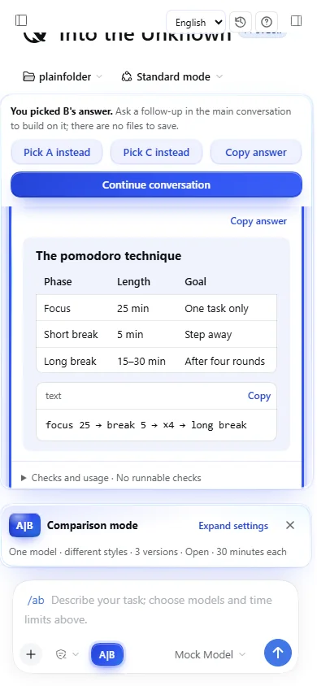
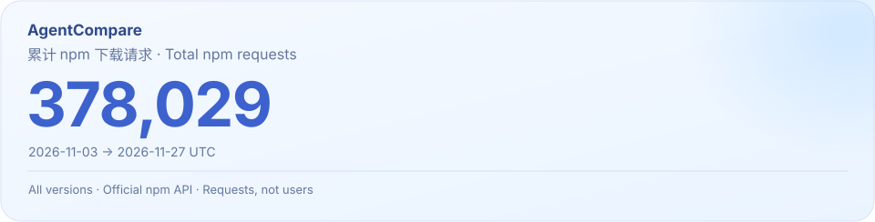

[](#demo)

<div align="center">

<a id="agentcompare"></a>
<a id="agent-compare-dsh-agent-compare--鲸挑细选"></a>

# AgentCompare · 鲸挑细选

[](https://github.com/lijiaqi-AI-Product-Manager/dsh-agent-compare/stargazers)
[](https://www.npmjs.com/package/dsh-agent-compare)
[](https://dshmarket.com/categories/workflow/)

[](https://www.dsh.so/artifact/dsh-agent-compare/)
[](https://www.dsh.so/artifact/dsh-agent-compare/)

[](https://www.npmjs.com/package/dsh-agent-compare)
[](https://github.com/lijiaqi-AI-Product-Manager/dsh-agent-compare/actions/workflows/ci.yml)
[](https://github.com/lijiaqi-AI-Product-Manager/dsh-agent-compare/blob/main/LICENSE)
[](https://github.com/lijiaqi-AI-Product-Manager/dsh-agent-compare/blob/main/docs/demo.md)

<sub><a href="https://github.com/lijiaqi-AI-Product-Manager/dsh-agent-compare/blob/main/docs/npm-total-downloads.md">집계 기준 및 순위 출처</a></sub>

[中文](https://github.com/lijiaqi-AI-Product-Manager/dsh-agent-compare/blob/main/README.md) · [English](https://github.com/lijiaqi-AI-Product-Manager/dsh-agent-compare/blob/main/README.en.md) · [日本語](https://github.com/lijiaqi-AI-Product-Manager/dsh-agent-compare/blob/main/README.ja.md) · **한국어** · [Español](https://github.com/lijiaqi-AI-Product-Manager/dsh-agent-compare/blob/main/README.es.md) · [Português (Brasil)](https://github.com/lijiaqi-AI-Product-Manager/dsh-agent-compare/blob/main/README.pt-BR.md) · [Français](https://github.com/lijiaqi-AI-Product-Manager/dsh-agent-compare/blob/main/README.fr.md) · [Deutsch](https://github.com/lijiaqi-AI-Product-Manager/dsh-agent-compare/blob/main/README.de.md)

**하나의 아이디어에서, 더 다양한 구현 방안으로!**

**鲸挑细选 · AgentCompare**는 [DeepSeek Harness](https://github.com/deepseek-ai/deepseek-harness)(DSH)의 비교 플러그인이며 설치 이름은 `dsh-agent-compare`입니다. 주 대화에서 한 번 요청하고 2~4개 답변, 파일 또는 실행 가능한 페이지를 비교해 생각에 가장 잘 맞는 버전을 선택하세요. **DSH Desktop + Web**을 지원하며 제품 UI는 중국어와 영어로 전환할 수 있습니다.

<p align="center"><a href="#demo">45초 데모 보기</a> · <a href="#install">Desktop 또는 Web에 설치</a> · <a href="#support">호환성 확인</a></p>

<a id="demo"></a>
<a id="大肥鱼赛马-한-판-전체-보기"></a>

</div>

## 비교 흐름을 데모로 보기

[](https://github.com/lijiaqi-AI-Product-Manager/dsh-agent-compare/blob/main/docs/media/comparison-workflow.mp4)

실제 DSH 호스트에서 고정 후보를 사용한 녹화입니다. 고래와 실시간 단계, 페이지 조작, 이유를 포함한 C 선택, 저장 후 주 대화로 돌아오는 과정을 보여 줍니다. 대기 구간은 편집했고 나머지는 원래 속도입니다.

[전체 영상 · 45초](https://github.com/lijiaqi-AI-Product-Manager/dsh-agent-compare/blob/main/docs/media/comparison-workflow.mp4) · [녹화 조건과 결과](https://github.com/lijiaqi-AI-Product-Manager/dsh-agent-compare/blob/main/docs/demo.md) · [전체 GIF](https://github.com/lijiaqi-AI-Product-Manager/dsh-agent-compare/blob/main/docs/media/comparison-preview.gif)

다음 이미지와 애니메이션은 실제 DSH 호스트에서 고정 후보를 실행한 화면입니다. 실제 UI와 작업 흐름을 보여 주며, 외부 모델의 품질·속도 측정과 구분합니다.

[](https://raw.githubusercontent.com/lijiaqi-AI-Product-Manager/dsh-agent-compare/main/assets/readme/gallery-2.0/02-live-comparison.png)

네 페이지를 직접 조작하고 각 답변을 페이지와 함께 볼 수 있습니다. Steps를 열면 호스트가 제공한 생각과 도구 호출을 확인할 수 있습니다.

<details>
<summary>비교 과정 네 단계</summary>

[](https://raw.githubusercontent.com/lijiaqi-AI-Product-Manager/dsh-agent-compare/main/assets/readme/comparison-workflow.webp)

버전과 스타일 설정 → 병렬 실행 → 체험과 선택 → 검토 후 계속. 아래 그림은 기능 예시입니다.

</details>

<a id="install"></a>

## 설치

### DSH Desktop

1. 앱의 **Plugins → Add plugin**에서 `dsh-agent-compare`를 설치합니다.
2. **Plugins → Installed**에서 AgentCompare가 활성화되어 있는지 확인한 뒤, DSH를 완전히 종료하고 다시 엽니다.
3. 주 대화 입력창 왼쪽 아래의 **A|B**에서 버전 수와 스타일을 고르고 요청을 보냅니다.

### 직접 실행하는 DSH Web

인터페이스 언어는 중국어 간체와 영어입니다. DSH Desktop과 Web에서 전환할 수 있습니다.

아래 명령은 직접 실행하는 DSH Web 프로필용입니다. 데스크톱의 `desktop` 프로필은 앱이 관리하므로 앱의 플러그인 페이지를 사용하세요.

개발 기준은 Node 26.13.0, npm 12.2.2입니다. DSH 패키지 0.2.1-rc.5 / 0.2.2-rc.1로 검증합니다. 이미 사용하는 DSH 프로필을 확인하세요.

npm 패키지를 기본 Web 프로필에 추가합니다. 공개 상태는 위의 npm 배지에서 확인하세요.

```bash
dsh plugin --profile web add dsh-agent-compare
```

다른 자체 관리 프로필을 쓰면 `web`을 실제 이름으로 바꾸세요.

**업데이트 후 완전히 다시 시작하세요.** DSH Desktop을 완전히 종료한 뒤 다시 엽니다. Web에서는 해당 DSH 서비스를 재시작하고 페이지를 새로고침합니다. 화면만 새로고침하면 이전 백엔드가 남을 수 있으며, 버전이 다르면 재시작 안내가 표시됩니다.

<details>
<summary>소스에서 빌드하고 설치</summary>

소스에서 빌드하여 설치할 수도 있습니다.

```bash
git clone https://github.com/lijiaqi-AI-Product-Manager/dsh-agent-compare.git
cd dsh-agent-compare
npm ci
npm pack
```

다음 명령은 압축 파일을 웹 프로필 `web`에 설치합니다.

```bash
dsh plugin --profile web add ./dsh-agent-compare-3.3.1.tgz
```

</details>

DSH를 다시 시작합니다. 업데이트 전에는 같은 기록을 사용하는 이전 인스턴스의 작업을 끝내고 닫으세요. 서로 다른 플러그인 버전의 동시 변경은 지원하지 않습니다.

<a id="use"></a>
<a id="첫-비교"></a>

## 첫 비교

1. 입력창 왼쪽 아래 **A|B**를 누르면 기존 입력창 위에 비교 설정이 열립니다.
2. 2~4개 버전을 고릅니다. 기본값은 같은 모델·다른 스타일이며 현재 모델을 재사용합니다. 버전마다 스타일이나 한 줄 설명을 설정할 수 있고, 다른 모델 모드에서는 DSH에 설정된 모델 중에서 고릅니다.
3. 블라인드·공개 비교, 버전별 생성 한도(5~120분), 공유할 대화 문맥을 정한 뒤 평소 입력창에 요청을 적어 전송합니다.
4. 카드에서 진행 상태와 답변·파일·페이지 결과를 확인합니다. 실행 중인 페이지는 직접 조작할 수 있고 데스크톱·휴대전화 크기, 1~4 키 집중 보기, 0 키 전체 보기를 지원합니다. 3~4개일 때는 제외할 버전을 빼둘 수 있습니다.
5. 「Choose A」등으로 하나를 고르거나 「None of these」로 모두 선택하지 않을 수 있습니다. 블라인드는 선택 후 모델과 스타일을 공개하고, 공개 비교에서는 처음부터 보입니다.
6. 프로젝트 변경은 「Review and adopt」에서 차이와 검증 결과를 확인한 뒤 별도로 승인해야 적용됩니다. Git 밖의 폴더는 새 폴더로 저장할 수 있습니다. 답변만 있는 결과는 파일 적용이 필요 없습니다. 「Continue conversation」으로 선택 기록을 유지하며 기본 대화로 돌아갑니다.

`试跑内置示例`는 별도 예제 상점 저장소에서 실행합니다. 기존 프로젝트를 건드리지 않으며 적용 대상도 예제입니다. 오른쪽 위의 `比较记录`와 `使用教程`는 새 대화와 기존 대화 모두에서 사용할 수 있습니다.

대화 맥락은 공유 안 함·최근 대화·직접 선택 중에서 고릅니다. 기본값은 최근 3번의 대화이며 보낼 발췌를 먼저 확인할 수 있습니다. 긴 내용은 한도에 맞춰 잘리고 화면에 표시됩니다. 모든 버전은 같은 발췌를 받으며 선택 이유와 결과는 원래 대화로 이어집니다.

<a id="ui"></a>
<a id="gallery"></a>

## 화면과 경험

휴대폰에서 비교 방식, 버전 수, 블라인드 여부를 고르고 프로젝트와 공유할 대화를 확인한 뒤 바로 요청을 입력하세요. 스타일, 제한 시간, 기본 예제는 ‘More settings’에서 바꿀 수 있습니다. 이전 비교에서 설정을 열면 결과가 접힙니다. 다시 열어도 페이지의 입력값과 요청 초안은 그대로입니다.

높이가 낮은 창에서는 설정 영역만 스크롤할 수 있어 입력창과 전송 버튼이 화면에 남습니다. 가로로 긴 작은 창에서는 ‘Expand settings’로 설정을 펼치세요.

요청 본문에 `/ab` 옵션 이름을 쓰려면 본문 앞에 `--`를 넣으세요. 예를 들어 `/ab --versions 2 -- 옵션 --example 사용법을 설명해 줘`는 설명 두 가지를 요청합니다.

넓은 화면에서 실시간 페이지를 나란히 열고 ‘Align pages’를 누르면 두 페이지의 시작 높이가 맞춰집니다. 다시 누르면 원래 배치로 돌아가며 페이지에 입력한 값도 유지됩니다.

모바일에서는 미리보기를 보고 각 버전의 스타일을 고르세요. 데스크톱에서는 단계를 펼쳐 각 버전이 방금 수행한 작업을 확인할 수 있습니다. 블라인드 비교에서는 선택한 뒤 모델과 스타일을 공개합니다. 변경 사항을 적용하기 전에 파일별로 줄 번호와 차이를 확인할 수 있습니다.

<details>
<summary>3.3.0 실제 화면 보기</summary>


</details>

- **블루 리퀴드 글라스.** 서로 다른 깊이의 패널로 설정, 후보, 검토 영역을 구분합니다. 동작 줄이기를 켜면 선택과 결과 공개가 즉시 전환됩니다.
- **뚱뚱한 물고기가 함께 기다립니다.** 버전마다 DeepSeek 파란 고래 한 마리. 진행될수록 파란 물이 차오르고 빛 두 줄기가 윤곽을 따라 달립니다. 머리 위로 생각이 떠오르고, 찌르면 대답하고, 연달아 찌르면 빙글 돌고 비틀거리고 물을 튀깁니다.
- **최근 단계부터 확인.** 생성 중인 카드 상단에 가장 최근 작업이 표시됩니다. 단계를 펼치면 기록된 생각, 도구 호출, 소요 시간을 확인할 수 있습니다.
- **답장과 결과물을 같은 비중으로.** 답변만 있으면 답변만, 페이지가 있으면 답장과 나란히 보여 주고, 한 버전에 집중하면 답장은 왼쪽, 페이지는 오른쪽에 놓입니다.
- **색과 글자로 구분하는 네 버전.** A는 코발트, B는 하늘색, C는 보라색, D는 청록색이며 각 버전에는 글자도 표시됩니다.
- **실행 중인지 한눈에.** 실행 중인 비교 둘레를 혜성 두 개가 달리고, 페이지는 시작되는 즉시 사용할 수 있습니다.
- **데스크톱, 브라우저, 휴대폰 폭** 모두 지원하며 중국어와 영어 화면을 전환할 수 있습니다.

과정에는 모델과 호스트가 제공한 정보만 표시됩니다. 긴 기록은 처음과 끝을 보관하고 생략을 표시하며, 블라인드 선택 전에는 스타일 이름을 가립니다. 고래의 수위는 처리 단계이며 품질 점수나 정확한 완료 비율이 아닙니다.

[](https://raw.githubusercontent.com/lijiaqi-AI-Product-Manager/dsh-agent-compare/main/assets/readme/whale-closeup.webp)

<p align="center"><sub>고래 클로즈업: 고정 후보. 잘 보이도록 스크립트 모델이 단계마다 9초 기다립니다. 편집 있음, 나머지는 원래 속도.</sub></p>

[](https://raw.githubusercontent.com/lijiaqi-AI-Product-Manager/dsh-agent-compare/main/assets/readme/gallery-2.0/05-saved-result.png)

한 버전에 집중하면 답변과 페이지가 나란히 표시됩니다. 선택 이유를 남기고 저장하거나 변경을 검토한 뒤 같은 주 대화로 돌아갑니다.

<details>
<summary>더 많은 실제 화면: 답변, 설정, 영어 UI, 휴대폰 너비</summary>

[](https://raw.githubusercontent.com/lijiaqi-AI-Product-Manager/dsh-agent-compare/main/assets/readme/gallery-2.0/03-main-conversation.png)

[](https://raw.githubusercontent.com/lijiaqi-AI-Product-Manager/dsh-agent-compare/main/assets/readme/gallery-2.0/04-comparison-settings.png)

[](https://raw.githubusercontent.com/lijiaqi-AI-Product-Manager/dsh-agent-compare/main/assets/readme/13-english-answers.webp)

<p align="center"><a href="https://raw.githubusercontent.com/lijiaqi-AI-Product-Manager/dsh-agent-compare/main/assets/readme/14-phone-answer.webp"></a></p>

</details>

[더 많은 실제 화면: 답변, 설정, 영어 UI, 휴대폰 너비](https://github.com/lijiaqi-AI-Product-Manager/dsh-agent-compare/blob/main/docs/storefront-gallery.md)

<a id="tasks"></a>
<a id="적합한-작업과-비교-조건"></a>

## 적합한 작업과 비교 조건

| 하려는 작업 | 비교할 내용 |
|---|---|
| 답변·분석·글쓰기 | 다양한 접근과 표현을 나란히 읽고 한 번에 복사합니다. |
| 스크립트·문서·기타 파일 | 각 버전의 파일과 답변을 보고 선택한 결과를 새 폴더에 저장합니다. |
| 페이지와 UI 변경 | 실행 가능한 페이지를 조작하고 공통 검증을 확인한 다음 적용을 검토합니다. |

<details>
<summary>모델·스타일·작업 선택의 자세한 설명</summary>

검색·필터, 폼 흐름, 랜딩 페이지, 대시보드, 컴포넌트 재설계처럼 직접 사용하며 품질을 판단하는 작업에 적합합니다. 정답이 명확한 버그 수정이나 기계적인 리팩터링은 단일 에이전트와 테스트가 더 적절합니다.

같은 모델에서는 2–4개 버전에 서로 다른 스타일을 지정합니다. 프리셋 8개 또는 한 줄의 사용자 지시를 고를 수 있습니다. 모델 비교에서는 DSH에 설정된 2–4개 모델에 같은 요청·스타일·검증 조건을 적용합니다. Git 프로젝트는 같은 코드 기준점에서, Git 밖에서는 빈 사본에서 시작합니다. 한 번의 선택은 모델 전체의 순위를 뜻하지 않습니다.

</details>

<a id="support"></a>

## 지원 범위와 사용 시 제한

[](https://github.com/lijiaqi-AI-Product-Manager/dsh-agent-compare/blob/main/package.json)
[](https://github.com/lijiaqi-AI-Product-Manager/dsh-agent-compare/blob/main/package.json)

| 호스트와 범위 | 검증 내용 |
| --- | --- |
| Windows · DSH 0.2.2-rc.2 / rc.3 · Node 26.13.0 · 2026-11-18 | 3.2.0 Windows 호스트 테스트에서 의존성 설치, 명령 검사, Vite 미리보기를 확인했습니다. |
| Edge 157 · 390 / 1440 px | [샘플 대화로 확인한 Edge 실제 화면](#ui) |

- 실시간 페이지에는 실행 가능한 웹 프로젝트가 필요합니다. 답변과 파일도 비교할 수 있으며 일반 폴더·저장소·하위 폴더의 차이는 프로젝트 가이드를 참고하세요.
- 각 버전은 별도의 모델 사용량을 발생시킵니다. 시간과 비용은 작업과 모델에 따라 달라지며 병렬 실행이 항상 더 빠르거나 저렴하지는 않습니다.
- 적용 전에 검토하고 실행 취소·복구 기록을 보존합니다. 작업 복사본은 완전한 가상 머신이 아닙니다. 쓰기 경계는 DSH가 제공하며 읽기와 네트워크는 격리하지 않습니다. Windows에서는 실제 제한 범위를 표시합니다.
- Git 외부에서는 빈 복사본에서 생성하며 기존 파일을 읽지 않습니다. 기존 내용을 수정하려면 설정 표시줄에서 Git을 먼저 활성화하세요. 결과는 새 하위 폴더에 저장합니다.

[프로젝트와 일반 폴더](https://github.com/lijiaqi-AI-Product-Manager/dsh-agent-compare/blob/main/docs/workspaces-and-projects.md) · [패키지 관리자 검증표](https://github.com/lijiaqi-AI-Product-Manager/dsh-agent-compare/blob/main/docs/package-managers.md) · [호환성과 Safari 제한](https://github.com/lijiaqi-AI-Product-Manager/dsh-agent-compare/blob/main/README.en.md#compatibility)

[플러그인 디렉터리와 설치](https://github.com/lijiaqi-AI-Product-Manager/dsh-agent-compare/blob/main/docs/distribution.en.md) · [등록 신청과 심사 현황](https://github.com/lijiaqi-AI-Product-Manager/dsh-agent-compare/issues/4)

<a id="details"></a>

## 자세히 보기: 검증·복구·고급 설정

### 실행과 공통 검증

Git 저장소에서는 커밋이 아직 없어도, 무시된 파일을 제외한 미커밋·미추적 변경까지 전용 index로 스냅샷을 만듭니다. Git 밖의 폴더에서는 각 버전이 플러그인 전용 빈 작업 공간에서 시작하며, 선택한 결과를 그 폴더의 새 하위 폴더에 저장할 수 있습니다. 원본 HEAD와 index는 유지하며, 각 구현은 별도 worktree와 세션을 사용합니다. 변경은 해시가 포함된 바이너리 패치로 보존합니다.

기준점의 `typecheck`, `lint`, `test`, `build`와 설정한 페이지 검증을 모든 버전에 적용합니다. 잠금 파일이 있으면 고정 설치를 수행하고 실패했다고 느슨한 설치로 재시도하지 않습니다. 후보가 검증 스크립트나 설정을 바꿔 통과한 결과는 직접 적용의 근거가 되지 않습니다.

저장소 루트의 [`.agent-compare.json` 예제](https://github.com/lijiaqi-AI-Product-Manager/dsh-agent-compare/blob/main/examples/vite-react-demo/.agent-compare.json)로 입력·클릭·개수·문자열·화면 크기 검사를 추가할 수 있습니다. 정의는 생성 전에 검증하고 기준점에 묶습니다. 명시적 페이지 인수 검사가 실행되지 않으면 직접 적용할 수 없습니다. 기본 페이지 로드 검사만 실행하지 못한 경우에는 미검증 경고를 표시합니다. HTTP 응답, 빌드 통과, 기능 충족, 사용자의 선호는 각각 다른 사실입니다.

의존성 사전 설치는 npm 잠금 파일이 있고 다른 패키지 관리자 설정·루트 설치 스크립트·로컬 의존성이 없는 프로젝트에 적용됩니다. 기준점과 매니페스트가 같은 버전만 독립된 사본을 받습니다. 대상이 아니거나 매니페스트가 바뀌거나 복사에 실패하면 각 버전에서 정상 설치하며 잠금 파일 검증을 완화하지 않습니다.

### 적용·취소·복구

적용 시 현재 작업 트리와 선택한 변경을 결합합니다. 변경 경로가 겹치면 중단하고, 다른 파일의 변경이 있으면 임시 사본에서 조합을 다시 검증합니다. 쓰기 전에 HEAD, index와 대상 내용을 재확인하며 복구 기록을 저장합니다.

작업 트리 적용은 자동 커밋·push·브랜치 전환을 하지 않습니다. 새 파일, 삭제, 바이너리도 변경에 포함합니다. 검증을 충족하지 못한 후보는 확인용 브랜치로 저장할 수 있습니다. 적용 후 편집은 취소·복구 과정에서 충돌로 남기고 덮어쓰지 않도록 검사합니다.

저장소 잠금은 플러그인 작업끼리 조정하며 외부 편집기를 잠그지 않습니다. 실제 쓰기 단계에서는 편집을 잠시 멈추세요.

### 기록과 브라우저 상태

기록은 기본적으로 모든 대화를 표시하며 현재 대화 필터, 작업·저장소·실행 번호 검색, 30개씩 페이지 이동을 제공합니다. 결과·선택·적용 설명은 같은 대화로 전달하며 일시적으로 불가능하면 재시도합니다. 긴 로그 전체를 주 대화에 반복 삽입하지 않습니다. 손상되거나 오래된 기록은 이유와 함께 읽기 전용으로 보관합니다.

재시작 뒤에는 멈춘 미리보기와 보존된 검증 이미지를 구분합니다. 사본이 남아 있으면 다시 실행할 수 있습니다. 이미지는 정적 기록이며 실행 중인 앱이 아닙니다. 미리보기마다 새 `.localhost` 주소를 사용해 후보 사이의 Cookie와 오리진 저장소를 분리합니다. 재실행하면 페이지 내부의 임시 상태는 초기화되지만 비교 기록과 이미지는 남습니다.

### 지원 범위와 격리 한계

worktree는 완전한 보안 샌드박스가 아닙니다. DSH의 파일 쓰기 경계를 사용하며 Windows에서는 **partial**로 보고합니다. 파일 읽기와 네트워크는 격리하지 않습니다. 포함된 페이지의 Cookie는 브라우저 정책을 따르고 외부 탭에서는 저장소 맥락이 달라질 수 있습니다. 로그인, 외부 백엔드, 공유 데이터베이스는 현재 범위 밖입니다.

Windows, Linux, macOS에서 네이티브 검증을 실행합니다. npm, pnpm, Yarn의 검증된 구성과 Windows/PnP 제한은 [호환성 표](https://github.com/lijiaqi-AI-Product-Manager/dsh-agent-compare/blob/main/README.en.md#compatibility)에 구분합니다. 네이티브 Safari는 별도로 검증하며, 고정 응답 테스트는 외부 모델의 품질이나 처리 시간 측정이 아닙니다.

### 비용과 확인된 근거

각 후보는 생성 비용이 들며 병렬 실행이 항상 더 빠르거나 저렴하지는 않습니다. 한 후보 또는 전체 작업을 중지할 수 있습니다. 시간 한도가 끝나면 이미 작성한 변경을 검증합니다. 사용량이 제공되지 않으면 0이 아니라 알 수 없음으로 표시합니다.

[CI](https://github.com/lijiaqi-AI-Product-Manager/dsh-agent-compare/actions/workflows/ci.yml)는 Windows/Linux, Node, 브라우저 검사를 제공합니다. 최신 DSH의 일부 실제 세션·도구·앱 실행 검사는 고정 응답의 로컬 어댑터를 사용합니다. 이는 외부 모델의 생성 품질 증명이 아닙니다. 문서의 실제 모델 사례는 DSH 0.2.1-rc.3 환경의 기록입니다. 단일 사례를 일반적인 모델 순위나 성능 약속으로 사용하지 않습니다.

<a id="whats-new"></a>

## 업데이트 내역

**3.3.1** · 후보 결과를 기다리는 동안에도 도구로 비교 상태를 조회할 수 있습니다. 입력창을 사용 중이면 초안을 유지한 채 가이드에서 다시 시도할 수 있습니다.

**3.3.0** · 스타일 미리보기, 단계별 표정, 줄 단위 변경 검토, 날짜별 기록을 추가했습니다.

**3.2.1** · 페이지 텍스트 검사는 작업 결과가 화면에 나타날 때까지 최대 5초 기다립니다. 대기 중인 비교 결과는 먼저 갱신된 순서대로 원래 대화에 반영되며 한 단계에 최대 5개씩 처리합니다.

**3.2.0** · 모바일 설정을 두 단계로 나누고 넓은 화면에 실시간 페이지 정렬을 추가했습니다. 여덟 언어 모두 데모에서 설치와 첫 비교로 바로 이동할 수 있습니다.

<details>
<summary>3.1.1과 이전 버전의 변경 사항</summary>

**3.1.1:** 중국어 호환 주소에 전체 가이드를 동기화합니다. 게시 전 실제 패키지에서 npm이 선택하는 README를 검사해 목차만 소개 페이지에 표시되는 문제를 방지합니다. 비교와 적용 동작은 바뀌지 않습니다.


**3.1.0의 새로운 기능:**
- **모든 단계를, 실행 중에도 끝난 뒤에도.** 버전이 작업을 시작하면 카드에 「Steps」 버튼이 생깁니다. 펼치면 한 일이 순서대로 나옵니다. 걸린 시간이 붙은 생각, 도구 호출(파일 읽기, 파일 편집, 명령 실행 등, 펼치면 입력과 출력이 보입니다), 그 사이에 쓴 말입니다. 작업 중에는 최신 3단계가 고래 아래에서 실시간으로 흐르고, 끝난 뒤에도 모든 단계를 클릭 한 번으로 다시 볼 수 있습니다. 블라인드 비교에서는 스타일을 드러내는 말이 ▒▒로 표시됩니다.
- **답장을 바로 보여 줍니다.** 답변만 한 버전은 답변만 보입니다. 페이지나 파일을 만든 버전은 답장을 결과물과 같은 비중으로 보여 줍니다. 나란히 볼 때는 페이지 위에, 한 버전에 집중할 때는 페이지 왼쪽에 놓입니다. 답장은 버전이 끝나는 즉시, 페이지보다 먼저 나타납니다.
- **페이지를 바로 보여 줍니다.** 정적 페이지는 플러그인이 직접 제공하므로 다 쓰이는 즉시 사용할 수 있고, 데스크톱 앱이 멈출 수 있는 별도 프로세스도 없습니다. 그래도 제공할 수 없으면 HTML 결과를 그대로 페이지로 보여 주며, 소스는 클릭 한 번으로 전환됩니다.
- **결과를 더 빨리.** 각 버전의 턴이 끝나고 대기 메시지가 없으면 완료 확인을 시작하며 다른 플러그인이 세션을 놓아주기를 기다리지 않습니다. 기록된 테스트 호스트에서는 0.35–0.6초, 이전 백엔드의 데스크톱 사례에서는 41–44초가 걸렸습니다. 조건에 맞는 npm 프로젝트는 생성 중에 고정 설치를 수행하고 의존성을 바꾸지 않은 각 버전에 독립된 사본을 제공합니다. 검사는 병렬로 진행하며 페이지는 시작되면 조작할 수 있습니다. 고정 후보 녹화에서는 Vite 페이지 4개가 전송 후 약 24–30초에 모두 준비되었습니다. 외부 모델의 속도·품질 평가나 다른 환경의 소요 시간 보장은 아닙니다.
- **기다리는 시간도 즐겁게.** 작업 중인 버전마다 DeepSeek의 파란 고래 로고가 나타나고, 처음에는 옅은 색이다가 진행될수록 파란 물이 차오르며 빛 두 줄기가 윤곽을 따라 달립니다. 가끔 머리 위로 생각 말풍선이 떠오릅니다(지금 하는 일, 떠오른 생각, 또는 찔러 달라는 초대). 단계를 밟을 때마다 물을 뿜고 포인터 쪽으로 몸을 돌리며, 연달아 찌르면 뛰어오르고, 빙글 돌고, 비틀거리고, 물을 튀기며, 그때마다 새로운 대사를 합니다. 실행 중인 비교 둘레에서는 혜성 두 개가 테두리를 달리고(오래된 엔진용 대체 경로가 있으며 동작 줄이기 설정에서는 멈춥니다), 배경에는 천천히 흐르는 파란 빛이 섞입니다.
- **A–D는 네 가지 파랑.** 버전 라벨이 서로 다른 네 가지 파란색으로 바뀌었습니다.
- **DSH 재시작 안내.** DSH는 플러그인 화면은 바로 바꾸지만, 백엔드는 시작할 때 불러온 것을 계속 씁니다. 둘이 다르면 AgentCompare는 조용히 단계와 답장을 빠뜨리는 대신 DSH를 완전히 종료했다가 다시 열라고 알려 줍니다.
- **중국어 이름이 생겼습니다.** 공식 이름은 「鲸挑细选」, 별명은 「大肥鱼赛马」입니다.
- **따로 공개하지 않은 2.1.0의 개선도 포함합니다:** 인사나 질문에 대한 답변을 페이지 생성 없이도 직접 비교할 수 있습니다. 더 밝고 투명한 리퀴드 글래스, 가벼운 버튼, 미끄러지는 컨트롤. 라이트와 다크 모두에서 검증한 21개 화면 상태에서 글자가 대비 4.5:1 이상입니다.

**2.0.0의 새로운 기능:** 한 번에 **2~4개 버전**을 비교합니다. 버전마다 **스타일**을 고를 수 있습니다(변경 폭: 안정·대담 / 분위기: 미니멀·세련·활기 / 우선순위: 친절·엄밀·가벼움, 또는 한 줄 직접 입력). **블라인드**(선택 후 공개)와 **공개 비교**(처음부터 표시) 중에서 선택합니다. 3~4개 버전일 때는 제외할 버전을 **빼두고** 나머지를 나란히 비교할 수 있으며, 카드에서 1~4 키로 한 버전에 집중할 수 있습니다.
- **새 블루 리퀴드 글래스 인터페이스.** 오로라와 별빛 배경, 유리 패널, 선택지 사이를 미끄러지는 유리 렌즈, 액체 진행 표시. 선택하는 순간 빛 입자가 터지고 공개할 때 빛이 지나갑니다. 다크 모드, 동작 줄이기, 고대비 모드를 지원합니다.
- **선택한 이유 남기기.** 선택 후 이유(레이아웃, 색감과 질감, 사용감 등)를 고르거나 한 줄을 덧붙이면 주 대화의 후속 수정이 그 장점을 유지합니다.
- **빠른 조합.** 버전 수와 스타일을 한 번에 설정합니다: 기본 대비, 세 가지 룩, 세 가지 우선순위, 네 방향 탐색.
- **스타일별 2–4개 버전.** 8개 프리셋이나 한 줄 사용자 지정 스타일을 선택하고, 서로 다른 모델에 같은 스타일을 적용할 수 있습니다.
- **블라인드 또는 공개 비교.** 각 버전을 사용해 보고 제외·복원합니다. 1–4로 집중 보기, 0으로 전체 보기가 가능합니다.
- **답변·파일·실행 페이지.** Markdown을 읽고 답변, 코드, 파일 내용, 저장 경로를 복사합니다. 선택한 버전이 명확히 표시됩니다.
- **주 대화에서 계속.** 비교, 선택, 적용과 실행 취소가 현재 대화 기억에 남아 이어서 수정할 수 있습니다.
- **Desktop + Web, 중국어·영어 UI.** 설정된 모델을 재사용하고 변경을 검토한 뒤 적용합니다. 실행 취소와 복구도 지원합니다.

</details>

<details>
<summary>이름의 의미</summary>

중국어 이름은 **鲸挑细选**(징탸오시쉬안)입니다. '정성껏 고르다'라는 뜻의 精挑细选을 비튼 말로, 鲸은 고래입니다. 같은 요청에 DeepSeek 고래 2–4마리가 동시에 달려들고, 가장 좋은 버전을 고릅니다. 별명은 **大肥鱼赛马**('뚱뚱한 물고기 경주'). 중국 네티즌은 DeepSeek 고래를 '뚱뚱한 물고기'라고 부릅니다. 같은 트랙에서 여러 마리가 달리고, 승자는 당신이 정합니다.

</details>

## 기여와 라이선스

[Issue](https://github.com/lijiaqi-AI-Product-Manager/dsh-agent-compare/issues)에는 버전, OS, 재현 단계, 기대와 실제 결과를 적어 주세요. 자격 증명·비공개 코드·전체 로컬 경로는 공개하지 마세요. [기여 안내](https://github.com/lijiaqi-AI-Product-Manager/dsh-agent-compare/blob/main/CONTRIBUTING.md)와 [변경 기록](https://github.com/lijiaqi-AI-Product-Manager/dsh-agent-compare/blob/main/CHANGELOG.md)을 참고할 수 있습니다.

```bash
npm ci
npm run typecheck
npm test
npm run test:ui
```

[MIT](https://github.com/lijiaqi-AI-Product-Manager/dsh-agent-compare/blob/main/LICENSE). 유용한 결과를 얻었다면 Star나 재현 가능한 사례로 도울 수 있습니다. 공유와 Star는 선택 사항입니다.

<!-- project-growth:start -->

## 프로젝트 성장

**유지보수 안내:** 운영자에 따르면 11월 11일(UTC) 유지보수·개선·수정을 위해 대부분의 플러그인 마켓에서 일시적으로 내려 배포와 당일 요청이 줄었습니다. [유지보수 및 배포 안내(영문)](https://github.com/lijiaqi-AI-Product-Manager/dsh-agent-compare/blob/main/docs/maintenance-update-2026-11-11.en.md).

<a href="https://www.npmjs.com/package/dsh-agent-compare">
<picture>
  <source media="(max-width: 600px) and (prefers-color-scheme: dark)" srcset="https://raw.githubusercontent.com/lijiaqi-AI-Product-Manager/dsh-agent-compare/main/assets/statistics/npm-total-mobile-dark.svg">
  <source media="(max-width: 600px)" srcset="https://raw.githubusercontent.com/lijiaqi-AI-Product-Manager/dsh-agent-compare/main/assets/statistics/npm-total-mobile-light.svg">
  <source media="(prefers-color-scheme: dark)" srcset="https://raw.githubusercontent.com/lijiaqi-AI-Product-Manager/dsh-agent-compare/main/assets/statistics/npm-total-dark.svg">
  
</picture>
</a>

최초 게시일부터 모든 공개 버전의 npm 다운로드 요청을 누적합니다. 집계 종료일은 카드에 표시하며 반복·자동 요청이 포함될 수 있습니다.

[누적 집계 기준 및 자동 갱신](https://github.com/lijiaqi-AI-Product-Manager/dsh-agent-compare/blob/main/docs/npm-total-downloads.md)

Star 배지는 GitHub 값을 약 5분간 캐시합니다. npm 누적 요청 수는 매일 중국 시간 19:00에 갱신하며 실행이 지연될 수 있습니다.

<!-- project-growth:end -->
