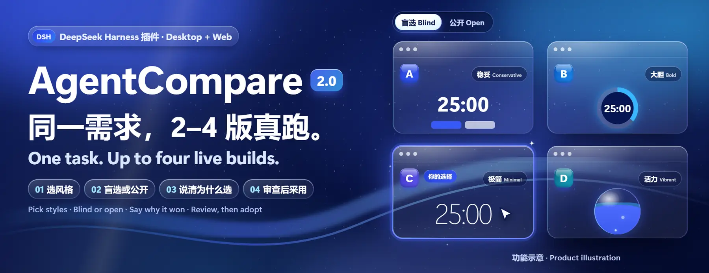
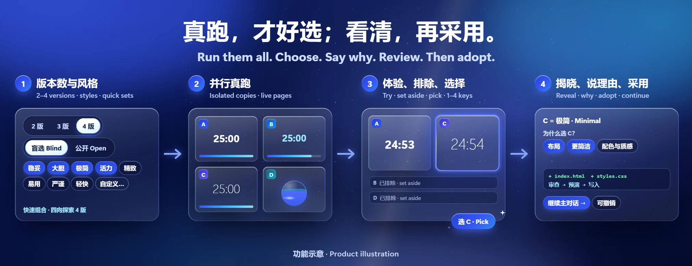
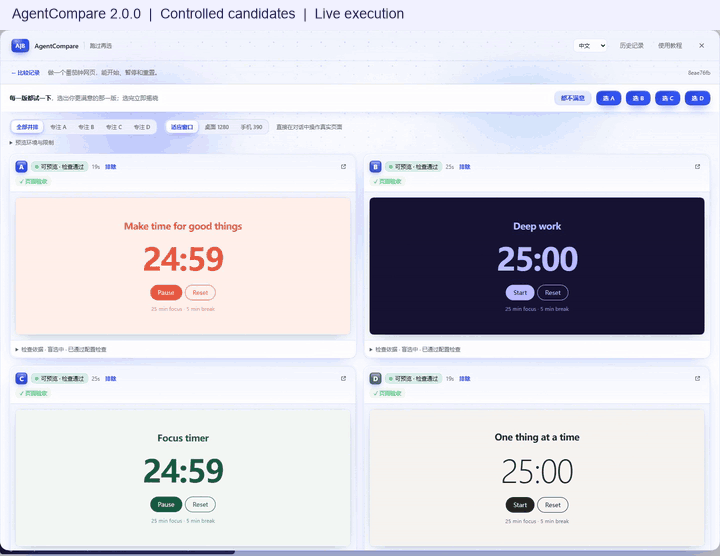

<p align="center">
  <a href="#install"></a>
</p>

# AgentCompare

[](https://github.com/lijiaqi-AI-Product-Manager/dsh-agent-compare/blob/main/package.json)
[](https://www.npmjs.com/package/dsh-agent-compare)
[](https://github.com/lijiaqi-AI-Product-Manager/dsh-agent-compare/actions/workflows/ci.yml)
[](https://github.com/lijiaqi-AI-Product-Manager/dsh-agent-compare/blob/main/package.json)
[](https://github.com/lijiaqi-AI-Product-Manager/dsh-agent-compare/blob/main/docs/demo.md)
[](https://github.com/lijiaqi-AI-Product-Manager/dsh-agent-compare/blob/main/LICENSE)

**中文** · [English](https://github.com/lijiaqi-AI-Product-Manager/dsh-agent-compare/blob/main/README.en.md) · [日本語](https://github.com/lijiaqi-AI-Product-Manager/dsh-agent-compare/blob/main/README.ja.md) · [한국어](https://github.com/lijiaqi-AI-Product-Manager/dsh-agent-compare/blob/main/README.ko.md) · [Español](https://github.com/lijiaqi-AI-Product-Manager/dsh-agent-compare/blob/main/README.es.md) · [Português (Brasil)](https://github.com/lijiaqi-AI-Product-Manager/dsh-agent-compare/blob/main/README.pt-BR.md) · [Français](https://github.com/lijiaqi-AI-Product-Manager/dsh-agent-compare/blob/main/README.fr.md) · [Deutsch](https://github.com/lijiaqi-AI-Product-Manager/dsh-agent-compare/blob/main/README.de.md)

**同一需求，两版真跑，盲选再揭晓。**

**DSH 桌面端 + 浏览器 / Desktop + Web**

<p align="center"><a href="#install">安装 / Install</a> · <a href="#demo">真实演示 / Recorded demo</a></p>

> **1.0.1 · 正式版。** 支持 DSH 桌面端与浏览器界面。首期面向本地 Git 仓库中的根目录 Vite 前端，复用 DSH 当前模型。

AgentCompare 是 [DeepSeek Harness](https://github.com/deepseek-ai/deepseek-harness)（DSH）插件：同一前端需求，生成并实际运行两份实现。先体验再选，选后揭晓模型或策略；采用前核对当前项目与候选改动，确认后写回。

[插件目录与安装](https://github.com/lijiaqi-AI-Product-Manager/dsh-agent-compare/blob/main/docs/distribution.md) · [Plugin directories and installation](https://github.com/lijiaqi-AI-Product-Manager/dsh-agent-compare/blob/main/docs/distribution.en.md) · [Listing status / 收录状态](https://github.com/lijiaqi-AI-Product-Manager/dsh-agent-compare/issues/4)

<p align="center">
  <a href="https://raw.githubusercontent.com/lijiaqi-AI-Product-Manager/dsh-agent-compare/main/assets/readme/comparison-workflow.webp"></a>
</p>

<p align="center"><sub>功能示意 / Product illustrations · <a href="#demo">查看真实演示 / Watch the recorded workflow</a></sub></p>

<a id="demo"></a>

## 看一次完整流程

[](https://github.com/lijiaqi-AI-Product-Manager/dsh-agent-compare/blob/main/docs/media/comparison-workflow.mp4)

固定候选样例，中文界面。应用运行、共同验收与采用实际执行；等待段已剪辑，本地路径已隐藏。

[完整视频（28 秒）](https://github.com/lijiaqi-AI-Product-Manager/dsh-agent-compare/blob/main/docs/media/comparison-workflow.mp4) · [演示条件与结果](https://github.com/lijiaqi-AI-Product-Manager/dsh-agent-compare/blob/main/docs/demo.md)

<a id="install"></a>

## 安装

以下命令用于自行运行的 DSH Web profile。桌面版的 `desktop` profile 由应用管理，请使用应用的插件页面。

安装 npm 包到默认 Web profile（公开发布状态见顶部 npm 徽章）：

```bash
dsh plugin --profile web add dsh-agent-compare@1.0.1
```

如使用其他自行运行的 profile，请将 `web` 换成实际名称。

也可以从源码构建并安装：

```bash
git clone https://github.com/lijiaqi-AI-Product-Manager/dsh-agent-compare.git
```

```bash
cd dsh-agent-compare
npm ci
npm pack
```

```bash
dsh plugin --profile <你的 profile> add ./dsh-agent-compare-1.0.1.tgz
```

重启 DSH 后，在**主对话输入框左下角点 A|B**：

1. 输入框上方展开设置条，直接选择「同一模型 · 两种策略」或「两个模型 · 同一要求」。默认复用当前模型；双模型模式提供两个已配置模型的下拉框。
2. 选择每版生成上限（5–120 分钟）。设置保存在当前对话，重新打开仍可读取。
3. 在原输入框里写需求并发送。无需填写指令或参数；模式切换只操作自己的命令标记，保留草稿、引用与附件。暂不支持的附件提交会由宿主拒绝并保留原稿。
4. 同一条对话里出现 A|B 卡片，两个小窗口是两版**真实运行的应用**。新会话尚未显示聊天时间线时，同一份记录直接显示在输入框上方。默认适应窗口、直接交互，也可切换统一桌面／手机视口或专注 A/B；「大窗口查看」用于放大检查。
5. 选择后揭晓模型和策略，展开代码改动，再点「审查并采用」。先显示目标仓库与核验结果，确认后才写入。恢复操作置于结果顶部；采用后点「继续主对话」，退出比较模式并聚焦原输入框，记录仍保留。

设置条中的「试跑内置示例」会直接新建独立的示例仓库并在本对话中启动，不修改已有草稿。示例结果只采用到示例仓库。

右上角的**比较记录**与**使用教程**在新建和已有对话中均可打开。历史保留需求、检查、选择、采用与撤销记录；预览停止后可查看验收截图。

安装环境造成失败时，卡片会区分连接、访问权限、磁盘、运行环境、锁文件和超时，给出处理建议。修正环境后点「重新验收 A/B」即可复用已封存代码和原验收定义，不重复生成；上次失败、检查与用量继续保留。锁文件不一致需要修正后开始新的比较，不能靠反复安装或放宽条件通过。

[运行记录、重启与恢复](https://github.com/lijiaqi-AI-Product-Manager/dsh-agent-compare/blob/main/docs/runs-and-recovery.md) · [支持范围](#兼容范围) · [自定义验收](#repository-acceptance-agent-comparejson)

<a id="what-it-is-for"></a>

## 适合什么任务

界面和交互类任务：好坏要靠人体验，测试只能判断「有没有做到」。比如搜索和筛选、表单流程、落地页、仪表盘布局、组件重设计。
答案唯一的修 bug 或重构，用单个 Agent 加测试更合适。

两种比较方式：

| 方式 | 两边相同的 | 两边不同的 |
|---|---|---|
| 同一模型 · 两种策略（默认） | 模型、需求、验收 | 「稳妥」沿用现有写法 vs「大胆」重做交互 |
| 两个模型 · 同一要求 | 需求、验收、给 Agent 的说明 | 模型（从你在 DSH 里已配置的模型中选两个） |

<a id="what-it-does-for-you"></a>

## 它替你做掉的那部分

自己开两个会话也能让模型写两版，真正麻烦的是后面这些，AgentCompare 把它们变成一步：

- 两份代码从**同一基线**出发，包括你还没提交的改动，而你的 index 和文件一点不动；
- 每个候选分别申请以自己副本为根的宿主写入约束，并披露宿主实际提供的约束范围；
- 两边各装一份依赖、各自构建、各占一个端口，**同时跑起来**；
- 用**同一套、事先固定并绑定内容**的验收比较，候选改了验收脚本或测试就不算通过；
- 选完以后合回项目时，先确认它和你这期间的修改能一起工作；待写入前发现目标发生变化，就停止采用。

<a id="how-it-works"></a>

## 工作流程

1. **基线**：用私有临时 index 给工作区拍快照（含未提交和未跟踪文件，不含被忽略的文件），不改你的 index 和文件。
2. **验收绑定**：从基线确定验收命令（`typecheck` / `lint` / `test` / `build` 脚本 + 页面验收），并记录这些脚本的内容、验收相关文件（`tsconfig*`、`vite`/`vitest` 配置、lint 配置、已有测试文件、`.agent-compare.json`）的内容哈希、锁文件和运行时。仓库根目录的 `.agent-compare.json` 可以加上逐步交互验收（见下文）。
3. **隔离副本**：为每个候选建一个不带分支的 `git worktree`，放在插件目录（`~/.dsh/agent-compare/w/<run>/<A|B>`），并在副本的 git 管理目录里写入归属标记。
4. **候选会话**：每个候选是一个独立的 DSH 会话，会话目录就是它的副本。开始前以此目录申请 `workspace-write` 约束，审批策略固定为「从不」。具体约束由宿主执行，包含下文列出的平台限制。每个候选有生成时间上限（界面可选 5 / 15 / 30 / 60 / 120 分钟，默认 30）。到时还没说完成，就停止它，照样封存并验收它已写的改动；生成期间卡片上显示它走了几轮、最近在做什么、多久没有新动作。
5. **封存**：生成结束后会话被关闭，改动被冻结为一个提交和一份完整的二进制补丁（SHA-256），永远排除 `node_modules`。
6. **验证**：确认副本内容与封存版本一致 → 按锁文件**冻结安装**（失败就失败，不会退回非冻结安装）→ 跑验收命令 → 用 `vite preview` 运行**构建产物** → 在独立的无头浏览器上下文里跑页面验收（可加载、无控制台错误、逐步交互、桌面和手机截图）→ 再确认验收没有在副本里留下未封存的改动。构建没通过时只提供开发模式预览，并标明「仅供观察」。
7. **结论**：根据已记录的检查、验收定义和内容一致性决定能否采用。失败、超时、验收文件变更或未封存改动会阻止直接采用；明确的页面行为验收没有运行也会阻止。仅基础页面加载检查未运行时保留警告，不算已经验证；依赖变更和缺少锁文件也会提示。
8. **盲选**：面板左右两个 iframe 展示真实运行的构建产物，只标 A/B。选完立即揭晓策略、实际模型和 token 用量，并显示「程序验收倾向」与「你的选择」是否一致。
9. **采用**（只对通过验收的版本开放）：
   - 计算采用后项目应有的完整内容：你当前的工作区 + 候选改动的文件。候选改过的文件如果你在基线后也改过，直接阻止，一个字节都不写。
   - 如果你在这期间改过其他文件，先在**当前项目的副本里预演**这个组合并跑完整验收；不通过就阻止，不写入。
   - 预演结束后、每个文件写入或删除前，重新核验工作区、HEAD 和暂存内容，包含写入日志保存后的变化。发现变化就停止；只对之前已尝试写入的路径执行回退，保留之后的用户编辑。
   - 写入前先持久化恢复记录（采用前快照、预期内容、HEAD 和暂存区指纹），并持有仓库级锁。
   - 按仓库自己的换行和过滤设置预备候选文件，先保留实际原始文件，再以不会覆盖现有路径的链接交接；交接瞬间的新编辑或新文件会阻止写回，双方内容均保留。随后核对项目**与预演通过的内容完全一致**、HEAD 和暂存区未变。不提交，不改 index。
   - 写入失败自动恢复；宿主中断后，重新打开时会进入「需要处理」，可以恢复到采用前或保留当前文件。
   - 之后也可以撤销（前提是你没再改过这些文件，否则会列出这些文件、不覆盖）。
   - 未通过验收的版本只能「另存为分支」（含一个提交，不切换、不改当前文件）供你查看。
10. **继续**：采用成功后会回收副本和预览进程，面板直接给出「继续这份成果」：在刚采用的结果上输入下一项需求，再比较一次。历史记录单独浏览。

<a id="isolation-and-safety-what-is-and-is-not-guaranteed"></a>

## 隔离与安全：保证什么、不保证什么

封存与验收从原仓库核对副本的 Git 管理目录、双向链接和归属标记，再显式绑定 Git 目录与工作区执行。指针被改写、链接替换、过大或缺失时，拒绝继续封存和重新打开预览；清理会保留归属不明的副本并说明原因。终端遗留的 Git 仓库、index 和配置选择变量不会重定向这些操作，内部显式创建的私有 index 仍可使用。这些检查保护插件的 Git 生命周期操作；项目进程的约束仍由宿主沙箱提供。

| 方面 | 做法 | 边界 |
|---|---|---|
| 候选写文件 | 候选会话的目录就是它的副本，由 DSH 沙箱在执行前限制 | DSH 官方把 Windows 沙箱标为 partial；平台临时目录可能可写 |
| 项目命令 | 安装、检查、初次预览和重新预览都使用宿主的 `workspace-write` 约束；子进程环境使用宿主的规范清理接口 | 没有约束就停止，不会退回无约束执行。宿主报告部分约束时保留记录并提示；不提供文件读取或网络隔离 |
| 你的项目 | 生成期间检查项目是否和基线不同，并在面板中提示 | 只报告观察到的变化，不推断是谁修改；采用时检查是否重叠 |
| 并发编辑 | 核验工作区与原始文件指纹；先保留原始文件，再以不覆盖现有路径的链接交接。撤销和恢复也保留冲突内容 | 仓库锁不锁定外部编辑器；交接逐文件完成，涉及文件的编辑与目录重排请等操作结束。不是对同权限进程的安全沙箱 |
| 验收 | 绑定脚本内容、配置和测试文件的哈希；验收前后核对副本内容 | 自由文本需求中无法自动验证的部分只能靠你体验，不会被宣称已验证 |
| 依赖 | 有锁文件时总是冻结安装，包缓存各自放在候选副本内 | 没有锁文件的项目只能非冻结安装，会明确提示 |
| 进程 | 预览进程只在命令行能证明是本插件启动的那个时才会被结束；预览写入同样使用宿主约束 | 网络访问和进程可见性**不隔离** |
| 浏览器状态 | 每次启动预览分配新的随机 `.localhost` 域名，进程仍只绑定 `127.0.0.1`；宿主直接连接回环探测，并要求 HTTP 成功状态 | 嵌入 Cookie 受浏览器策略限制，登录、外部后端和共享数据库暂不支持；外部标签页可能使用不同存储。重开预览会重置页面状态，比较记录和截图仍保留 |
| 嵌入导航 | 预览允许脚本和表单，不允许跳转比较窗口的顶层页面 | 不提供完整的恶意代码沙箱；页面与网络请求仍受浏览器自身策略管理 |
| 清理 | 只删除「已注册为该仓库 worktree + 归属标记匹配」的目录 | 不能证明归属的目录会保留并列出 |
| 原始内容保留 | 项目内自忽略的 `.agent-compare-transfer-*` 目录保留原始文件和交接日志，结果中可查看位置；预览清理不会删除它 | 直接写回限普通文件、10,000 个路径及合计 128 MiB 的原始与候选内容；不支持硬链接的文件系统、符号链接及特殊文件可另存分支。未完成恢复前请保留目录 |
| 旧版记录 | 0.1 版本留下的记录只读显示 | 不会对其中记录的路径或进程做任何操作 |

DSH 宿主没有提供会话创建接口（`ctx.agents.create`）时，会退回 0.1 的子 Agent 方式（`isolation: shared-root`）：副本放在仓库内的 `.agents/worktrees`，越界写入只能事后发现。面板和运行记录都会标明当前用的是哪种。

当前 Windows 宿主限制受限进程内部创建捕获输出的命名管道。npm 安装脚本改用前台输出，不改变项目的脚本许可；esbuild 版本检查及 Vite 的可选 `net use` 探测通过私有临时文件捕获输出，esbuild 服务使用宿主公开的匿名管道接口，子进程继承同一个受限令牌。其他需要嵌套命名管道的工具仍可能失败，不会降低权限要求重试。此边界不包含文件读取和网络访问隔离。

<a id="configuration-optional"></a>

## 配置（可选）

在 profile 的 `cordis.patch.yml` 里追加一条以插件 id 为目标的配置：

```yaml
- id: agent-compare
  name: dsh-agent-compare
  config:
    generationMinutes: 20
```

| 键 | 默认值 | 说明 |
|---|---|---|
| `generationMinutes` | `30` | 每个候选的生成时间预算 |
| `maxActiveRuns` | `1` | 同时生成的比较轮数 |
| `isolation` | `own-root` | `shared-root` 为实验性的旧方式 |
| `home` | `~/.dsh/agent-compare` | 记录、补丁、截图和副本的位置 |

<a id="repository-acceptance-agent-comparejson"></a>

## 仓库自定义验收：`.agent-compare.json`

放在仓库根目录、并提交（验收读取的是基线里的版本，候选改它不算数）：

```json
{
  "scripts": ["test:e2e"],
  "browser": {
    "path": "/",
    "steps": [
      { "label": "初始 8 个商品", "expectCount": "[data-testid=product-card]", "min": 8, "max": 8 },
      { "fill": "input[type=search]", "text": "lamp" },
      { "expectCount": "[data-testid=product-card]", "min": 1, "max": 1 },
      { "click": "button:has-text(\"清空\")" },
      { "viewport": { "width": 390, "height": 844 } },
      { "expectVisible": "input[type=search]" }
    ]
  }
}
```

步骤类型：`fill`、`click`、`press`、`expectVisible`、`expectCount`、`expectText`、`viewport`；选择器是 Playwright 选择器。完整示例见 [examples/vite-react-demo/.agent-compare.json](https://github.com/lijiaqi-AI-Product-Manager/dsh-agent-compare/blob/main/examples/vite-react-demo/.agent-compare.json)。

配置会在生成前严格校验。未知字段、不存在的脚本、非法步骤和跨来源页面路径会直接报错。自动绑定根目录 JS/TS 辅助程序、`scripts/`、`tools/`、`config/`、已知配置和已有测试；新增验证配置及 package scripts（包括生命周期钩子）的变化也会使候选不可直接采用。其它位置的验证数据或辅助文件可在基线配置中通过 `"protectedFiles": ["custom/fixture.json"]` 指定，必须是已存在的具体仓库相对路径。

绑定范围不会推断任意程序动态读取的全部文件。程序验收说明已配置检查的结果；需求中的其它质量标准仍需实际体验和代码审查。

<a id="compatibility"></a>

## 兼容范围

| 项目 | 状态 |
|---|---|
| DSH 0.2.1-rc.3 桌面版，Windows 11 | 历史兼容案例：真实模型完成生成、验收、盲选和采用；候选会话申请各自副本的写入边界，shell 命令已运行 |
| DSH 0.2.1-rc.5，Windows 11 Web UI | 生产版指令、真实子会话、预览、采用、历史恢复及采用说明进入主对话下一次请求已通过；使用本地脚本化适配器 |
| Linux，Ubuntu CI，DSH 0.2.1-rc.5 | 核心回归和真实宿主进程约束、环境清理、冻结安装、构建、预览重开、取消检查已通过；未测外部模型完整交付 |
| DSH next 通道 | 独立 Windows／Linux 原生运行 canary，记录实际版本；状态见 [CI](https://github.com/lijiaqi-AI-Product-Manager/dsh-agent-compare/actions/workflows/ci.yml)，不等同于完整模型交付验收 |
| macOS | 尚未实测 |
| Node | 26.13.0 为主开发基线；22／24 维护线的最新补丁版也纳入 CI 兼容检查 |
| 项目类型 | 仓库根目录的 Vite 项目；至少有一次提交的 Git 仓库。npm 已执行安装和验收；pnpm / yarn 的完整运行待验证 |

<a id="verified-maintained-through-current-ci-and-the-cases-below"></a>

## 已验证（持续更新，以当前 CI 和所列案例为准）

最新结果见 [CI](https://github.com/lijiaqi-AI-Product-Manager/dsh-agent-compare/actions/workflows/ci.yml)。可复现的原生运行检查还在 Windows 上实测了 DSH 0.2.1-rc.5、Node 26.13 和 Vite 8.3.5：相邻文件写入被拒绝、子进程环境被清理、冻结安装、类型检查和构建通过、预览两次启动、取消后停止写入。Windows 如实报告部分约束。

用单独的依赖目录安装官方当前宿主后，可以重复这项检查：

```bash
npm install --prefix .runtime-checks/host-sdk --ignore-scripts --no-audit --no-fund @deepseek-ai/dsh@latest
npm run test:runtime
```

测试宿主依赖目录被忽略，也不会打入插件包。本项使用受控示例，不请求模型。

- 自动化回归（数量和结果以当前 CI 为准），包含真实 git、冻结 npm 安装、构建与预览进程的集成测试（临时路径带空格），以及单元测试和宿主接口契约测试。已建立的回归包括：
  - 候选改写测试脚本：检查「通过」，但结论为不可采用，写入工作区被拒绝，只能另存为分支；
  - 检查失败、构建失败、改依赖不更新锁文件（冻结安装失败，不会退回非冻结安装）、生成超时；
  - 采用写入的内容与验收一致，HEAD 和暂存区不变，预览进程和副本随后被回收；
  - 你在基线后改了其他文件：预演通过则采用并保留你的修改；预演发现组合失败则阻止，一个字节都不写；
  - 与你后来的修改重叠：阻止；
  - 预演或写入日志保存期间的新编辑、并发 HEAD/暂存区变化：写入前阻止；替换、删除或新增路径出现变化时保留用户文件，只回退本次已尝试写入的路径；解决重叠后可重试采用和撤销；
  - 采用中途中断：重启后进入「需要处理」，可以恢复到采用前；
  - 同一仓库的第二个采用在仓库锁被占用时被拒绝；
  - 清理拒绝删除未注册或归属标记不符的目录；
  - 基于过期记录的保存被拒绝；旧版记录只读，不会据此结束进程；
  - 并发启动提前占用名额，初次保存失败可重试，编号冲突保留已有历史；退出时等待准备、候选和采用操作收尾；
  - 全部对话和当前对话分别筛选，65 条实际文件记录均可通过分页找到，读取不修改原始文件；
  - 只有命令行能证明归属的进程才会被结束；
  - 候选会话的创建参数（会话目录 = 副本、沙箱 workspace-write、审批 never）、开始前就收到的停止、真实 token 用量的汇总。
- `node scripts/smoke.mjs`：脚本代替模型，用内置案例真实运行 React 19.3.1、Vite 8.3.5 与 Playwright Chromium 156.0.8078.4。完整实现的一版通过 12/12 步验收；漏做「清空」按钮的一版只通过 9/12 步，被判为不可采用。基线建立后再次编辑笔记文件，采用必须先预演组合结果，并保留更新后的笔记。`--escape B` 时，候选写到副本外的文件被检测出来。
- DSH 0.2.1-rc.5 隔离环境：生产版指令读取界面选择的五分钟上限，创建两个真实候选会话，运行应用并完成审查及采用。刷新并返回普通对话后，本地脚本化适配器在真实主会话请求中读到了采用说明。新建／已有对话的入口均正常，没有页面异常。本项没有请求外部模型。
- 开发与示例依赖审计均为零已知漏洞。`npm run test:coverage` 单独报告后端覆盖率；浏览器和原生宿主集成检查属于其他验证层，不计入这个百分比。
- 浏览器断言覆盖输入框设置、设置持久化、多条记录的独立操作、两个可交互预览、空白会话导航与重新打开、代码审查、采用确认、返回输入框的焦点、响应式状态及弹窗键盘操作。历史导航包含 72 条样例的分页、搜索、慢响应、旧服务端提示、错误重试和需处理记录筛选。浅色／深色界面状态通过 WCAG 2 A/AA 和 2.1 AA 自动规则检查。此项使用明确标记的示例记录。

- 真实模型（DSH 0.2.1-rc.3 桌面版，deepseek-flash，内置案例）：两个候选会话的头部记录 `cwd` 分别是各自的副本，`sandbox/mode` 为 `workspace-write`、`approval/policy` 为 `never`；候选里的 `pwsh` 正常执行（0.1 的 `SetNamedSecurityInfoW` 错误不再出现）；token 用量来自会话日志。两个候选都在 30 分钟上限内没有说完成——其中一个已写完全部改动，事后对它的副本跑共同验收：冻结安装、类型检查、构建和 12/12 步页面验收全部通过。0.2.0-alpha.2 因此改为到时照样验收已写的改动。

- 真实模型完整一轮（DSH 0.2.1-rc.3 桌面版，deepseek-flash，同一模型两种策略，60 分钟上限）：两版各用约 42 分钟生成，token 用量约 264 万和 294 万；两版都通过类型检查、构建和页面验收；选择 B 后采用到工作区，写入 `src/App.tsx` 和 `src/styles.css`，未提交、index 和 HEAD 未改动。
- 对话内运行（DSH 0.2.1-rc.3 运行时，测试 profile）：`/ab` 出现在指令菜单；输入框的 A|B 按钮把草稿变成 `/ab …`，发送后按指令执行；会话日志里记录 `command/run`（`ab` 及参数）和 `command/done`（含运行编号）；生成结束时，一条说明结果的消息写入该对话，供模型下一步读取；输入框按钮、指令卡片、工具卡片、标题栏按钮的注册全部被宿主接受。
- 打包安装后的界面检查（DSH 0.2.1-rc.3 Web UI，隔离 profile）：原输入框的图形化提交、两份真实 Vite 预览中的搜索与清空、选择、采用审查及工作区写入、结果说明写入持久会话并进入下一步消息队列、刷新后恢复已采用记录，以及退出比较模式后继续普通对话。本项使用固定的脚本化候选，没有请求模型。

<a id="not-verified-yet"></a>

## 尚未验证（不要当成已支持）

- 更新后桌面壳的最终显示效果，以及最新版宿主中由外部模型完成「采用后接着提下一项需求」的完整体验。采用说明进入请求上下文已通过本地脚本化适配器检查。
- 历史 Windows 案例记录到较长工具调用和轮间等待，一轮比较可能超过 30 分钟。各阶段开销尚未定位，不能据此归因为某个插件或服务；最新版仍需要真实外部模型的性能测量。
- 已测 Chromium／Edge 以外的浏览器与隐私模式。当前已验证候选之间的浏览器状态分离；嵌入 Cookie 和外部标签页仍受浏览器自身策略管理，不构成完整浏览器安全边界。
- 两个模型模式下各家 provider 的实际表现。

<a id="known-limitations"></a>

## 已知限制

- 只支持 Vite 项目；必须是至少有一次提交的 Git 仓库。
- npm 12 的安装脚本策略可能拦截依赖脚本；需要原生安装步骤的项目须先按项目自身策略允许相关脚本。
- 单次比较的结果不代表模型或策略的整体优劣。

<a id="development"></a>

## 开发

使用 Node 26.13.0（`.nvmrc`）与 npm 12.2.1。编译和测试基线为 TypeScript 7、React 19.3、Vitest 5；分发的客户端复用 DSH 提供的 React 运行时。

```bash
npm ci && npm run typecheck && npm test
```

```bash
npx playwright-core install --only-shell chromium
npm run test:ui
npm run test:coverage
npm run smoke
```

```bash
node scripts/preview-ui.mjs
```

贡献方式见 [CONTRIBUTING.md](https://github.com/lijiaqi-AI-Product-Manager/dsh-agent-compare/blob/main/CONTRIBUTING.md)，版本变化见 [CHANGELOG.md](https://github.com/lijiaqi-AI-Product-Manager/dsh-agent-compare/blob/main/CHANGELOG.md)。

<a id="license"></a>

## 许可证

MIT

<!-- project-growth:start -->

## 项目增长

Star 历史每天自动更新。更新日期采用 UTC，Star 日期沿用 GitHub 聚合口径。 同时展示 npm 每日下载请求量。

<a href="https://github.com/lijiaqi-AI-Product-Manager/dsh-agent-compare/stargazers">
<picture>
  <source media="(max-width: 600px) and (prefers-color-scheme: dark)" srcset="https://raw.githubusercontent.com/lijiaqi-AI-Product-Manager/lijiaqi-AI-Product-Manager/main/assets/growth/dsh-agent-compare/stars-mobile-dark.svg">
  <source media="(max-width: 600px)" srcset="https://raw.githubusercontent.com/lijiaqi-AI-Product-Manager/lijiaqi-AI-Product-Manager/main/assets/growth/dsh-agent-compare/stars-mobile-light.svg">
  <source media="(prefers-color-scheme: dark)" srcset="https://raw.githubusercontent.com/lijiaqi-AI-Product-Manager/lijiaqi-AI-Product-Manager/main/assets/growth/dsh-agent-compare/stars-dark.svg">
  
</picture>
</a>

<a href="https://www.npmjs.com/package/dsh-agent-compare">
<picture>
  <source media="(max-width: 600px) and (prefers-color-scheme: dark)" srcset="https://raw.githubusercontent.com/lijiaqi-AI-Product-Manager/lijiaqi-AI-Product-Manager/main/assets/growth/dsh-agent-compare/downloads-mobile-dark.svg">
  <source media="(max-width: 600px)" srcset="https://raw.githubusercontent.com/lijiaqi-AI-Product-Manager/lijiaqi-AI-Product-Manager/main/assets/growth/dsh-agent-compare/downloads-mobile-light.svg">
  <source media="(prefers-color-scheme: dark)" srcset="https://raw.githubusercontent.com/lijiaqi-AI-Product-Manager/lijiaqi-AI-Product-Manager/main/assets/growth/dsh-agent-compare/downloads-dark.svg">
  
</picture>
</a>

下载请求包含重复与自动化访问，不等于独立用户或活跃用户。

[数据来源与统计口径](https://github.com/lijiaqi-AI-Product-Manager/lijiaqi-AI-Product-Manager/blob/main/docs/growth.md)

<!-- project-growth:end -->
