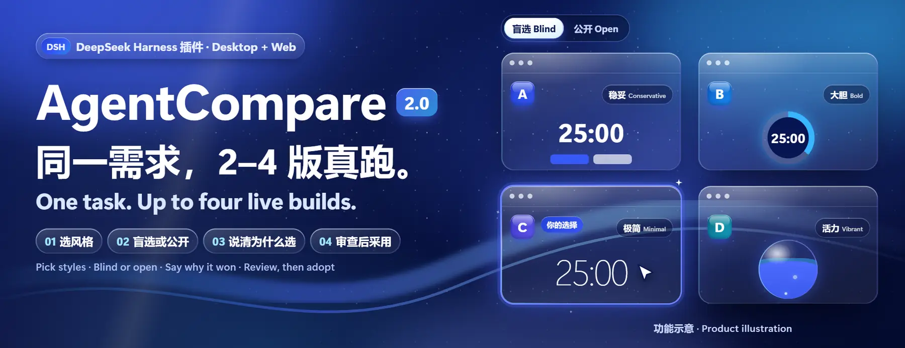
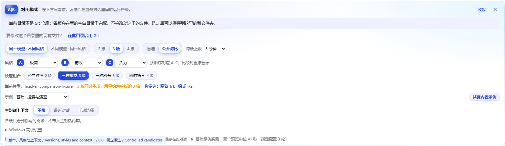

[](#demo)

<div align="center">

<a id="agentcompare"></a>
<a id="agent-compare-dsh-agent-compare--鲸挑细选"></a>

# AgentCompare · 鲸挑细选

[](https://github.com/lijiaqi-AI-Product-Manager/dsh-agent-compare/stargazers)
[](https://www.npmjs.com/package/dsh-agent-compare)
[](https://dshmarket.com/categories/workflow/)

[](https://www.dsh.so/artifact/dsh-agent-compare/)
[](https://www.dsh.so/artifact/dsh-agent-compare/)

[](https://www.npmjs.com/package/dsh-agent-compare)
[](https://github.com/lijiaqi-AI-Product-Manager/dsh-agent-compare/actions/workflows/ci.yml)
[](https://github.com/lijiaqi-AI-Product-Manager/dsh-agent-compare/blob/main/LICENSE)
[](https://github.com/lijiaqi-AI-Product-Manager/dsh-agent-compare/blob/main/docs/demo.md)

<sub><a href="https://github.com/lijiaqi-AI-Product-Manager/dsh-agent-compare/blob/main/docs/npm-total-downloads.md">Métricas e fontes dos rankings</a></sub>

[中文](https://github.com/lijiaqi-AI-Product-Manager/dsh-agent-compare/blob/main/README.md) · [English](https://github.com/lijiaqi-AI-Product-Manager/dsh-agent-compare/blob/main/README.en.md) · [日本語](https://github.com/lijiaqi-AI-Product-Manager/dsh-agent-compare/blob/main/README.ja.md) · [한국어](https://github.com/lijiaqi-AI-Product-Manager/dsh-agent-compare/blob/main/README.ko.md) · [Español](https://github.com/lijiaqi-AI-Product-Manager/dsh-agent-compare/blob/main/README.es.md) · **Português (Brasil)** · [Français](https://github.com/lijiaqi-AI-Product-Manager/dsh-agent-compare/blob/main/README.fr.md) · [Deutsch](https://github.com/lijiaqi-AI-Product-Manager/dsh-agent-compare/blob/main/README.de.md)

**Uma mesma ideia, mais formas de torná-la realidade!**

**鲸挑细选 · AgentCompare** é um plugin de comparação para [DeepSeek Harness](https://github.com/deepseek-ai/deepseek-harness) (DSH), instalado como `dsh-agent-compare`. Envie uma tarefa na conversa principal, compare de 2 a 4 respostas, arquivos ou páginas executáveis e escolha a versão que combina com sua ideia. Funciona no **DSH Desktop + Web**, com interfaces em chinês e inglês.

<p align="center"><a href="#demo">Ver a demonstração de 45 segundos</a> · <a href="#install">Instalar no Desktop ou na Web</a> · <a href="#support">Consultar compatibilidade</a></p>

<a id="demo"></a>
<a id="veja-uma-corrida-do-peixe-gordo-inteira"></a>

</div>

## Veja uma comparação em ação

[](https://github.com/lijiaqi-AI-Product-Manager/dsh-agent-compare/blob/main/docs/media/comparison-workflow.mp4)

Gravação com candidatos controlados em um host DSH real: baleias e etapas ao vivo, páginas interativas, escolha de C com motivos, salvamento e retorno à conversa. As esperas foram cortadas; o restante está na velocidade original.

[Vídeo completo · 45 segundos](https://github.com/lijiaqi-AI-Product-Manager/dsh-agent-compare/blob/main/docs/media/comparison-workflow.mp4) · [Condições e resultados](https://github.com/lijiaqi-AI-Product-Manager/dsh-agent-compare/blob/main/docs/demo.md) · [GIF completo](https://github.com/lijiaqi-AI-Product-Manager/dsh-agent-compare/blob/main/docs/media/comparison-preview.gif)

Estas capturas e animações mostram candidatos controlados em um host DSH real. Elas demonstram a interface e o fluxo reais; qualidade e tempo do modelo são descritos separadamente.

[](https://raw.githubusercontent.com/lijiaqi-AI-Product-Manager/dsh-agent-compare/main/assets/readme/gallery-2.0/02-live-comparison.png)

Use as quatro páginas diretamente e leia cada resposta junto ao resultado. Abra Steps para consultar pensamentos e chamadas de ferramentas fornecidos pelo host.

<details>
<summary>A comparação em quatro etapas</summary>

[](https://raw.githubusercontent.com/lijiaqi-AI-Product-Manager/dsh-agent-compare/main/assets/readme/comparison-workflow.webp)

Configure versões e estilos → execute em paralelo → experimente e escolha → revise e continue. O diagrama é uma ilustração do produto.

</details>

<a id="install"></a>

## Instalação

### DSH Desktop

1. Instale `dsh-agent-compare` em **Plugins → Add plugin** no aplicativo.
2. Em **Plugins → Installed**, confirme que o AgentCompare está ativado. Feche o DSH por completo e abra-o novamente.
3. Clique em **A|B** no canto inferior esquerdo do editor principal, escolha versões e estilos e envie a tarefa.

### DSH Web hospedado por você

A interface está disponível em chinês simplificado e inglês, selecionáveis no DSH Desktop e Web.

Os comandos abaixo são para um perfil DSH Web gerenciado pelo usuário. O perfil `desktop` é gerenciado pelo aplicativo de desktop; use a página de plugins do aplicativo.

A referência de desenvolvimento é Node 26.13.0 com npm 12.2.2. As verificações atuais usam o pacote oficial DSH 0.2.1-rc.5 / 0.2.2-rc.1. Identifique o perfil que você já utiliza no DSH.

Instale o pacote npm no perfil Web padrão. O selo do npm indica o estado de publicação:

```bash
dsh plugin --profile web add dsh-agent-compare
```

Para outro perfil gerenciado por você, substitua `web` pelo nome real.

**Reinicie por completo após atualizar.** Encerre totalmente o DSH Desktop e abra novamente. No Web, reinicie o serviço DSH correspondente e recarregue a página. Atualizar só a interface pode deixar o backend antigo ativo; versões diferentes geram um aviso.

<details>
<summary>Compilar e instalar a partir do código</summary>

Também é possível compilar e instalar a partir do código-fonte:

```bash
git clone https://github.com/lijiaqi-AI-Product-Manager/dsh-agent-compare.git
cd dsh-agent-compare
npm ci
npm pack
```

Este comando instala o arquivo no perfil Web `web`.

```bash
dsh plugin --profile web add ./dsh-agent-compare-3.4.1.tgz
```

</details>

Reinicie o DSH. Antes de atualizar, finalize as comparações ativas e feche instâncias antigas que usam os mesmos registros. Não há suporte a alterações simultâneas por versões diferentes do plugin.

<a id="use"></a>
<a id="primeira-comparação"></a>

## Primeira comparação

1. Clique em **A|B** no canto inferior esquerdo do campo de conversa. Os ajustes se abrem acima do campo existente.
2. Escolha 2–4 versões. O padrão reutiliza o modelo atual com estilos diferentes; escolha cada estilo ou descreva-o em uma linha. Para modelos diferentes, selecione entre os já configurados no DSH.
3. Defina comparação às cegas ou aberta, limite por versão (5–120 minutos) e contexto compartilhado da conversa. Escreva o pedido no campo habitual e envie.
4. O cartão mostra o progresso e o resultado: resposta, arquivos ou página. Páginas em execução são interativas. Use tamanhos de desktop/celular, foco com 1–4 e visão geral com 0; com 3–4 versões, deixe de lado as descartadas.
5. Use «Choose A», por exemplo, ou «None of these» para não escolher nenhuma. Às cegas, modelos e estilos aparecem após a escolha; na comparação aberta, desde o início.
6. Para mudanças do projeto, «Review and adopt» mostra diferenças e verificações antes de uma confirmação separada. Fora do Git, salve em uma pasta nova. Uma resposta não exige aplicar arquivos. «Continue conversation» volta à conversa mantendo a escolha.

`试跑内置示例` cria um repositório separado com uma loja de exemplo, sem alterar seu projeto. A aplicação do resultado também ocorre nesse exemplo. `比较记录` abre o histórico e `使用教程` abre o guia, tanto em conversas novas quanto existentes.

Escolha não compartilhar contexto, incluir trocas recentes ou selecionar mensagens. O padrão são as últimas 3 trocas; você pode conferir o trecho antes do envio. Conteúdo longo é truncado com aviso visível. Todas as versões recebem o mesmo trecho, e o resultado e os motivos da escolha voltam à conversa original.

<a id="ui"></a>
<a id="gallery"></a>

## Interface e experiência

No celular, escolha o modo, o número de versões e se a comparação será às cegas. Confira o projeto e o contexto compartilhado e digite o pedido na conversa. Abra “More settings” para ajustar estilos, limite de tempo e o exemplo. Ao voltar a uma comparação, abrir as configurações recolhe o resultado anterior. Ao reabri-lo, as páginas e o rascunho são preservados.

Em janelas baixas, o painel de configurações tem rolagem própria e mantém o campo de texto e o botão de envio visíveis. Em uma tela pequena na horizontal, use “Expand settings” para abrir as opções.

Se o pedido mencionar opções de `/ab`, coloque `--` antes do texto. Por exemplo, `/ab --versions 2 -- Explique a opção --example` pede duas explicações.

Em uma tela larga, use “Align pages” para alinhar o início das páginas interativas. Clique novamente para voltar à disposição original. O que você digitou em cada página é preservado.

No celular, escolha o estilo de cada versão pelas amostras visuais. No computador, abra as etapas para ver a ação mais recente de cada versão. Na comparação às cegas, o modelo e o estilo aparecem depois da escolha. Antes de aplicar as mudanças, revise cada arquivo com os números das linhas.

<details>
<summary>Ver a interface da versão 3.3.0</summary>


</details>

- **Vidro líquido azul.** As camadas distinguem configurações, versões e revisão. Quando a redução de movimento está ativa, a escolha e a revelação aparecem imediatamente.
- **Um peixe gordo faz companhia.** Uma baleia azul do DeepSeek por versão se enche de água azul conforme avança, enquanto duas luzes percorrem a borda. Pensamentos sobem acima da cabeça; toque e ela responde, continue tocando e ela gira, cambaleia e espirra água.
- **Comece pela última ação.** Durante a geração, o cabeçalho mostra a ação mais recente. Abra as etapas para ver o raciocínio, as chamadas de ferramentas e os tempos registrados.
- **Resposta e resultado com o mesmo peso.** Uma resposta aparece sozinha; uma página divide o cartão com a resposta, e em foco a resposta fica à esquerda da página.
- **Quatro azuis para A–D.** Numa comparação às cegas você só vê A–D; estilos e modelos são revelados depois da escolha, com um feixe de luz passando pelos cartões.
- **Dá para ver que está rodando.** Dois cometas percorrem a borda de uma comparação em andamento, e cada página pode ser usada assim que inicia.
- **Desktop, navegador e largura de celular**, com interface em chinês e inglês.

As etapas mostram as informações fornecidas pelo modelo e pelo host. Registros longos preservam o início e o fim, com cortes indicados; nomes de estilos ficam ocultos antes da escolha às cegas. O nível de água representa uma etapa, não qualidade nem uma porcentagem exata.

[](https://raw.githubusercontent.com/lijiaqi-AI-Product-Manager/dsh-agent-compare/main/assets/readme/whale-closeup.webp)

<p align="center"><sub>Close das baleias: candidatos fixos; o modelo roteirizado espera 9 s por passo para dar tempo de ver; com cortes, o resto em velocidade normal.</sub></p>

[](https://raw.githubusercontent.com/lijiaqi-AI-Product-Manager/dsh-agent-compare/main/assets/readme/gallery-2.0/05-saved-result.png)

Ao focar uma versão, a resposta fica ao lado da página. Guarde os motivos, salve o resultado ou revise as alterações e volte à mesma conversa.

<details>
<summary>Mais telas reais: respostas, ajustes, inglês e largura de celular</summary>

[](https://raw.githubusercontent.com/lijiaqi-AI-Product-Manager/dsh-agent-compare/main/assets/readme/gallery-2.0/03-main-conversation.png)

[](https://raw.githubusercontent.com/lijiaqi-AI-Product-Manager/dsh-agent-compare/main/assets/readme/gallery-2.0/04-comparison-settings.png)

[](https://raw.githubusercontent.com/lijiaqi-AI-Product-Manager/dsh-agent-compare/main/assets/readme/13-english-answers.webp)

<p align="center"><a href="https://raw.githubusercontent.com/lijiaqi-AI-Product-Manager/dsh-agent-compare/main/assets/readme/14-phone-answer.webp"></a></p>

</details>

[Mais telas reais: respostas, ajustes, inglês e largura de celular](https://github.com/lijiaqi-AI-Product-Manager/dsh-agent-compare/blob/main/docs/storefront-gallery.md)

<a id="tasks"></a>
<a id="quando-vale-comparar"></a>

## Quando vale comparar

| Sua tarefa | O que comparar |
|---|---|
| Uma resposta, análise ou texto | Abordagens e redações diferentes, formatadas lado a lado e prontas para copiar. |
| Scripts, documentos ou outros arquivos | Arquivos e respostas de cada versão; salve a escolha em uma pasta nova. |
| Páginas e mudanças de interface | Use páginas executáveis, confira os critérios comuns e revise antes de aplicar. |

<details>
<summary>Detalhes de modelos, estilos e escolha de tarefas</summary>

Busca e filtros, formulários, páginas de apresentação, painéis e reformulação de componentes: tarefas em que usar o resultado ajuda a julgar sua qualidade. Para um bug com resposta clara ou uma refatoração mecânica, um agente com testes costuma ser mais adequado.

Com o mesmo modelo, atribua estilos diferentes a 2–4 versões: oito predefinições ou uma instrução própria de uma linha. Para comparar modelos, escolha 2–4 dos configurados no DSH e mantenha o pedido, o estilo e as verificações. Em Git, todas partem do mesmo estado do código; fora do Git, de cópias vazias. Uma escolha não determina qual modelo é melhor em geral.

</details>

<a id="support"></a>

## Compatibilidade e limites de uso

[](https://github.com/lijiaqi-AI-Product-Manager/dsh-agent-compare/blob/main/package.json)
[](https://github.com/lijiaqi-AI-Product-Manager/dsh-agent-compare/blob/main/package.json)

| Ambiente e escopo | Verificação |
| --- | --- |
| Windows · DSH 0.2.2-rc.2 / rc.3 · Node 26.13.0 · 2026-11-18 | O teste da versão 3.2.0 no Windows cobriu a instalação de dependências, a execução das verificações e uma prévia do Vite. |
| Edge 157 · 390 / 1440 px | [Ver a interface no Edge com uma conversa de exemplo](#ui) |

- Páginas ao vivo precisam de um projeto web executável; respostas e arquivos também podem ser comparados. O guia distingue pastas comuns, repositórios e subpastas.
- Cada versão consome uso do modelo. Tempo e custo variam conforme a tarefa e o modelo; a execução paralela não garante menor custo nem espera.
- Revise antes de aplicar e preserve os registros de desfazer e recuperação. Uma cópia de trabalho não é uma máquina virtual completa: o DSH fornece o limite de escrita, leitura e rede não são isoladas e o Windows informa a restrição real.
- Fora do Git, as versões começam em cópias vazias e não leem os arquivos existentes. Para alterá-los, ative o Git primeiro nos ajustes. Os resultados ficam em uma nova subpasta.

[Projetos e pastas comuns](https://github.com/lijiaqi-AI-Product-Manager/dsh-agent-compare/blob/main/docs/workspaces-and-projects.md) · [Matriz de gerenciadores](https://github.com/lijiaqi-AI-Product-Manager/dsh-agent-compare/blob/main/docs/package-managers.md) · [Compatibilidade e limites do Safari](https://github.com/lijiaqi-AI-Product-Manager/dsh-agent-compare/blob/main/README.en.md#compatibility)

[Diretórios e instalação](https://github.com/lijiaqi-AI-Product-Manager/dsh-agent-compare/blob/main/docs/distribution.en.md) · [Situação dos envios e avaliações](https://github.com/lijiaqi-AI-Product-Manager/dsh-agent-compare/issues/4)

<a id="details"></a>

## Saiba mais: verificações, recuperação e ajustes avançados

### Execução e verificação comum

Em um repositório Git, mesmo sem commits, um index privado registra alterações sem commit e arquivos não rastreados, exceto os excluídos. Em uma pasta fora do Git, as versões começam em um espaço de trabalho privado e vazio, e a escolhida pode ser salva em uma nova subpasta. O HEAD e o index originais são preservados. Cada versão tem seu worktree e sua sessão; a diferença é guardada como patch binário com hash.

As verificações vêm da base: `typecheck`, `lint`, `test`, `build` e a verificação de página configurada. Havendo lockfile, a instalação é congelada; uma falha não provoca nova tentativa sem congelamento. Alterar testes ou configurações para fazer uma versão passar não é uma aprovação válida para aplicação direta.

Um [`.agent-compare.json` na raiz](https://github.com/lijiaqi-AI-Product-Manager/dsh-agent-compare/blob/main/examples/vite-react-demo/.agent-compare.json) permite definir ações e expectativas comuns: preencher, clicar, conferir texto, visibilidade, quantidade e tamanho da tela. A definição é validada antes da geração. Se uma aceitação explícita de página não rodar, a aplicação direta é bloqueada. Se apenas a checagem básica de carregamento não puder rodar, isso aparece como aviso. Resposta HTTP, compilação, funcionamento e preferência pessoal são resultados diferentes.

A instalação antecipada exige um lockfile npm, sem outro gerenciador declarado, scripts de instalação na raiz nem dependências locais. Só versões cujos manifestos coincidem com a base recebem uma cópia própria. Fora dessas condições, com manifestos alterados ou falha na cópia, cada versão faz a instalação normal, sem relaxar as verificações do lockfile.

### Aplicação, desfazer e recuperar

O plugin combina seu estado atual com os caminhos alterados pela versão escolhida. Sobreposições detectadas interrompem a aplicação. Se você mudou outros arquivos, a combinação passa por um ensaio em uma cópia temporária. Antes de escrever, conteúdo, HEAD e index são conferidos novamente, e um registro de recuperação é salvo.

A aplicação na árvore de trabalho não faz commit, push nem troca de branch automaticamente. Arquivos novos, removidos e binários fazem parte da diferença. Uma versão que não atende aos critérios pode ser salva em uma branch para análise. Ao desfazer ou recuperar uma interrupção, edições posteriores detectadas são mantidas como conflitos.

O bloqueio do repositório coordena operações do plugin; ele não bloqueia o editor. Pause as edições durante a breve etapa de escrita.

### Histórico e estado das páginas

O histórico começa com todas as conversas, com filtro da conversa atual, busca por pedido, repositório ou identificador e páginas de 30 registros. Resultado, escolha e aplicação são preservados. As notas são entregues à mesma conversa, com novas tentativas se ela estiver indisponível. Logs longos não são inseridos integralmente no contexto principal.

Registros antigos ou danificados permanecem somente para leitura, com explicação. Depois de reiniciar, capturas salvas são identificadas como imagens estáticas. Se a cópia ainda existe, a prévia pode ser reaberta. Cada abertura usa um endereço `.localhost` novo, separando cookies e armazenamento por origem entre as versões. O estado temporário da página é reiniciado; registros e capturas continuam disponíveis.

### Compatibilidade e limites

Um worktree não é uma barreira completa de segurança. O plugin usa a política de escrita do DSH; no Windows, a proteção é informada como **partial**. Leituras de arquivos e rede não são isoladas. Cookies em páginas incorporadas seguem a política do navegador, e uma aba externa pode ter outro contexto de armazenamento. Login, backends externos e bancos de dados compartilhados ficam fora do escopo atual.

Os testes nativos cobrem Windows, Linux e macOS. A [matriz detalhada](https://github.com/lijiaqi-AI-Product-Manager/dsh-agent-compare/blob/main/README.en.md#compatibility) distingue as combinações verificadas de npm, pnpm e Yarn e as limitações de Windows/PnP. O Safari nativo é validado separadamente; respostas controladas dos testes não medem a qualidade nem o desempenho de modelos externos.

### Tempo, custo e evidências

Cada versão consome geração; paralelismo não garante economia de tempo ou dinheiro. É possível parar uma versão ou a comparação inteira. Quando o limite termina, o plugin verifica o que já foi escrito. Uso não informado aparece como desconhecido, nunca como custo zero.

A [CI](https://github.com/lijiaqi-AI-Product-Manager/dsh-agent-compare/actions/workflows/ci.yml) cobre Windows/Linux, Node e navegador. Parte das integrações atuais usa um adaptador local de respostas fixas, com sessões, ferramentas e aplicações reais. Isso demonstra execução, sem medir a qualidade de um modelo externo. Os casos históricos com modelos reais são do DSH 0.2.1-rc.3 e não devem virar ranking ou promessa de desempenho.

<a id="whats-new"></a>

## Novidades por versão

**3.4.1** · Encontre comparações pelo nome da pasta original ou pelo caminho completo do projeto. Caminhos longos ocupam uma linha e podem ser expandidos para copiá-los. Se uma mensagem selecionada mudar ou desaparecer, você poderá refazer a seleção antes de enviar. Os trechos longos preservam o início e o fim. Ao trocar de arquivo, você vê o conteúdo selecionado. Também pode copiar respostas e blocos de código na janela de comparação.

**3.3.1** · A consulta de status funciona mesmo com resultados pendentes. Se o campo de mensagem estiver ocupado, o guia preserva o rascunho e permite tentar de novo.

**3.3.0** · Amostras de estilos, expressões por etapa, revisão linha a linha e histórico agrupado por data.

**3.2.1** · A verificação de texto espera até cinco segundos para que a página mostre o resultado de uma ação. Os resultados pendentes voltam à conversa de origem por ordem de atualização, até cinco por etapa.

**3.2.0** · As configurações no celular agora têm dois níveis e as páginas ao vivo podem ser alinhadas em telas largas. Os oito guias levam da demonstração à instalação e à primeira comparação.

<details>
<summary>Mudanças da 3.1.1 e de versões anteriores</summary>

**3.1.1:** A entrada de compatibilidade em chinês espelha o guia completo. Uma verificação offline confere o README que o npm escolhe do arquivo real, evitando que só um índice apareça na página do pacote. Comparação e aplicação não mudam.


**Novidades da versão 3.1.0:**
- **Cada passo à vista, ao vivo e depois.** Assim que uma versão começa, o cartão ganha um botão **Steps**. Ao abrir, o trabalho aparece em ordem: raciocínios com o tempo de cada um, chamadas de ferramentas (ler ou editar um arquivo, executar um comando…; cada uma abre com entrada e saída) e o que foi escrito entre os passos. Enquanto trabalha, os três passos mais recentes também passam ao vivo sob a baleia, e depois de terminar cada passo fica a um clique. Numa comparação às cegas, palavras que nomeiam um estilo aparecem como ▒▒.
- **A resposta, direto na tela.** Uma versão que só responde mostra apenas a resposta. Uma versão que construiu uma página ou escreveu arquivos mostra a resposta com o mesmo peso: acima da página lado a lado e à esquerda da página quando essa versão está em foco. A resposta aparece assim que a versão termina, antes da página.
- **Páginas direto na tela.** Páginas estáticas são servidas pelo próprio plugin: podem ser usadas assim que são escritas, sem um processo separado que o aplicativo de desktop possa encerrar. Se mesmo assim uma página não puder ser servida, um resultado HTML aparece como página do mesmo jeito, com o código a um clique.
- **Resultados mais cedo.** A confirmação começa quando o turno de cada versão termina sem mensagens na fila, sem esperar outros plugins liberarem toda a sessão. No host de teste registrado, foram 0,35–0,6 s; os casos de desktop com o backend anterior levavam 41–44 s. Projetos npm elegíveis podem preparar uma instalação fixa durante a geração e entregar uma cópia independente a cada versão sem mudanças nas dependências. As verificações rodam em paralelo e a página pode ser usada assim que inicia. Na gravação com candidatos fixos, as quatro páginas Vite ficaram disponíveis em cerca de 24–30 s após o envio. Isso não mede velocidade ou qualidade de modelos externos nem garante o tempo em outras máquinas.
- **Esperar ficou divertido.** Cada versão em andamento mostra a baleia azul do DeepSeek, clara no início, que se enche de água azul conforme avança, enquanto duas luzes percorrem a borda. De vez em quando sobe um pensamento acima da cabeça dela: o que está fazendo, uma ideia ou um convite para tocá-la. Ela solta um esguicho a cada passo e se vira para o ponteiro; vários toques seguidos a fazem pular, girar, cambalear e espirrar água, com uma fala nova a cada vez. Dois cometas percorrem a borda de uma comparação em andamento (há uma alternativa para motores antigos; com movimento reduzido ficam parados), sobre uma luz azul que flui devagar.
- **Quatro azuis para A–D.** As etiquetas das versões são quatro azuis diferentes.
- **Um lembrete para reiniciar o DSH.** O DSH troca na hora a interface de um plugin, mas mantém o servidor que carregou ao iniciar. Quando os dois não batem, o AgentCompare pede para fechar e reabrir o DSH, em vez de perder em silêncio os passos e as respostas.
- **Nome em chinês.** O nome oficial é «鲸挑细选» e o apelido, «大肥鱼赛马».
- **Inclui também a 2.1.0, que não foi publicada separadamente:** saudações e perguntas podem ser comparadas como respostas, sem exigir uma página; vidro líquido mais claro e luminoso, botões mais leves e controles que deslizam; nos dois temas, o texto nos 21 estados de interface verificados apresentou pelo menos 4.5:1.

**Novidades da versão 2.0.0:** compare **2, 3 ou 4 versões** de uma vez. Cada versão pode ter um **estilo** (alcance: conservador, ousado; aparência: minimalista, refinado, vibrante; prioridade: amigável, rigoroso, leve; ou uma linha própria). Compare **às cegas** (estilos revelados na escolha) ou **abertamente** (estilos visíveis desde o início). Com três ou quatro versões, **deixe de lado** as que descartou para comparar o restante lado a lado; no cartão, as teclas 1–4 focam uma versão.
- **Nova interface de vidro líquido azul.** Aurora e poeira estelar atrás de painéis de vidro, uma lente de vidro que desliza entre as opções e progresso líquido; um brilho ao escolher e uma faixa de luz ao revelar. Suporta modo escuro, movimento reduzido e alto contraste.
- **Diga por que venceu.** Depois da escolha, marque alguns motivos (layout, cor e acabamento, sensação de uso…) ou escreva uma linha; as mudanças seguintes na conversa principal mantêm esses pontos fortes.
- **Combinações rápidas.** Um toque define o número de versões e os estilos: Par clássico, Três visuais, Três prioridades, Quatro direções.
- **2–4 versões com estilos.** Oito estilos prontos ou uma descrição em uma linha; modelos diferentes podem usar o mesmo estilo.
- **Comparação cega ou aberta.** Experimente, separe e restaure versões; 1–4 foca uma versão e 0 mostra todas.
- **Respostas, arquivos e páginas reais.** Leia Markdown e copie respostas, código, conteúdos ou caminhos. Sua escolha fica marcada.
- **Continue na conversa.** Comparações, escolhas, adoção e desfazer ficam na memória da conversa atual.
- **Desktop + Web, interface em chinês e inglês.** Reutilize modelos configurados e revise antes de adotar, com desfazer e recuperação disponíveis.

</details>

<details>
<summary>Sobre o nome</summary>

O nome em chinês é **鲸挑细选** (*jīng tiāo xì xuǎn*), um trocadilho com 精挑细选, «escolhido a dedo», em que 鲸 quer dizer baleia: 2–4 baleias do DeepSeek encaram a mesma tarefa e você fica com a melhor. O apelido é **大肥鱼赛马**, «a corrida do peixe gordo»: na China a baleia do DeepSeek é chamada de «peixe gordo», e aqui vários correm na mesma pista enquanto você decide o vencedor.

</details>

## Contribuição e licença

Ao abrir uma [Issue](https://github.com/lijiaqi-AI-Product-Manager/dsh-agent-compare/issues), informe versões, sistema, passos e resultados esperados e observados. Não publique credenciais, código privado ou caminhos locais completos. Consulte [CONTRIBUTING.md](https://github.com/lijiaqi-AI-Product-Manager/dsh-agent-compare/blob/main/CONTRIBUTING.md) e [CHANGELOG.md](https://github.com/lijiaqi-AI-Product-Manager/dsh-agent-compare/blob/main/CHANGELOG.md).

```bash
npm ci
npm run typecheck
npm test
npm run test:ui
```

Licença [MIT](https://github.com/lijiaqi-AI-Product-Manager/dsh-agent-compare/blob/main/LICENSE). Se o resultado for útil, você pode apoiar com uma Star ou um caso reproduzível. Compartilhar e dar Star são decisões opcionais.

<!-- project-growth:start -->

## Crescimento do projeto

**Aviso de manutenção:** Segundo o mantenedor, a manutenção, as melhorias e as correções de 11 de novembro UTC incluíram a retirada temporária da maioria dos mercados, reduzindo a distribuição e as solicitações naquele dia. [Aviso de manutenção e distribuição (inglês)](https://github.com/lijiaqi-AI-Product-Manager/dsh-agent-compare/blob/main/docs/maintenance-update-2026-11-11.en.md).

<a href="https://www.npmjs.com/package/dsh-agent-compare">
<picture>
  <source media="(max-width: 600px) and (prefers-color-scheme: dark)" srcset="https://raw.githubusercontent.com/lijiaqi-AI-Product-Manager/dsh-agent-compare/main/assets/statistics/npm-total-mobile-dark.svg">
  <source media="(max-width: 600px)" srcset="https://raw.githubusercontent.com/lijiaqi-AI-Product-Manager/dsh-agent-compare/main/assets/statistics/npm-total-mobile-light.svg">
  <source media="(prefers-color-scheme: dark)" srcset="https://raw.githubusercontent.com/lijiaqi-AI-Product-Manager/dsh-agent-compare/main/assets/statistics/npm-total-dark.svg">
  
</picture>
</a>

Solicitações acumuladas do npm desde a primeira publicação, em todas as versões públicas. O cartão informa a data de corte; pode incluir acessos repetidos ou automatizados.

[Definição do total e atualização automática](https://github.com/lijiaqi-AI-Product-Manager/dsh-agent-compare/blob/main/docs/npm-total-downloads.md)

O selo Star consulta o GitHub com cerca de cinco minutos de cache. As solicitações acumuladas do npm são atualizadas diariamente às 19h na China (UTC+8); a execução pode atrasar.

<!-- project-growth:end -->
