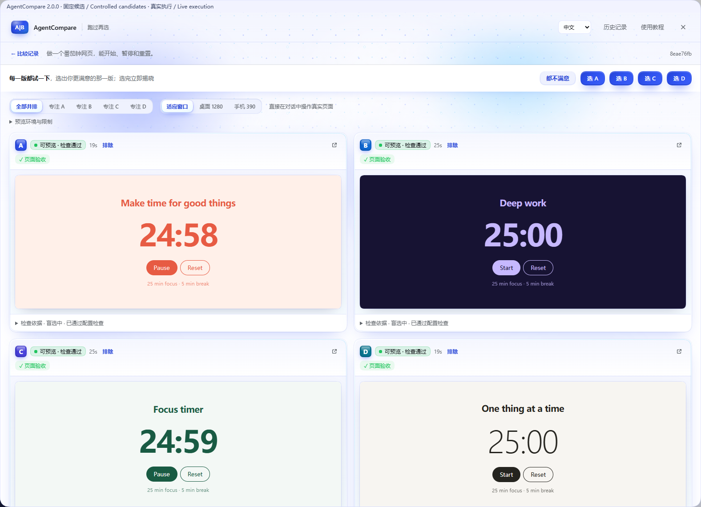
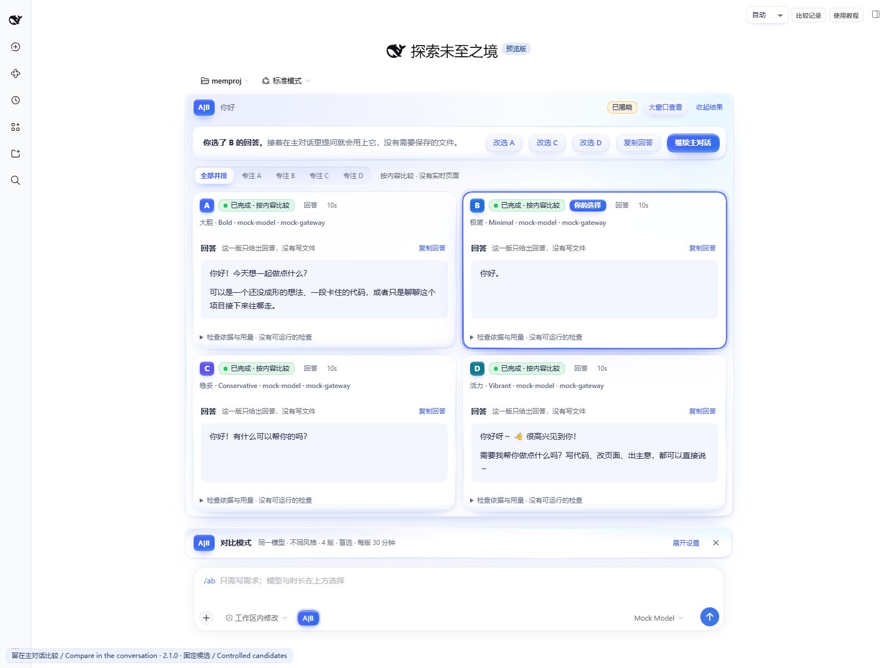
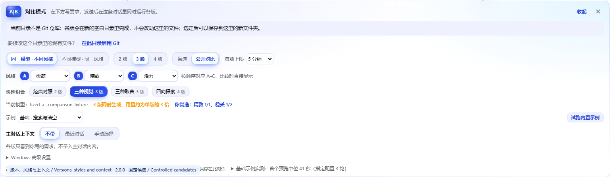
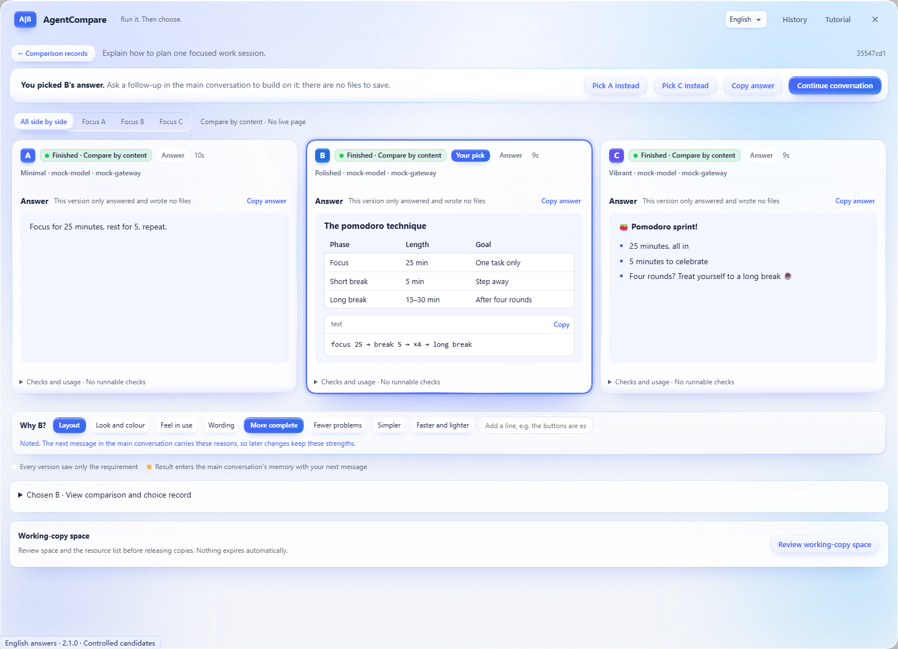
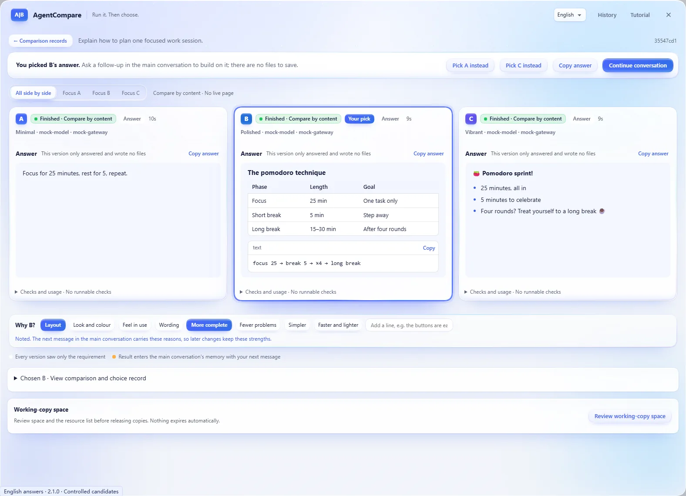
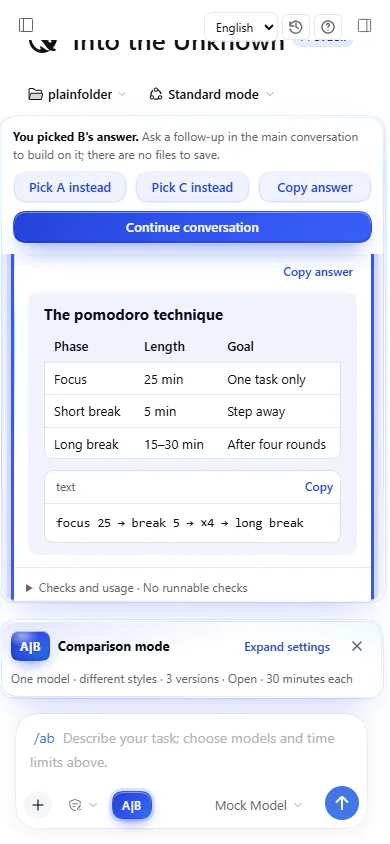
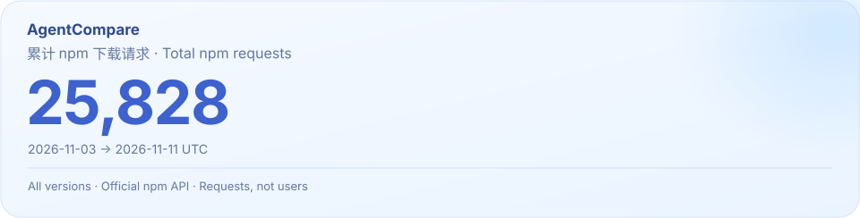

[](#install)

# AgentCompare

[](https://github.com/lijiaqi-AI-Product-Manager/dsh-agent-compare/stargazers)
[](https://www.npmjs.com/package/dsh-agent-compare)

[](https://github.com/lijiaqi-AI-Product-Manager/dsh-agent-compare/blob/main/package.json)
[](https://www.npmjs.com/package/dsh-agent-compare)
[](https://github.com/lijiaqi-AI-Product-Manager/dsh-agent-compare/actions/workflows/ci.yml)
[](https://github.com/lijiaqi-AI-Product-Manager/dsh-agent-compare/blob/main/package.json)
[](https://github.com/lijiaqi-AI-Product-Manager/dsh-agent-compare/blob/main/docs/demo.md)
[](https://github.com/lijiaqi-AI-Product-Manager/dsh-agent-compare/blob/main/LICENSE)

[中文](https://github.com/lijiaqi-AI-Product-Manager/dsh-agent-compare/blob/main/README.md) · [English](https://github.com/lijiaqi-AI-Product-Manager/dsh-agent-compare/blob/main/README.en.md) · [日本語](https://github.com/lijiaqi-AI-Product-Manager/dsh-agent-compare/blob/main/README.ja.md) · [한국어](https://github.com/lijiaqi-AI-Product-Manager/dsh-agent-compare/blob/main/README.ko.md) · [Español](https://github.com/lijiaqi-AI-Product-Manager/dsh-agent-compare/blob/main/README.es.md) · **Português (Brasil)** · [Français](https://github.com/lijiaqi-AI-Product-Manager/dsh-agent-compare/blob/main/README.fr.md) · [Deutsch](https://github.com/lijiaqi-AI-Product-Manager/dsh-agent-compare/blob/main/README.de.md)

**Uma tarefa. De 2 a 4 implementações em execução. Escolha estilos, compare às cegas ou abertamente e aplique.**

**DSH 桌面端 + 浏览器 / Desktop + Web**

<p align="center"><a href="#install">安装 / Install</a> · <a href="#demo">真实演示 / Recorded demo</a></p>

> **2.1.0 · Versão estável.** DSH Desktop e Web, com interface em chinês e inglês. Compare respostas, arquivos ou páginas web na conversa principal a partir de qualquer pasta, reutilizando os modelos configurados.

**Novidades da versão 2.1.0:**
- **Vidro líquido mais claro e luminoso.** O azul ficou mais claro; a área de trabalho fica um nível abaixo do vidro, com luz suave vinda de cima. O vidro tem três espessuras (fino, grosso e quase sólido), com borda brilhante e um toque de ciano e lilás nas arestas; só a barra de ações flutuante desfoca o que está atrás.
- **Botões e texto mais leves.** O azul sólido fica reservado para a ação principal, a opção escolhida e as letras das versões; os demais botões são de vidro azul-claro com texto azul em peso normal.
- **Controles que deslizam.** O filtro "Needs attention only" do histórico é um interruptor deslizante; os controles segmentados ficam em uma ranhura, e escolher uma opção não desloca mais as vizinhas. Caixas de seleção e listas usam o mesmo estilo de vidro.
- **Legível em todo lugar.** Contraste medido glifo a glifo em 19 estados da interface por tema: todo texto tem pelo menos 4.5:1. Versões lado a lado têm a mesma altura.

**Novidades da versão 2.0.0:** compare **2, 3 ou 4 versões** de uma vez. Cada versão pode ter um **estilo** (alcance: conservador, ousado; aparência: minimalista, refinado, vibrante; prioridade: amigável, rigoroso, leve; ou uma linha própria). Compare **às cegas** (estilos revelados na escolha) ou **abertamente** (estilos visíveis desde o início). Com três ou quatro versões, **deixe de lado** as que descartou para comparar o restante lado a lado; no cartão, as teclas 1–4 focam uma versão.
- **Nova interface de vidro líquido azul.** Aurora e poeira estelar atrás de painéis de vidro, uma lente de vidro que desliza entre as opções e progresso líquido; um brilho ao escolher e uma faixa de luz ao revelar. Suporta modo escuro, movimento reduzido e alto contraste.
- **Diga por que venceu.** Depois da escolha, marque alguns motivos (layout, cor e acabamento, sensação de uso…) ou escreva uma linha; as mudanças seguintes na conversa principal mantêm esses pontos fortes.
- **Combinações rápidas.** Um toque define o número de versões e os estilos: Par clássico, Três visuais, Três prioridades, Quatro direções.
- **2–4 versões com estilos.** Oito estilos prontos ou uma descrição em uma linha; modelos diferentes podem usar o mesmo estilo.
- **Comparação cega ou aberta.** Experimente, separe e restaure versões; 1–4 foca uma versão e 0 mostra todas.
- **Respostas, arquivos e páginas reais.** Leia Markdown e copie respostas, código, conteúdos ou caminhos. Sua escolha fica marcada.
- **Continue na conversa.** Comparações, escolhas, adoção e desfazer ficam na memória da conversa atual.
- **Desktop + Web, interface em chinês e inglês.** Reutilize modelos configurados e revise antes de adotar, com desfazer e recuperação disponíveis.

AgentCompare é um plugin do [DeepSeek Harness](https://github.com/deepseek-ai/deepseek-harness), ou DSH. De 2 a 4 agentes trabalham em cópias independentes da mesma tarefa. O plugin instala dependências, compila, serve cada aplicação e executa critérios comuns de verificação. Você testa as páginas antes de escolher uma ou nenhuma; numa comparação às cegas, o modelo e o estilo são revelados na escolha. Antes de aplicar uma versão, ele verifica a combinação com o estado atual do seu projeto.

[插件目录与安装](https://github.com/lijiaqi-AI-Product-Manager/dsh-agent-compare/blob/main/docs/distribution.md) · [Plugin directories and installation](https://github.com/lijiaqi-AI-Product-Manager/dsh-agent-compare/blob/main/docs/distribution.en.md) · [Listing status / 收录状态](https://github.com/lijiaqi-AI-Product-Manager/dsh-agent-compare/issues/4)

[](https://raw.githubusercontent.com/lijiaqi-AI-Product-Manager/dsh-agent-compare/main/assets/readme/comparison-workflow.webp)

<p align="center"><sub>功能示意 / Product illustrations · <a href="#demo">查看真实演示 / Watch the recorded workflow</a></sub></p>

<a id="gallery"></a>

## Veja a interface atual

Capturas reais do DSH com candidatos controlados. A capa e o fluxo são ilustrações do produto.

<details>
<summary>Open four interface views / 展开实际界面</summary>









</details>

[As 8 imagens e as condições de captura](https://github.com/lijiaqi-AI-Product-Manager/dsh-agent-compare/blob/main/docs/storefront-gallery.md)

<a id="demo"></a>

## Veja o fluxo completo

[](https://github.com/lijiaqi-AI-Product-Manager/dsh-agent-compare/blob/main/docs/media/comparison-workflow.mp4)

Gravação com candidatos fixos em um host DSH real, a partir do código candidato da 2.0.0, com interface em chinês. Quatro versões criam uma página pomodoro numa pasta comum, e as quatro páginas ao vivo podem ser usadas. Duas são deixadas de lado, o restante fica lado a lado, a escolha revela cada estilo e o resultado é salvo numa pasta nova antes de continuar a conversa. O vídeo corta a espera e mantém o restante em velocidade normal. Caminhos locais estão ocultos.

Depois da escolha, dois motivos (layout e mais simples) são marcados e chegam ao próximo pedido da conversa principal.

[Vídeo completo (13 segundos)](https://github.com/lijiaqi-AI-Product-Manager/dsh-agent-compare/blob/main/docs/media/comparison-workflow.mp4) · [Condições e resultados](https://github.com/lijiaqi-AI-Product-Manager/dsh-agent-compare/blob/main/docs/demo.md)

<details>
<summary>English answers · 390 px</summary>

<p align="center"> </p>

</details>

<a id="install"></a>

## Instalação

A interface está disponível em chinês simplificado e inglês, selecionáveis no DSH Desktop e Web.

Os comandos abaixo são para um perfil DSH Web gerenciado pelo usuário. O perfil `desktop` é gerenciado pelo aplicativo de desktop; use a página de plugins do aplicativo.

A referência de desenvolvimento é Node 26.13.0 com npm 12.2.2. As verificações atuais usam o pacote oficial DSH 0.2.1-rc.5. Identifique o perfil que você já utiliza no DSH.

Instale o pacote npm no perfil Web padrão. O selo do npm indica o estado de publicação:

```bash
dsh plugin --profile web add dsh-agent-compare@2.1.0
```

Para outro perfil gerenciado por você, substitua `web` pelo nome real.

Também é possível compilar e instalar a partir do código-fonte:

```bash
git clone https://github.com/lijiaqi-AI-Product-Manager/dsh-agent-compare.git
cd dsh-agent-compare
npm ci
npm pack
```

Substitua `<your-profile>` pelo nome real do seu perfil:

```bash
dsh plugin --profile <your-profile> add ./dsh-agent-compare-2.1.0.tgz
```

Reinicie o DSH. Antes de atualizar, finalize as comparações ativas e feche instâncias antigas que usam os mesmos registros. Não há suporte a alterações simultâneas por versões diferentes do plugin.

## Primeira comparação

1. Clique em **A|B** no canto inferior esquerdo da caixa de conversa. Os ajustes aparecem acima do campo existente.
2. O padrão usa o modelo atual com duas estratégias, sem exigir uma segunda conta. No modo de dois modelos, escolha entre os modelos já configurados no DSH.
3. Escolha na interface o limite de geração de cada versão: 5–120 minutos, com padrão de 30. Escreva apenas o pedido e envie. Não é necessário digitar parâmetros.
4. O cartão da conversa mostra o progresso e as duas aplicações interativas. Há visualização de desktop e celular, foco em A ou B e uma janela maior.
5. Use `选 A`, `选 B` ou `都不满意` para escolher A, B ou nenhuma. Depois aparecem a estratégia ou o modelo real, as verificações e o uso informado.
6. Em `审查并采用`, confira o repositório de destino e as condições de aplicação. Uma confirmação separada escreve os arquivos. `继续主对话` encerra o modo de comparação e volta ao campo original.

`试跑内置示例` cria um repositório separado com uma loja de exemplo, sem alterar seu projeto. A aplicação do resultado também ocorre nesse exemplo. `比较记录` abre o histórico e `使用教程` abre o guia, tanto em conversas novas quanto existentes.

## Quando vale comparar

Busca e filtros, formulários, páginas de apresentação, painéis e reformulação de componentes: tarefas em que usar o resultado ajuda a julgar sua qualidade. Para um bug com resposta clara ou uma refatoração mecânica, um agente com testes costuma ser mais adequado.

Com um modelo, uma estratégia preserva a estrutura e a outra reconsidera a interação. Com dois modelos, mantêm-se pedido, instruções e verificações. As duas versões partem do mesmo código. Uma escolha não determina qual modelo é melhor em geral.

## Execução e verificação comum

Em um repositório Git, mesmo sem commits, um index privado registra alterações sem commit e arquivos não rastreados, exceto os excluídos. Em uma pasta fora do Git, as duas versões começam em um espaço de trabalho privado e vazio, e a escolhida pode ser salva em uma nova subpasta. O HEAD e o index originais são preservados. Cada versão tem seu worktree e sua sessão; a diferença é guardada como patch binário com hash.

As verificações vêm da base: `typecheck`, `lint`, `test`, `build` e a verificação de página configurada. Havendo lockfile, a instalação é congelada; uma falha não provoca nova tentativa sem congelamento. Alterar testes ou configurações para fazer uma versão passar não é uma aprovação válida para aplicação direta.

Um [`.agent-compare.json` na raiz](https://github.com/lijiaqi-AI-Product-Manager/dsh-agent-compare/blob/main/examples/vite-react-demo/.agent-compare.json) permite definir ações e expectativas comuns: preencher, clicar, conferir texto, visibilidade, quantidade e tamanho da tela. A definição é validada antes da geração. Se uma aceitação explícita de página não rodar, a aplicação direta é bloqueada. Se apenas a checagem básica de carregamento não puder rodar, isso aparece como aviso. Resposta HTTP, compilação, funcionamento e preferência pessoal são resultados diferentes.

## Aplicação, desfazer e recuperar

O plugin combina seu estado atual com os caminhos alterados pela versão escolhida. Sobreposições detectadas interrompem a aplicação. Se você mudou outros arquivos, a combinação passa por um ensaio em uma cópia temporária. Antes de escrever, conteúdo, HEAD e index são conferidos novamente, e um registro de recuperação é salvo.

A aplicação na árvore de trabalho não faz commit, push nem troca de branch automaticamente. Arquivos novos, removidos e binários fazem parte da diferença. Uma versão que não atende aos critérios pode ser salva em uma branch para análise. Ao desfazer ou recuperar uma interrupção, edições posteriores detectadas são mantidas como conflitos.

O bloqueio do repositório coordena operações do plugin; ele não bloqueia o editor. Pause as edições durante a breve etapa de escrita.

## Histórico e estado das páginas

O histórico começa com todas as conversas, com filtro da conversa atual, busca por pedido, repositório ou identificador e páginas de 30 registros. Resultado, escolha e aplicação são preservados. As notas são entregues à mesma conversa, com novas tentativas se ela estiver indisponível. Logs longos não são inseridos integralmente no contexto principal.

Registros antigos ou danificados permanecem somente para leitura, com explicação. Depois de reiniciar, capturas salvas são identificadas como imagens estáticas. Se a cópia ainda existe, a prévia pode ser reaberta. Cada abertura usa um endereço `.localhost` novo, separando cookies e armazenamento por origem entre as versões. O estado temporário da página é reiniciado; registros e capturas continuam disponíveis.

## Compatibilidade e limites

Um worktree não é uma barreira completa de segurança. O plugin usa a política de escrita do DSH; no Windows, a proteção é informada como **partial**. Leituras de arquivos e rede não são isoladas. Cookies em páginas incorporadas seguem a política do navegador, e uma aba externa pode ter outro contexto de armazenamento. Login, backends externos e bancos de dados compartilhados ficam fora do escopo atual.

Os testes nativos cobrem Windows, Linux e macOS. A [matriz detalhada](https://github.com/lijiaqi-AI-Product-Manager/dsh-agent-compare/blob/main/README.en.md#compatibility) distingue as combinações verificadas de npm, pnpm e Yarn e as limitações de Windows/PnP. O Safari nativo é validado separadamente; respostas controladas dos testes não medem a qualidade nem o desempenho de modelos externos.

## Tempo, custo e evidências

Cada versão consome geração; paralelismo não garante economia de tempo ou dinheiro. É possível parar uma ou ambas. Quando o limite termina, o plugin verifica o que já foi escrito. Uso não informado aparece como desconhecido, nunca como custo zero.

A [CI](https://github.com/lijiaqi-AI-Product-Manager/dsh-agent-compare/actions/workflows/ci.yml) cobre Windows/Linux, Node e navegador. Parte das integrações atuais usa um adaptador local de respostas fixas, com sessões, ferramentas e aplicações reais. Isso demonstra execução, sem medir a qualidade de um modelo externo. Os casos históricos com modelos reais são do DSH 0.2.1-rc.3 e não devem virar ranking ou promessa de desempenho.

## Contribuição e licença

Ao abrir uma [Issue](https://github.com/lijiaqi-AI-Product-Manager/dsh-agent-compare/issues), informe versões, sistema, passos e resultados esperados e observados. Não publique credenciais, código privado ou caminhos locais completos. Consulte [CONTRIBUTING.md](https://github.com/lijiaqi-AI-Product-Manager/dsh-agent-compare/blob/main/CONTRIBUTING.md) e [CHANGELOG.md](https://github.com/lijiaqi-AI-Product-Manager/dsh-agent-compare/blob/main/CHANGELOG.md).

```bash
npm ci
npm run typecheck
npm test
npm run test:ui
```

Licença [MIT](https://github.com/lijiaqi-AI-Product-Manager/dsh-agent-compare/blob/main/LICENSE). Se o resultado for útil, você pode apoiar com uma Star ou um caso reproduzível. Compartilhar e dar Star são decisões opcionais.

<!-- project-growth:start -->

## Crescimento do projeto

**Aviso de manutenção:** Segundo o mantenedor, a manutenção, as melhorias e as correções de 11 de novembro UTC incluíram a retirada temporária da maioria dos mercados, reduzindo a distribuição e as solicitações naquele dia. [Aviso de manutenção e distribuição (inglês)](https://github.com/lijiaqi-AI-Product-Manager/dsh-agent-compare/blob/main/docs/maintenance-update-2026-11-11.en.md).

<a href="https://www.npmjs.com/package/dsh-agent-compare">
<picture>
  <source media="(max-width: 600px) and (prefers-color-scheme: dark)" srcset="https://raw.githubusercontent.com/lijiaqi-AI-Product-Manager/dsh-agent-compare/main/assets/statistics/npm-total-mobile-dark.svg">
  <source media="(max-width: 600px)" srcset="https://raw.githubusercontent.com/lijiaqi-AI-Product-Manager/dsh-agent-compare/main/assets/statistics/npm-total-mobile-light.svg">
  <source media="(prefers-color-scheme: dark)" srcset="https://raw.githubusercontent.com/lijiaqi-AI-Product-Manager/dsh-agent-compare/main/assets/statistics/npm-total-dark.svg">
  
</picture>
</a>

Solicitações acumuladas do npm desde a primeira publicação, em todas as versões públicas. O cartão informa a data de corte; pode incluir acessos repetidos ou automatizados.

[Definição do total e atualização automática](https://github.com/lijiaqi-AI-Product-Manager/dsh-agent-compare/blob/main/docs/npm-total-downloads.md)

<!-- project-growth:end -->
