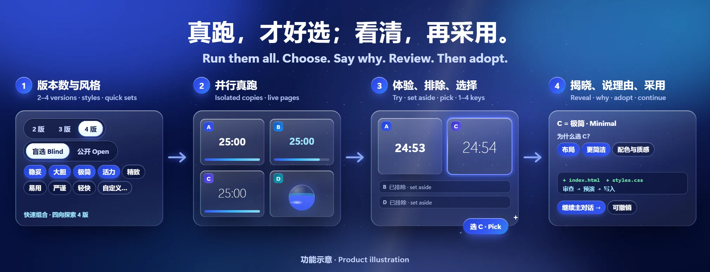
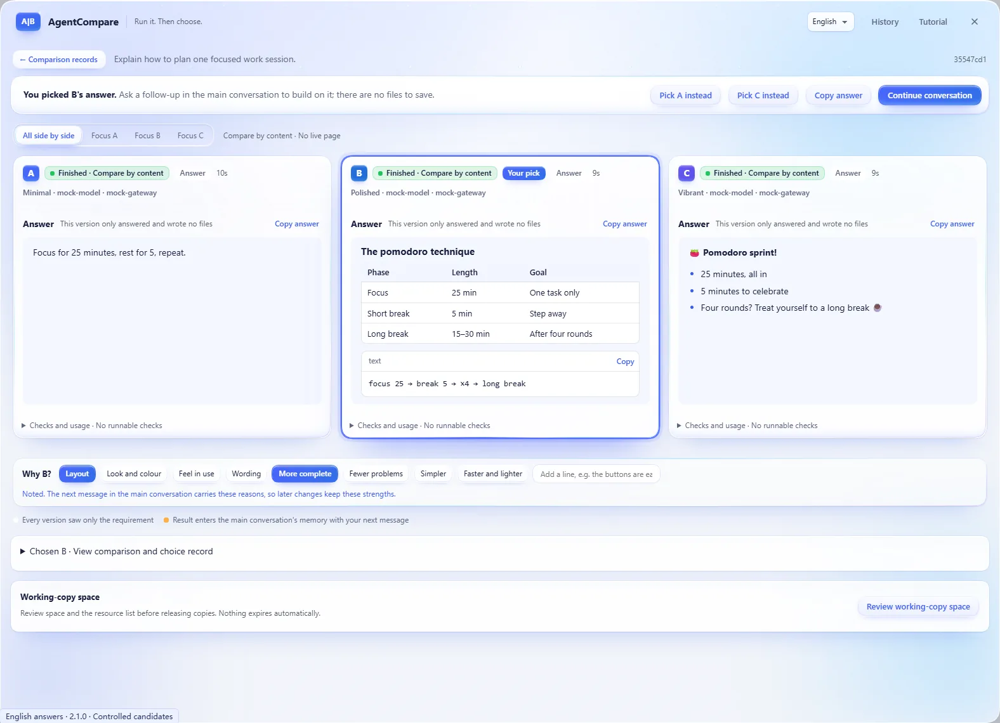

[](#demo)

<div align="center">

<a id="agentcompare"></a>
<a id="agent-compare-dsh-agent-compare--鲸挑细选"></a>

# AgentCompare · 鲸挑细选

[](https://github.com/lijiaqi-AI-Product-Manager/dsh-agent-compare/stargazers)
[](https://www.npmjs.com/package/dsh-agent-compare)
[](https://dshmarket.com/categories/workflow/)

[](https://www.dsh.so/artifact/dsh-agent-compare/)
[](https://www.dsh.so/artifact/dsh-agent-compare/)

[](https://www.npmjs.com/package/dsh-agent-compare)
[](https://github.com/lijiaqi-AI-Product-Manager/dsh-agent-compare/actions/workflows/ci.yml)
[](https://github.com/lijiaqi-AI-Product-Manager/dsh-agent-compare/blob/main/LICENSE)
[](https://github.com/lijiaqi-AI-Product-Manager/dsh-agent-compare/blob/main/docs/demo.md)

<sub><a href="https://github.com/lijiaqi-AI-Product-Manager/dsh-agent-compare/blob/main/docs/npm-total-downloads.md">Ölçüm ve sıralama kaynakları</a></sub>

[中文](https://github.com/lijiaqi-AI-Product-Manager/dsh-agent-compare/blob/main/README.md) · [English](https://github.com/lijiaqi-AI-Product-Manager/dsh-agent-compare/blob/main/README.en.md) · [日本語](https://github.com/lijiaqi-AI-Product-Manager/dsh-agent-compare/blob/main/README.ja.md) · [한국어](https://github.com/lijiaqi-AI-Product-Manager/dsh-agent-compare/blob/main/README.ko.md) · [Español](https://github.com/lijiaqi-AI-Product-Manager/dsh-agent-compare/blob/main/README.es.md) · [Português (Brasil)](https://github.com/lijiaqi-AI-Product-Manager/dsh-agent-compare/blob/main/README.pt-BR.md) · [Français](https://github.com/lijiaqi-AI-Product-Manager/dsh-agent-compare/blob/main/README.fr.md) · [Deutsch](https://github.com/lijiaqi-AI-Product-Manager/dsh-agent-compare/blob/main/README.de.md) · **Türkçe**

**Tek bir fikir. Onu hayata geçirmenin daha fazla yolu.**

**鲸挑细选 · AgentCompare**, [DeepSeek Harness](https://github.com/deepseek-ai/deepseek-harness) (DSH) için `dsh-agent-compare` olarak kurulan bir karşılaştırma eklentisidir. Ana sohbette tek bir görev gönderin; 2–4 yanıtı, dosyayı veya çalıştırılabilir sayfayı karşılaştırın, ardından fikrinize en uygun sürümü seçip saklayın. Çince ve İngilizce arayüzlerle **DSH Desktop + Web** üzerinde çalışır.

<p align="center"><a href="#demo">45 saniyelik demoyu izle</a> · <a href="#install">Desktop veya Web'e kur</a> · <a href="#support">Uyumluluğu kontrol et</a></p>

<a id="demo"></a>
<a id="watch-a-whole-big-fat-fish-race"></a>

</div>

## Karşılaştırmayı iş başında görün

[](https://github.com/lijiaqi-AI-Product-Manager/dsh-agent-compare/blob/main/docs/media/comparison-workflow.mp4)

Gerçek bir DSH ortamında kontrollü aday kaydı: balinalar ve canlı adımlar, etkileşimli sayfalar, gerekçeleriyle C seçimi, ardından sonucu kaydedip sohbete devam etme. Bekleme süreleri kesilmiştir; kalan görüntüler özgün hızında oynatılır.

[Tam video · 45 saniye](https://github.com/lijiaqi-AI-Product-Manager/dsh-agent-compare/blob/main/docs/media/comparison-workflow.mp4) · [Kayıt koşulları ve sonuçlar](https://github.com/lijiaqi-AI-Product-Manager/dsh-agent-compare/blob/main/docs/demo.md) · [Tam GIF](https://github.com/lijiaqi-AI-Product-Manager/dsh-agent-compare/blob/main/docs/media/comparison-preview.gif)

Bu ekran görüntüleri ve animasyonlar gerçek bir DSH ortamındaki kontrollü adayları gösterir. Gerçek arayüzü ve iş akışını sergilerler; model kalitesi ve zamanlama ayrıca açıklanmıştır.

[](https://raw.githubusercontent.com/lijiaqi-AI-Product-Manager/dsh-agent-compare/main/assets/readme/gallery-2.0/02-live-comparison.png)

Her yanıtın kendi sayfasıyla eşit konumda gösterildiği dört sayfanın tamamını doğrudan kullanın. Ortamın sağladığı düşünceleri ve araç çağrılarını incelemek için Adımlar'ı (Steps) açın.

<details>
<summary>Dört adım</summary>

[](https://raw.githubusercontent.com/lijiaqi-AI-Product-Manager/dsh-agent-compare/main/assets/readme/comparison-workflow.webp)

Sürümleri ve stilleri ayarla → paralel çalıştır → dene ve seç → incele ve devam et. İş akışı grafiği bir ürün illüstrasyonudur.

</details>

<a id="install"></a>

## Kurulum

### DSH Desktop

1. Uygulamada **Plugins → Add plugin** yolundan `dsh-agent-compare` eklentisini kurun.
2. **Plugins → Installed** altında AgentCompare'in etkin olduğunu kontrol edin, ardından DSH'ten tamamen çıkıp yeniden açın.
3. Ana mesaj yazma alanının sol altındaki **A|B** düğmesine tıklayın, sürümleri ve stilleri seçin, ardından görevinizi gönderin.

### Kendi barındırdığınız DSH Web

Arayüz dilleri: DSH Desktop ve Web içinde seçilebilen Basitleştirilmiş Çince ve İngilizce.

Bu komutlar kendi yönettiğiniz bir DSH Web profilini hedefler. Masaüstü uygulamasının `desktop` profili uygulama tarafından yönetilir; onun için Eklentiler sayfasını kullanın.

npm paketini varsayılan Web profiline kurun (yukarıdaki npm rozeti kayıt defteri durumunu gösterir):

```bash
dsh plugin --profile web add dsh-agent-compare
```

Kendi yönettiğiniz başka bir profil için `web` yerine profilin gerçek adını yazın.

**Güncellemeden sonra tamamen yeniden başlatın.** DSH Desktop'tan tamamen çıkıp yeniden açın. Web için ilgili DSH servisini yeniden başlatın ve sayfayı yenileyin. Yalnızca arayüzü yenilemek eski arka ucun çalışmaya devam etmesine yol açabilir; sürüm uyuşmazlığı durumunda artık yeniden başlatma uyarısı gösterilir.

<details>
<summary>Kaynak koddan derle ve kur</summary>

Veya kaynak koddan derleyip kurun:

```bash
git clone https://github.com/lijiaqi-AI-Product-Manager/dsh-agent-compare.git
```

```bash
cd dsh-agent-compare
npm ci
npm pack
```

```bash
dsh plugin --profile web add ./dsh-agent-compare-3.3.1.tgz
```

</details>

<a id="use"></a>

## İlk karşılaştırmanız

DSH'i yeniden başlattıktan sonra **sohbet yazma alanının sol altındaki A|B** seçeneğini etkinleştirin:

1. Mevcut giriş alanının üzerinde bir ayar şeridi açılır. **Tek model · farklı stiller** (varsayılan, mevcut modeli kullanır) veya **farklı modeller · tek stil** (her sürüm için yapılandırılmış bir model, hepsi aynı stilde) seçeneklerinden birini seçin.
2. 2, 3 veya 4 sürüm ve kör (blind) veya açık (open) karşılaştırma seçin. Tek modelde her sürüm için bir stil seçin veya tek satırda kendi stilinizi tarif edin. Şerit daha fazla sürümün daha fazla kullanım tükettiğini hatırlatır.
3. Sürüm başına üretim süresi sınırı (5–120 dakika) ve her sürümün göreceği **ana sohbet bağlamını** seçin: yok, son mesajlaşmalar (varsayılan 3) veya işaretlediğiniz mesajlar. Şerit alacakları sınırlı özeti gösterir ve kırpma varsa bunu belirtir. Ayarlar bu sohbet yeniden açıldığında da korunur.
4. Görevi özgün yazma alanına yazıp gönderin. Ek bayrak yazmanıza gerek yoktur. Mod değiştirmek yalnızca komut etiketini değiştirir; taslağı, referansları ve ekleri korur. Desteklenmeyen ek gönderimleri ortam tarafından reddedilirken özgün ekler korunur.
5. Sohbette **yanıtlar, dosyalar veya çalıştırılabilir web sayfaları** içeren kalıcı bir A|B kartı görünür. Canlı sayfalar tıklamayı ve yazmayı destekler. Sohbet zaman çizelgesi olmayan yeni bir sohbette aynı kayıt yazma alanının üzerinde görünür. Uyarlanabilir görünümler doğrudan etkileşimi destekler. Masaüstü/telefon boyutları mevcuttur ve tek bir sürüme odaklanabilirsiniz (kartta 1–4 tuşları, tümü için 0). Üç veya dört sürümde elediklerinizi **Kenara ayır (Set aside)** ile kaldırıp kalanları yan yana getirebilirsiniz. Daha yakından incelemek için kartı genişletin.
6. Bir sürüm veya **Hiçbiri (None of these)** seçin. Kör seçimde modeller ve stiller açığa çıkar; açık karşılaştırmada baştan görünürler. Kontrollerden geçen proje değişiklikleri için **İncele ve uygula (Review and adopt)**, ayrı bir yazma onayından önce hedefi, farkları ve ön kontrolleri gösterir. Git dışında yeni bir klasöre kaydedilir. Yanıtlar dosya uygulaması gerektirmez. **Sohbete devam et (Continue conversation)**, seçimi ve kurtarma kaydını koruyarak yazma alanına döner.

Örnek seçici daha küçük bir arama-ve-temizleme senaryosu veya tam filtreleme/mobil senaryosu sunar ve seçiminizi hatırlar. Aynı sohbette ilgisiz taslakları koruyarak ayrı bir depo oluşturur; uygulama bu örnek depoyu hedefler. Her sürüm yapılandırılmış gerçek modeli kullanır ve kullanım tüketir. Daha küçük kapsam sabit süre garantisi değildir. [Örnek kapsamı ve zamanlama](https://github.com/lijiaqi-AI-Product-Manager/dsh-agent-compare/blob/main/docs/first-use.md).

Yeni veya mevcut sohbetlerin sağ üstündeki **karşılaştırma kayıtları** ve **eğitim** seçeneklerini kullanın. Geçmiş; görevi, kontrolleri, seçimi, uygulamayı ve geri almayı saklar. Ön izlemeler durduğunda doğrulama ekran görüntüleri erişilebilir kalır.

[Kayıtlar, yeniden başlatmalar ve kurtarma](https://github.com/lijiaqi-AI-Product-Manager/dsh-agent-compare/blob/main/docs/runs-and-recovery.en.md) · [Desteklenen kapsam](#uyumluluk) · [Özel kabul kuralları](#depo-kabulü-agent-comparejson)

Sonuçlar, seçiminiz, uygulama ve geri alma bu sohbetin belleğine girer. Ardından karşılaştırmanın nasıl gittiğini sorabilir veya uygulanan sürüm üzerinde çalışmaya devam edebilirsiniz. Açıklamadan sonra ve uygulamadan önce tamamlanmış başka bir sürüme geçebilirsiniz; hiçbiri kullanılabilir değilse **Tekrar karşılaştır (Compare again)** seçeneğini kullanın. Bkz. [sohbet belleği ve bağlam](docs/conversation-memory.md#english).

[Windows süreç uyumluluk ayarları](docs/windows-process-compat.en.md), ortam kısıtlamasını koruyan otomatik/kapalı kontroller sunar ve açıklama sonrasında gözlemlenen kancaları gösterir.

1.3.0 sürümüyle A|B herhangi bir klasörde çalışır. DSH varsayılan çalışma alanı dahil Git dışındaki bir klasör, her sürümün sayfalarını, dosyalarını veya yanıtlarını boş bir klasörden karşılaştırır ve seçimi orada yeni bir klasöre kaydeder. Alt klasör projeleri, Vite olmayan Node projeleri ve statik siteler de desteklenir. Bkz. [klasörler ve proje türleri](docs/workspaces-and-projects.md#english).

<a id="ui"></a>
<a id="gallery"></a>

## Arayüz ve deneyim

Telefonda modu, sürüm sayısını ve kör ya da açık karşılaştırmayı seçin. Projeyi ve paylaşılan bağlamı kontrol edip sohbete yazın. Stiller, süre sınırları ve yerleşik örnek için Daha fazla ayar'ı açın. Bir karşılaştırmaya geri döndüğünüzde ayarları açmak önceki sonucu katlar. Aynı sayfalar ve taslakla devam etmek için yeniden açın.

Kısa pencerelerde taslak ve Gönder düğmesi görünür kalırken ayarlar panelini kaydırabilirsiniz. Alçak yatay pencerelerde seçenekleri değiştirmek için Ayarları genişlet'i kullanın.

`/ab` yazarken seçenek adlarından söz eden bir istemden önce `--` koyun. Örneğin `/ab --versions 2 -- Explain the --example option` iki açıklama ister.

Geniş ekranda canlı ön izlemeleri aynı başlangıç yüksekliğine getirmek için Sayfaları hizala'yı seçin. Özgün düzeni geri yüklemek için tekrar seçin. Ön izlemeye yazılan her şey yerinde kalır.

Mobilde stili renk örneğinden seçin. Masaüstünde her sürümün az önce ne yaptığını görmek için adımları açın. Kör karşılaştırmalar seçiminizden sonra modeli ve stili gösterir. Değişiklikleri uygulamadan önce her dosyayı satır numaralarıyla inceleyin.

<details>
<summary>3.3.0 arayüzünü görün</summary>


</details>

- **Mavi sıvı cam.** Ayrı cam yüzeyler ayarları, adayları ve incelemeyi birbirinden ayırır. Azaltılmış hareket etkinken seçimler ve açıklamalar doğrudan geçiş yapar.
- **Kocaman bir Balina size eşlik eder.** Her sürüm için mavi bir DeepSeek balinası ilerledikçe mavi suyla dolar, iki ışık kenarını izler. Başının üstünde düşünceler yükselir; dürttüğünüzde yanıt verir, dürtmeye devam ederseniz döner, sallanır ve su sıçratır.
- **En son adımla başlayın.** Kart başlığı üretim sırasında en son eylemi gösterir. Kaydedilen düşünceleri, araç çağrılarını ve mevcut süreleri okumak için Adımlar'ı açın.
- **Yanıt ve sonuç yan yana.** Bir yanıt tek başına durur; bir sayfa kartı yanıtıyla paylaşır ve odaktayken yanıt sayfanın solunda yer alır.
- **A–D için dört mavi tonu.** Kör karşılaştırmada yalnızca A–D görürsünüz; stiller ve modeller seçimin ardından kartlar boyunca geçen bir ışık dalgasıyla açığa çıkar.
- **Çalıştığını anlamak kolay.** Çalışan bir karşılaştırmanın etrafında iki kuyruklu yıldız yarışır ve her sayfa başladığı anda kullanılabilir.
- **Masaüstü, tarayıcı ve telefon genişlikleri**, Çince ve İngilizce arayüzlerle.

Adımlar yalnızca model ve ortamın sağladığı bilgileri içerir. Uzun kayıtlar başını ve sonunu korur; kısaltılan metinler işaretlenir ve kör seçimden önce stil adları maskelenir. Balinanın su seviyesi bir kalite puanı veya kesin tamamlanma yüzdesi değil, bir işlem aşamasını temsil eder.

[](https://raw.githubusercontent.com/lijiaqi-AI-Product-Manager/dsh-agent-compare/main/assets/readme/whale-closeup.webp)

<p align="center"><sub>Balina yakın çekimi: kontrollü adaylar; betikli model izlenebilmesi için adım başına 9 sn bekler; kırpılmış, diğer bölümler özgün hızındadır.</sub></p>

[](https://raw.githubusercontent.com/lijiaqi-AI-Product-Manager/dsh-agent-compare/main/assets/readme/gallery-2.0/05-saved-result.png)

Odaktayken yanıt sayfanın yanında durur. Seçim gerekçelerini saklayın, değişiklikleri kaydedin veya inceleyin, ardından aynı sohbete dönün.

<details>
<summary>Daha fazla gerçek görünüm: yanıtlar, ayarlar, İngilizce ve telefon genişliği</summary>

[](https://raw.githubusercontent.com/lijiaqi-AI-Product-Manager/dsh-agent-compare/main/assets/readme/gallery-2.0/03-main-conversation.png)

[](https://raw.githubusercontent.com/lijiaqi-AI-Product-Manager/dsh-agent-compare/main/assets/readme/gallery-2.0/04-comparison-settings.png)

[](https://raw.githubusercontent.com/lijiaqi-AI-Product-Manager/dsh-agent-compare/main/assets/readme/13-english-answers.webp)

<p align="center"><a href="https://raw.githubusercontent.com/lijiaqi-AI-Product-Manager/dsh-agent-compare/main/assets/readme/14-phone-answer.webp"></a></p>

</details>

[Daha fazla gerçek görünüm: yanıtlar, ayarlar, İngilizce ve telefon genişliği](https://github.com/lijiaqi-AI-Product-Manager/dsh-agent-compare/blob/main/docs/storefront-gallery.md)

<a id="tasks"></a>
<a id="what-it-is-for"></a>

## Ne işe yarar

| Göreviniz | Neyi karşılaştırırsınız |
|---|---|
| Bir yanıt, analiz veya metin | Farklı yaklaşımlar ve ifadeler; tek tıkla kopyalamayla yan yana biçimlendirilmiş. |
| Betikler, belgeler veya diğer dosyalar | Her sürümün ürettiği dosyalar ve yanıtlar; seçimi yeni bir klasöre kaydedin. |
| Sayfalar ve arayüz değişiklikleri | Çalıştırılabilir sayfaları deneyin, ortak kabul kontrollerini inceleyin, uygulamadan önce gözden geçirin. |

<details>
<summary>Model, stil ve görev seçimi ayrıntıları</summary>

Kalitenin kullanarak değerlendirildiği ve testlerin yalnızca bir şeyin teslim edilip edilmediğini söyleyebildiği arayüz ve etkileşim görevleri: arama ve filtreler, form akışları, açılış sayfaları, pano düzenleri, bileşen yenilemeleri. Tek bir doğru yanıtı olan hata düzeltmeleri ve yeniden düzenlemeler için tek ajan + testler daha uygundur.

Her iki mod da kör veya açık olarak 2–4 sürüm çalıştırır:

| Mod | Her sürüm için aynı | Farklı |
|---|---|---|
| Tek model · farklı stiller (varsayılan) | model, görev, kabul | stil (varsayılan olarak iki için Conservative + Bold, üç için + Minimal, dört için + Vibrant) |
| Farklı modeller · tek stil | görev, kabul, stil (varsayılan Balanced) | model (sürüm başına DSH'te yapılandırılmış bir model, tekrarsız) |

<a id="styles"></a>

Üç grupta sekiz stil. Her stil yine de görevin tüm gereksinimlerini karşılamak zorundadır:

| Grup | Stil | Bir sayfa veya proje değişikliği için | Bir yanıt veya yazılı dosyalar için |
|---|---|---|---|
| Yaklaşım | Conservative | Mevcut bileşenleri ve kalıpları yeniden kullan; en küçük değişiklik | Geleneksel ve doğrudan |
| | Bold | Düzeni ve etkileşimi yeniden düşün | Taze, yaratıcı bir açı |
| Görünüm | Minimal | Az öğe, bol boşluk, ilk bakışta anlaşılır | Yalnızca istenen kadar |
| | Polished | Profesyonel bitiş, net hiyerarşi, eksiksiz durumlar | Yapılandırılmış ve kapsamlı |
| | Vibrant | Renk, hareket ve karakter | Sıcak ton, canlı örnekler |
| Öncelik | Friendly | Yeni başlayan dostu, erişilebilir, mobil öncelikli | Adım adım, sade sözcükler |
| | Rigorous | Doğrulama, uç durumlar ve testler | Varsayımları belirtir, istisnaları kapsar |
| | Lean | Az kod, hızlı yükleme, bağımlılık yok | Olabildiğince kısa |

Özel stil en fazla 120 karakterlik tek satırlık bir açıklamadır. Her sürüme stil açıklaması olarak verilir ve görevi ya da kuralları değiştiremez. Bir stil birden fazla kez seçilebilir; bu, aynı özeti birkaç kez çalıştırır.

Kör karşılaştırma seçilen stilleri başlangıçta A–D arasında karıştırır ve seçimden sonra açıklar. Açık karşılaştırma onları A–D sırasıyla tutar ve karşılaştırırken gösterir.

</details>

<a id="support"></a>

## Destek ve pratik sınırlar

[](https://github.com/lijiaqi-AI-Product-Manager/dsh-agent-compare/blob/main/package.json)
[](https://github.com/lijiaqi-AI-Product-Manager/dsh-agent-compare/blob/main/package.json)

| Ortam ve kapsam | Doğrulama |
| --- | --- |
| Windows · DSH 0.2.2-rc.2 / rc.3 · Node 26.13.0 · 2026-11-18 | 3.2.0 Windows ortam testi kurulumu, komut kontrollerini ve bir Vite ön izlemesini kapsadı. |
| Edge 157 · 390 / 1440 px | [Yeni arayüzü örnek bir sohbetle Edge'de görün](#ui) |

- Canlı sayfalar çalıştırılabilir bir web projesi gerektirir; yanıtlar ve dosyalar da karşılaştırılabilir. Düz klasörler, depolar ve alt klasörler için proje rehberine bakın.
- Her sürüm model kullanımı tüketir. Süre ve maliyet göreve ve modele bağlıdır; paralel çalıştırmak daha düşük fatura veya daha kısa bekleme garantisi vermez.
- Uygulamadan önce inceleyin ve geri alma/kurtarma kayıtlarını koruyun. Bir çalışma kopyası tam bir sanal makine değildir: DSH yazma sınırını sağlar, okuma ve ağ erişimi yalıtılmamıştır ve Windows gerçek uygulama düzeyini raporlar.
- Git dışında sürümler boş kopyalardan başlar ve mevcut dosyaları okumaz. Mevcut içeriği değiştirmek için önce ayar şeridinde Git'i etkinleştirin. Sonuçlar yeni bir alt klasöre kaydedilir.

[Proje türleri ve düz klasörler](https://github.com/lijiaqi-AI-Product-Manager/dsh-agent-compare/blob/main/docs/workspaces-and-projects.md) · [Paket yöneticisi matrisi](https://github.com/lijiaqi-AI-Product-Manager/dsh-agent-compare/blob/main/docs/package-managers.md) · [Tam uyumluluk ve Safari sınırları](https://github.com/lijiaqi-AI-Product-Manager/dsh-agent-compare/blob/main/README.tr.md#uyumluluk)

[Eklenti dizinleri ve kurulum](https://github.com/lijiaqi-AI-Product-Manager/dsh-agent-compare/blob/main/docs/distribution.en.md) · [Listeleme ve inceleme durumu](https://github.com/lijiaqi-AI-Product-Manager/dsh-agent-compare/issues/4)

<a id="details"></a>

## İleri okuma: kontroller, kurtarma ve gelişmiş ayarlar

### Sizin için neler yapar

- Her sürüm, indeksinize veya dosyalarınıza dokunmadan, commit edilmemiş çalışmalar dahil **aynı temel noktadan (baseline)** başlar.
- Her aday, kendi kopyasını kök alan ortam yazma politikasını ister; ortamın uygulama sınırları açıkça bildirilir.
- Sürüm başına bağımsız bağımlılık dosyaları, kontroller ve ön izleme ortamları paralel çalışır; manifestosu değişmemiş uygun npm projeleri özel sıcak kurulumun bağımsız kopyalarını kullanabilir.
- **Tek bir sabit, içeriğe bağlı kabul**: test betiğini, yapılandırmaları veya mevcut testleri düzenleyen bir aday geçmiş sayılmaz.
- Uygulama, sonucu **o sırada yaptığınız diğer değişikliklerle birlikte** kontrol eder ve bekleyen bir yazmadan önce kontrol edilen hedef değişirse durur.

### Nasıl çalışır

1. **Temel nokta (Baseline)** — özel bir geçici indeks üzerinden çalışma ağacının anlık görüntüsü alınır (commit edilmemiş ve izlenmeyen dosyalar dahil, yok sayılanlar hariç).
2. **Bağlı kabul** — kontroller temel noktadan türetilir (`typecheck` / `lint` / `test` / `build` betikleri artı sayfa kontrolü) ve betik gövdeleri, doğrulama dosyalarının (`tsconfig*`, Vite/Vitest yapılandırması, lint yapılandırması, mevcut testler, `.agent-compare.json`) içerik özetleri, kilit dosyası ve çalışma zamanı kaydedilir. Commit edilmiş bir `.agent-compare.json` adım adım etkileşim kontrolleri ekleyebilir.
3. **Sahipli kopyalar** — eklenti ana dizini (`~/.dsh/agent-compare/w/<run>/<candidate>`) altında aday başına bir dalsız `git worktree` ve git yönetim dizininde bir sahiplik işareti.
4. **Aday oturumları** — her aday, çalışma dizini kendi kopyası olan ayrı bir DSH oturumudur. Oturum çalışmadan önce o kök için `workspace-write` ister; onaylar `never` olarak sabitlenir. Bu, aşağıda açıklanan platform sınırları dahil ortamın uygulamasını kullanır. Her birinin üretim süresi sınırı vardır (arayüzde 5 / 15 / 30 / 60 / 90 / 120 dakika, varsayılan 30). Süre dolduğunda ajan durdurulur ve yazdıkları yine de mühürlenip doğrulanır. Çalışırken karttaki **Adımlar** düşüncelerini, araç çağrılarını ve sözcüklerini canlı listeler ve ne kadar süredir sessiz olduğunu gösterir. Sırası kuyrukta hiçbir şey kalmadan bittiğinde tamamlanmış sayılır; oturumundaki diğer eklentilerin arka plan işleri beklenmez.
5. **Mühürleme (Seal)** — oturum kapatılır ve değişiklik bir commit artı tam ikili yama (SHA-256) olarak dondurulur; `node_modules` her zaman dışarıda bırakılır.
6. **Doğrulama (Verify)** — kopya mühürlü ağaca eşit → **dondurulmuş kurulum** (hata verirse başarısız olur; kilitsiz yeniden deneme yoktur) → kabul komutları (aynı anda en fazla üç) → **derleme çıktısını** `vite preview` ile sun → temiz bir başsız tarayıcı bağlamında sayfa kabulü (yüklenir, konsol hatası yok, betikli adımlar, masaüstü ve telefon ekran görüntüleri) → kopya hâlâ mühürlü ağaca eşit. Derleme başarısız olursa yalnızca "yalnızca gözlem için" işaretli bir geliştirme sunucusu ön izlemesi sunulur. Kabul sürerken sayfa sunulduğu anda kartta kullanılabilir.
   - Kilit dosyası olan, kök kurulum betiği ve yerel paketi bulunmayan bir npm projesinde temel noktanın manifestosu, sürümler üretilirken koşuma özel bir klasörde (`~/.dsh/agent-compare/d/<run>`) aynı dondurulmuş komutla bir kez kurulur. Manifesto dosyaları (`package.json`, kilit dosyası, `.npmrc`) bayt bazında aynı olan bir sürüm yeniden kurmak yerine bu sonucun kendi kopyasını alır; diğerleri eskisi gibi kurar. Tüm sürümler doğrulandığında klasör silinir.
   - Yukarıdaki derleme çıktısı sırası Vite'ı tanımlar. Diğer Node projeleri kendi geçerli betiklerini kullanır; düz statik sayfalar kurulum veya derleme gerektirmez. Yanıtlar ve dosyalar, çalıştırılmamış kontrolleri geçmiş gibi göstermeden içeriklerine göre karşılaştırılabilir.
7. **Karar (Verdict)** — uygulama için hatasız ve zaman aşımısız kayıtlı kontroller, değişmemiş doğrulama tanımları ve mühürlü ağaçla eşleşen doğrulanmış bir ağaç gerekir. Çalıştırılmamış bir betikli sayfa kabulü doğrudan uygulamayı engeller. Atlanan temel sayfa yükleme kontrolü doğrulanmış bir kontrol değil, açık bir uyarı olarak kalır. Bağımlılık değişiklikleri ve eksik kilit dosyaları da bildirilir.
8. **Seçim (Pick)** — 2–4 kart yanıtları, dosyaları veya bir sayfa mevcutsa bağımsız iframe'lerle canlı sayfaları gösterir. Kör karşılaştırmalar onları A–D olarak etiketler ve başlangıçta stilleri karıştırır; seçim stilleri, gerçek modelleri ve mevcut kullanımı açığa çıkarır. Açık karşılaştırmalar bunları baştan gösterir. Geçerli kontrol sonuçları seçiminizin kontrollerin öne çıkardığıyla eşleşip eşleşmediğini gösterir.
9. **Uygulama (Adopt)** (yalnızca uygulanabilir adaylar için):
   - Çalışma ağacınızın alacağı kesin ağacı hesapla: mevcut dosyalarınız artı adayın dokunduğu yollar. Temel noktadan bu yana o yollardan herhangi birini düzenlediyseniz dur — hiçbir şey yazılmaz.
   - Bu arada başka dosyaları değiştirdiyseniz o birleşimi tam kabulle geçici bir kopyada **prova et**; başarısız olursa dur — hiçbir şey yazılmaz.
   - Provadan sonra ve her dosya yazma veya silme işleminden önce çalışma ağacını, HEAD'i ve sahnelenmiş (staged) girdileri yeniden kontrol et. Algılanan bir değişiklik uygulamayı durdurur; sonraki kullanıcı düzenlemelerini korumak için yalnızca daha önce denenen yollar geri alma için değerlendirilir.
   - İlk yazmadan önce bir kurtarma günlüğü (uygulama öncesi anlık görüntü, beklenen ağaç, HEAD ve sahnelenmiş durum parmak izleri) kaydet ve bir depo kilidi tut.
   - Aday baytlarını deponun eol/filtre ayarlarıyla hazırla, özgün dosyaları koru ve mevcut bir yolun üzerine yazamayan bağlantılarla yayınla. Devir sınırındaki bir düzenleme veya yeni dosya, her iki içeriği de koruyarak işlemi durdurur. Çalışma ağacının **prova edilen ağaca eşit olduğunu** ve HEAD ile indeksin değişmediğini doğrula. Hiçbir şey commit edilmez.
   - Başarısız bir yazma otomatik olarak geri alınır; kesintiye uğrayan bir yazma panel bir sonraki açılışında kurtarma için sunulur. O dosyaları düzenlemediğiniz sürece daha sonra Geri Al (Undo) kullanılabilir (düzenlenenler listelenir, asla üzerine yazılmaz).
   - Geçemeyen bir aday yalnızca inceleme için bir dal (tek commit, dal değişikliği yok) olarak kaydedilebilir.
10. **Devam et (Continue)** — başarılı bir uygulamadan sonra kopyalar ve ön izlemeler serbest bırakılır ve panel "bu sonuçtan devam et" seçeneğini sunar: bir sonraki görev az önce uyguladığınız durumdan başlar. Geçmiş ayrı olarak gezilir.

### Yalıtım ve güvenlik: ne garanti edilir, ne edilmez

Aday mühürleme ve doğrulama, sahipli Git yönetimini özgün depodan çözümler, karşılıklı bağlantıları ve sahiplik işaretlerini kontrol eder ve açık Git dizini/worktree argümanları kullanır. Değişmiş, bağlantılı, aşırı büyük veya eksik işaretçi üst verileri daha fazla yakalamayı veya ön izlemeyi yeniden açmayı engeller; belirsiz kopyalar temizlik sırasında saklanır. Ortamdaki Git depo/indeks/yapılandırma seçicileri yok sayılırken kasıtlı özel indeksler desteklenmeye devam eder. Bu kontroller yaşam döngüsü işlemlerini Git işaretçi yönlendirmesinden korur; proje süreçlerinden ortam korumalı alanı sorumludur.

| Alan | Nasıl | Sınır |
|---|---|---|
| Aday yazmaları | Aday oturumunun dizini kendi kopyasıdır; DSH korumalı alanı bunu baştan uygular | DSH, Windows korumalı alanını kısmi olarak işaretler; platform geçici alanları yazılabilir olabilir |
| Proje komutları | Kurulum, kontroller, ilk ön izleme ve yeniden açılan ön izleme ortamın `workspace-write` politikasını kullanır; alt ortam değişkenleri kanonik temizlikten geçer | Eksik kısıtlama, kısıtlamasız yeniden deneme olmadan başarısız olur. Kısmi uygulama kaydedilir ve gösterilir; bu okuma veya ağ yalıtımı değildir |
| Projeniz | Adaylar çalışırken temel noktayla karşılaştırılır ve panelde gösterilir | Farklar kaynağını atfetmeden raporlanır; uygulama çakışma kontrolü yapar |
| Eşzamanlı düzenleme | Çalışma ağacını ve ham dosya parmak izlerini kontrol eder, üzerine yazmasız bağlantılarla yayınlamadan önce özgün dosyaları korur ve geri alma ile kurtarma sırasında çakışan içeriği saklar | Depo kilidi harici düzenleyicileri kilitlemez. Devir dosya bazındadır; etkilenen yolları düzenlemeden veya dizinleri yeniden düzenlemeden önce bekleyin. Bu aynı yetkiye sahip süreçlere karşı bir korumalı alan değildir |
| Kabul | Betik gövdeleri, yapılandırmalar ve test dosyaları özetle (hash) bağlıdır; kopya öncesinde ve sonrasında kontrol edilir | Otomatik kontrol edilemeyen gereksinimler size bırakılır, asla doğrulanmış gibi gösterilmez |
| Bağımlılıklar | Kilit dosyası varsa dondurulmuş kurulum veya aynı manifestolarla özel dondurulmuş kurulumun bağımsız kopyası | Kilit dosyası olmayan projeler uyarıyla kilitsiz kurulum alır; başarısız bir sıcak kopya, kilit dosyası kontrollerini zayıflatmadan adayın normal kurulumunu kullanır |
| Süreçler | Kayıtlı bir ön izleme yalnızca komut satırı bize ait olduğunu kanıtladığında durdurulur; ön izleme dosya yazmaları aynı ortam politikasını kullanır | Ağ erişimi ve süreç görünürlüğü yalıtılmış **değildir** |
| Tarayıcı durumu | Her ön izleme başlatması yeni rastgele bir `.localhost` ana bilgisayar adı alır; sunucu `127.0.0.1` üzerinde kalır. Ortam yoklamaları doğrudan loopback'e bağlanır ve başarılı HTTP durumu gerektirir | Gömülü çerezler tarayıcı politikasını izler. Oturum açma, harici arka uçlar ve paylaşılan veritabanları mevcut kapsam dışındadır; harici bir sekme farklı depolama kullanabilir. Yeniden açma sayfa durumunu sıfırlar, karşılaştırma kayıtları ve ekran görüntüleri kalır |
| Gömülü gezinme | Ön izleme çerçeveleri betiklere ve formlara izin verir ancak üst düzey karşılaştırma penceresini yönlendiremez | Bu tam bir zararlı kod korumalı alanı değildir; açılan sayfalar ve ağ istekleri yine tarayıcı politikalarını kullanır |
| Temizlik | Yalnızca o deponun eşleşen sahiplik işaretine sahip kayıtlı worktree'lerini siler | Geri kalan her şey saklanır ve listelenir |
| Korunan özgün dosyalar | Projedeki kendini yok sayan bir `.agent-compare-transfer-*` dizini ham dosyaları ve kalıcı günlüğü saklar. Konumu sonuçta yer alır ve ön izleme temizliği bunu korur | Doğrudan uygulama sıradan dosyalar, en fazla 10.000 yol, toplam 128 MiB özgün/değişen bayt ve sabit bağlantı (hard-link) desteği gerektirir. Sembolik bağlantılar, özel dosyalar ve desteklenmeyen dosya sistemleri dal uygulamasını kullanabilir. Kurtarma tamamlanana kadar bu dizinleri koruyun |
| Eski kayıtlar | 0.1 kayıtları salt okunur gösterilir | Kayıtlı yolları veya süreç kimlikleri üzerinde hiçbir işlem yapılmaz |

Ortamda oturum fabrikası (`ctx.agents.create`) yoksa AgentCompare 0.1 alt ajan yoluna (`isolation: shared-root`) düşer: kopyalar depo içinde `.agents/worktrees` altında yaşar ve dışarı taşmalar yalnızca sonradan tespit edilir. Panel ve koşum kaydı hangisinin kullanıldığını belirtir.

Mevcut Windows ortamı kısıtlanmış alt süreçlerde adlandırılmış kanal (named-pipe) stdio kullanımını sınırlar. npm yaşam döngüsü betikleri projenin betik izinlerini değiştirmeden ön plan çıktısı kullanır. Özel dosyalar esbuild sürüm kontrollerini ve Vite'ın isteğe bağlı `net use` yoklamasını yakalar; esbuild servisi ortamın açık adsız kanal ilkellerini kullanır ve aynı kısıtlı belirteci devralır. İç içe adlandırılmış kanal gerektiren diğer araçlar yine de başarısız olabilir; daha geniş izinlerle yeniden denenmezler. Dosya okuma ve ağ erişimi bu sınırın dışında kalır.

### Yapılandırma (isteğe bağlı)

Profilin `cordis.patch.yml` dosyasına kimlik hedefli bir girdi ekleyin:

```yaml
- id: agent-compare
  name: dsh-agent-compare
  config:
    generationMinutes: 20
```

| Anahtar | Varsayılan | Anlam |
|---|---|---|
| `generationMinutes` | `30` | Aday başına üretim süresi bütçesi |
| `maxActiveRuns` | `1` | Aynı anda üretim yapan karşılaştırma sayısı |
| `isolation` | `own-root` | `shared-root` deneysel 0.1 yoludur |
| `home` | `~/.dsh/agent-compare` | Kayıtlar, yamalar, ekran görüntüleri ve kopyalar |

### Depo kabulü: `.agent-compare.json`

Depo kökünde commit edin (temel sürüm kullanılır; bir adayın bunu düzenlemesi geçerli sayılmaz):

```json
{
  "scripts": ["test:e2e"],
  "browser": {
    "path": "/",
    "steps": [
      { "label": "8 products at first", "expectCount": "[data-testid=product-card]", "min": 8, "max": 8 },
      { "fill": "input[type=search]", "text": "lamp" },
      { "expectCount": "[data-testid=product-card]", "min": 1, "max": 1 },
      { "click": "button:has-text(\"Clear\")" },
      { "viewport": { "width": 390, "height": 844 } },
      { "expectVisible": "input[type=search]" }
    ]
  }
}
```

Adım türleri: `fill`, `click`, `press`, `expectVisible`, `expectCount`, `expectText`, `viewport`; seçiciler Playwright seçicileridir. Tam bir örnek: [examples/vite-react-demo/.agent-compare.json](https://github.com/lijiaqi-AI-Product-Manager/dsh-agent-compare/blob/main/examples/vite-react-demo/.agent-compare.json).

Tanım üretimden önce doğrulanır. Bilinmeyen alanlar, mevcut olmayan betikler, hatalı biçimlendirilmiş adımlar ve farklı kökenli sayfa yolları reddedilir. Bağlama; kök JS/TS yardımcılarını, `scripts/`, `tools/`, `config/`, bilinen yapılandırmaları ve mevcut testleri içerir. Yeni doğrulama yapılandırması ve yaşam döngüsü kancaları dahil paket betiklerindeki değişiklikler de doğrudan uygulamayı engeller. Ek temel verileri veya yardımcıları `"protectedFiles": ["custom/fixture.json"]` ile koruyun; her girdi depoya göreli mevcut bir dosyayı adlandırmalıdır.

Bağlama, rastgele bir programın dinamik olarak okuyabileceği her dosyayı çıkaramaz. Programatik kabul yapılandırılmış kontrolleri tanımlar; diğer kalite gereksinimleri yine de bizzat kullanım ve kaynak incelemesi gerektirir.

### Uyumluluk

| Öğe | Durum |
|---|---|
| DSH 0.2.1-rc.3 masaüstü, Windows 11 | Geçmiş uyumluluk vakası: gerçek model üretimi, doğrulama, seçim ve uygulama tamamlandı; aday oturumları kendi kopyalarının yazma sınırını istedi ve kabuk komutları çalıştı |
| DSH 0.2.1-rc.5, Web Arayüzü, Windows 11 | Üretim komutu, gerçek alt oturumlar, canlı ön izlemeler, uygulama, yenilenen geçmiş ve bir sonraki ana oturum isteğinde uygulanan sonuç bağlamı; yerel betikli adaptör |
| Linux, Ubuntu CI, DSH 0.2.1-rc.5 | Temel regresyonlar ve gerçek ortam kısıtlaması, ortam temizliği, dondurulmuş kurulum, derleme, ön izlemeyi yeniden açma ve iptal geçti; henüz tam harici model teslimat vakası yok |
| DSH next kanalı | Ayrı Windows/Linux/macOS yerel çalışma zamanı kanaryaları çözümlenen sürümü yazdırır; bkz. [CI](https://github.com/lijiaqi-AI-Product-Manager/dsh-agent-compare/actions/workflows/ci.yml). Bu tam model teslimatı kabulünden ayrıdır |
| macOS | Mevcut kaynak; yerel tam regresyon, Chromium arayüzü, gerçek DSH ve paket yöneticisi kontrollerini ekler. Safari canlı karşılaştırması [#115](https://github.com/lijiaqi-AI-Product-Manager/dsh-agent-compare/issues/115) içinde ayrıdır; Chromium sonuçları bunun yerini almaz |
| 1.2.0 temeli | Windows/Linux/macOS, DSH 0.2.1-rc.5 ve 0.2.2-rc.1 sürümlerini; Playwright 1.65.0, Vite 8.3.6 ve pnpm 12.18.0'ı sabitler. Geçen birleşimler ve sınırlar için yürütme matrisine ve güncel CI'a bakın |
| Node | 26.13.0 birincil geliştirme temelidir; güncel 22/24 bakım sürümlerinin de CI uyumluluk işleri vardır |
| Projeler | Yanıtlar, dosyalar ve web sayfaları; Git dışındaki klasörler, commit'li veya commit'siz depolar, depo alt klasörleri, Vite, Vite olmayan Node projeleri ve statik siteler. Bkz. [klasörler ve proje türleri](docs/workspaces-and-projects.md#english) ve tam paket yöneticisi kontrolleriyle bilinen sınırlar için [yürütme matrisi](docs/package-managers.md) |

### Doğrulananlar (güncel CI ve aşağıdaki vakalarla sürdürülür)

Aşağıdaki vakalar özgün kaynak ve araç sürümlerini korur. 1.2.0 betikleri yukarıdaki temeli kullanır; geçmiş koşum sayıları yeni sürüm ölçümleri olarak sunulmaz.

Güncel sonuçlar [CI](https://github.com/lijiaqi-AI-Product-Manager/dsh-agent-compare/actions/workflows/ci.yml) altında görülebilir. Tekrarlanabilir çalışma zamanı kontrolü ayrıca Windows'ta Node 26.13 ve Vite 8.3.5 ile DSH 0.2.1-rc.5'i çalıştırdı: komşu yazmalar reddedildi, alt ortam temizlendi, dondurulmuş kurulum, tip kontrolü/derleme, iki ön izleme başlatma ve iptal edilen yazmalar durduruldu. Windows kısmi uygulamayı doğru biçimde raporladı.

Bu kontrolü ayrı bir bağımlılık dizininde resmi güncel ortamla tekrarlamak için:

```bash
npm install --prefix .runtime-checks/host-sdk --ignore-scripts --no-audit --no-fund @deepseek-ai/dsh@latest
npm run test:runtime
```

Ortam bağımlılık dizini yok sayılır ve eklenti paketinden hariç tutulur. Bu çalışma zamanı kontrolü kontrollü bir örnek kullanır ve model isteği yapmaz.

- Gerçek git, dondurulmuş npm kurulumları, derlemeler ve ön izleme süreçleri (geçici yollar boşluk içerir) artı birim ve ortam sözleşmesi testlerini kapsayan otomatik regresyonlar (sayı için güncel CI sonuçlarına bakın). Regresyonlar şunları kapsar: yeniden yazılmış bir test betiği kendi kontrolünden geçse de uygulanabilir değildir; başarısız kontroller; kilit dosyası güncellenmeden yapılan bağımlılık değişiklikleri kilitsiz yeniden deneme olmadan dondurulmuş kurulumu başarısız kılar; üretim bütçesi; HEAD ve indeks bozulmadan ve kaynaklar serbest bırakılarak tam uygulama; diğer değişikliklerinizi koruyarak uygulayan veya birleşim başarısız olduğunda yazmadan engelleyen prova; çakışma; kesintiye uğrayan yazma sonrası kurtarma; depo kilidi; sahipliğini kanıtlayamadığı dizinleri reddeden temizlik; bayat kayıt kaydetmeleri; salt okunur eski kayıtlar; komut satırına göre süreç sahipliği; ve aday oturum sözleşmesi (dizin = kopya, korumalı alan `workspace-write`, onaylar `never`, başlamadan durdurma, bildirilen token kullanımı).
- Uygulama regresyonları prova veya günlük kaydetme sırasında yapılan düzenlemeleri korur, eşzamanlı HEAD/indeks değişikliklerinde durur, değiştirme ve silmeleri korur, ekleme yollarındaki yok sayılan dosyaları saklar ve yalnızca denenen yolları geri alır. Bir çakışmayı çözdükten sonra yeniden deneme yine de uygulama ve geri almayı destekler.
- Başlatma regresyonları eşzamansız hazırlıktan önce kapasite ayırır, ilk kaydetme hatasından sonra yeniden denemeye izin verir ve kimlik çakışmalarında geçmişi korur. Kapatma; bekleyen başlatmaları, etkin adayları ve günlüklenmiş uygulamayı boşaltır. Geçmiş testleri 65 gerçek kayıt dosyasında baytlarını değiştirmeden sayfalar arasında gezinir.
- Tarayıcı doğrulamaları yazma alanı kontrollerini ve kalıcı ayarları, ayrı koşum kimliklerini, iki etkileşimli ön izlemeyi, boş sohbet gezinmesini ve yeniden açmayı, kaynak incelemeyi, uygulama onayını, yazma alanına odak dönüşünü, duyarlı (responsive) durumları ve iletişim kutusu klavye davranışını kapsar. Geçmiş gezinmesi 72 örnek girdiyi, sayfalamayı, aramayı, geç yanıtları, eski arka uçları, yeniden denemeyi ve salt okunur sorun filtrelemeyi kapsar. Açık/koyu arayüz durumları otomatik WCAG 2 A/AA ve 2.1 AA kurallarından geçer. Bu kontroller etiketli örnek koşumlar kullanır.
- `node scripts/smoke.mjs`: React 19.3.1, Vite 8.3.5 ve Playwright Chromium 156.0.8078.4 üzerinde betikli ajanlarla yerleşik vaka. Eksiksiz sürüm 12/12 kabul adımını geçer; temizle düğmesi eksik olan 9/12 geçer ve uygulanabilir değildir. Notlar temel noktadan sonra düzenlendiği için uygulamanın birleşik sonucu prova edip güncellenen notları koruması gerekir. `--escape B` ile kopya dışına yazma tespit edilir.
- DSH 0.2.1-rc.5, yalıtılmış profil: üretim komutu beş dakikalık üretim ayarını kullanır, iki gerçek aday oturumu oluşturur, her iki uygulamayı sunar ve inceleme ile uygulamayı tamamlar. Yeniden yükleme ve normal sohbete dönüş sonrasında yerel betikli adaptör, gerçek ana oturum isteğinde uygulanan sonucu gözlemler. Yeni ve mevcut başlık kontrolleri sayfa hatası olmadan kullanılabilir kalır. Bu kontrolde harici model isteği yapılmaz.
- Geliştirme ve örnek bağımlılık denetimleri sıfır bilinen güvenlik açığı bildirir. Arka uç kapsama oranı `npm run test:coverage` ile ayrı raporlanır; tarayıcı ve yerel ortam entegrasyon kontrolleri ayrı katmanlardır ve bu yüzdeye dahil değildir.

- Gerçek model (DSH 0.2.1-rc.3 masaüstü, deepseek-flash, yerleşik vaka): her iki aday oturum başlığı kendi kopyasını `cwd` olarak kaydeder, `sandbox/mode` `workspace-write` ve `approval/policy` `never` değerindedir; adayların içinde `pwsh` çalışır (0.1 `SetNamedSecurityInfoW` hatası giderilmiştir); token kullanımı oturum günlüklerinden gelir. Her iki aday da 30 dakika içinde tamamlandığını bildirmedi. Biri tüm değişikliğini yazmıştı ve sonrasında kopyasında çalışan ortak kabul dondurulmuş kurulum, tip kontrolü, derleme ve 12/12 sayfa adımını geçti — 0.2.0-alpha.2'nin süre sınırı dolduğunda yazılmış çalışmayı doğrulamasının nedeni budur.

- Tam bir gerçek model turu (DSH 0.2.1-rc.3 masaüstü, deepseek-flash, iki stratejili tek model, 60 dakika sınır): her aday yaklaşık 42 dakika üretti, yaklaşık 2,64M ve 2,94M token kullandı; ikisi de tip kontrolü, derleme ve sayfa kabulünü geçti; B seçilip çalışma ağacına (`src/App.tsx`, `src/styles.css`) uygulandı, commit edilmedi, indeks ve HEAD değişmedi.
- Sohbet içi koşumlar (DSH 0.2.1-rc.3 çalışma zamanı, test profili): `/ab` komut menüsünde görünür; yazma alanındaki A|B düğmesi taslağı `/ab …` biçimine çevirir ve komut olarak çalıştırılır; oturum günlüğü `command/run` (`ab` ve argümanları) ve `command/done` (koşum kimliğiyle) kaydeder; üretim bittiğinde sonucu açıklayan bir not modelin sonraki adımı için o sohbete sıraya alınır; ortam her kaydı kabul etti (yazma alanı düğmesi, komut kartı, araç kartı, başlık düğmesi).
- Paketlenmiş eklenti arayüz kontrolleri (DSH 0.2.1-rc.3 Web Arayüzü, yalıtılmış profil): yerleşik yazma alanından grafiksel gönderim, arama ve temizle etkileşimli iki gerçek Vite ön izlemesi, seçim, uygulama incelemesi ve çalışma ağacı yazmaları, sonraki adım gelen kutusunda kalıcı sonuç notları, uygulanan kaydın yeniden yükleme kurtarması ve sıradan sohbete dönüş. Bu kontrol model isteği olmadan sabit betikli adaylar kullandı.

### Henüz doğrulanmayanlar

- Güncelleme sonrası masaüstü kabuğunun nihai görünümü ve en son ortamda harici bir model sağlayıcıyla "uygula, ardından sonraki değişikliği iste" akışı. İstek bağlamı teslimatı yerel betikli adaptörle kontrol edilmiştir.
- Geçmiş Windows vakaları bazen karşılaştırma başına 30 dakikayı aşan uzun araç çağrıları ve adım arası beklemeler kaydetti. Buna yol açan maliyetler ayrıştırılmadı ve belirli bir eklentiye veya servise atfedilemez; güncel ortam hâlâ harici bir modelle performans ölçümleri gerektiriyor.
- Tam yerel Safari platform matrisi ve tarayıcıların gizli modları. Otomatik WebKit kontrolleri yerel Safari kabulünün yerini almaz; kayıtlı Safari sonuçları ve kalan sınırlar için #115'e bakın. Doğrulanmış aday durumu ayrımı, tam bir tarayıcı güvenlik sınırı sağlamak yerine gömülü çerezler ve harici sekmeler için yine tarayıcı politikalarını izler.
- İki modelli modda sağlayıcı davranışı.

### Bilinen sınırlamalar

- Yanıtlar ve dosyalar içeriklerine göre karşılaştırılır. Canlı ön izlemeler ve sayfa kontrolleri çalıştırılabilir bir web projesi gerektirir; diğer dillerin testleri yalnızca temel noktanın paket betikleri onları çalıştırdığında çalışır.
- Git dışındaki bir klasörde her sürüm boş bir klasörden başlar ve orada bulunan dosyaları okumaz. Mevcut dosyaları değiştirmek için önce ayar şeridinden o klasörde Git'i etkinleştirin; ana klasör, sürücü kökleri, sistem klasörleri ve 5.000 dosyayı veya 300 MB'ı aşan klasörler reddedilir.
- Her sürüm model kullanımı tüketir ve bağımsız bir kopya, bağımlılık dosyaları ve ilgili olduğunda bir ön izleme gerektirir. Uygun npm projeleri özel bir dondurulmuş kurulumu kopyalayabilir. Gerçek toplam kullanım garantili sabit bir kat yerine modellere, göreve ve sürüm sayısına bağlıdır; daha büyük projeler daha fazla disk alanı ve bellek de gerektirir.
- 1.3.0 ve önceki sürümler üç veya dört sürümlü bir kaydı işlenecek öğe olarak listeler ve üzerinde işlem yapmaz; yükseltmeden sonra normal okunur.
- npm 12 kurulum politikası bağımlılık betiklerini engelleyebilir; yerel kurulum adımları gerektiren projeler önce bunlara kendi politikaları altında izin vermelidir.
- Tek bir karşılaştırma bir modelin veya stilin genel kalitesi hakkında kesin bir yargı vermez.

### Geliştirme

Node 26.13.0 (`.nvmrc`) ve npm 12.2.2 kullanın. Derleyici ve test temeli TypeScript 7, React 19.3 ve Vitest 5'tir. Dağıtılan istemci DSH tarafından sağlanan React çalışma zamanını yeniden kullanır.

```bash
npm ci && npm run typecheck && npm test
```

```bash
npx playwright-core install --only-shell chromium
npm run test:ui
npm run test:coverage
npm run smoke
```

```bash
node scripts/preview-ui.mjs
```

Bkz. [CONTRIBUTING.md](https://github.com/lijiaqi-AI-Product-Manager/dsh-agent-compare/blob/main/CONTRIBUTING.md) ve [CHANGELOG.md](https://github.com/lijiaqi-AI-Product-Manager/dsh-agent-compare/blob/main/CHANGELOG.md).

<a id="whats-new"></a>

## Yenilikler

**3.3.1** · Aday sonuçları hâlâ beklemedeyken programatik durum okumaları artık çalışıyor. Yazma alanı meşgulse rehber taslağınızı korur ve yeniden denemenize izin verir.

**3.3.0** · Stil renk örnekleri, aşama ifadeleri, satır satır inceleme ve tarihe göre gruplanmış geçmiş.

**3.2.1** · Sayfa metni kontrolleri işlenen geri bildirim için beş saniyeye kadar bekler. Kuyruğa alınan sonuçlar güncelleme sırasıyla, sohbet adımı başına en fazla beş adet olacak şekilde özgün sohbetlerine ulaşır.

**3.2.0** · Mobil ayarlar artık iki düzeyde açılıyor ve geniş ekranlarda canlı sayfalar hizalanabiliyor. Sekiz rehberin tamamı demodan doğrudan kuruluma ve ilk karşılaştırmaya yönlendiriyor.

<details>
<summary>3.1.1 ve önceki sürümlerdeki değişiklikler</summary>

**3.1.1:** Çince uyumluluk girdisi tam rehberi yansıtır. Çevrimdışı bir kontrol, npm'in gerçek arşivden seçtiği README'yi doğrulayarak bir bölüm dizininin paket açılış sayfası olmasını önler. Karşılaştırma ve uygulama davranışı değişmemiştir.

**3.1.0 yenilikleri:**
- **Adımlar, canlı ve sonrasında.** Her sürümün başından itibaren model ve ortamın sağladığı düşünceleri, araç çağrılarını ve yanıtları gösteren bir **Adımlar (Steps)** düğmesi bulunur. En yeni üç adımı çalışırken balinanın altında da akar. Uzun kayıtlar ilk 40 ve son 280 öğeyi korur; atlamaları veya kısaltılan metinleri işaretler. Kör seçimden önce bir stili adlandıran sözcükler ▒▒ olarak görünür.
- **Yanıt, doğrudan gösterilir.** Yalnızca yanıt veren bir sürüm yalnızca yanıtını gösterir. Sayfa oluşturan veya dosya yazan bir sürüm yanıtını aynı konumda gösterir: yan yanayken sayfanın üstünde, o sürüm odaktayken sayfanın solunda. Yanıt, sürüm biter bitmez sayfasından önce görünür.
- **Sayfalar doğrudan gösterilir.** Statik sayfalar, masaüstü uygulamasının durdurması gereken ayrı bir süreç olmadan eklentinin kendisi tarafından sunulur ve ön izleme hazır olduğunda etkileşimlidir. HTML dosya sonuçları da kaynak kodu tek tık uzaklıkta olacak şekilde yalıtılmış bir sayfada açılabilir.
- **Sonuçlar daha erken.** Tamamlanma, diğer eklentilerin tüm oturumu serbest bırakmasını beklemeden bir sürümün sırası kuyrukta hiçbir şey kalmadan bittikten sonra onaylanır. Bu, kayıtlı test ortamında 0,35–0,6 saniye sürdü; eski arka ucun masaüstü vakaları 41–44 saniye sürüyordu. Uygun npm projeleri sürümler çalışırken değişmemiş her manifesto için bağımsız bir kopyayla dondurulmuş bir kurulum hazırlayabilir; diğer sürümler normal kurulumlarını kullanır; kontroller paralel çalışır ve sunulan bir sayfa hemen kullanılabilir. Kontrollü kayıt düzeneğinde dört Vite sayfası yaklaşık 24–30 saniye sürdü. Bu ölçümler başka modeller veya makineler için süre garantisi değildir.
- **Beklemek eğlenceli.** Çalışan her sürüm DeepSeek'in mavi balina logosunu gösterir; başta soluktur ve sürüm ilerledikçe mavi suyla dolar, iki ışık kenarında dolaşır. Ara sıra başının üstünde bir düşünce yükselir: ne yaptığı, bir fikir veya onu dürtmeye bir davet. Her adımda su püskürtür ve imlece döner; art arda dürtmeler her seferinde yeni bir satırla zıplamasını, dönmesini, sallanmasını ve su sıçratmasını sağlar. Yavaşça akan mavi ışık üzerinde çalışan bir karşılaştırmanın etrafında iki kuyruklu yıldız yarışır (eski motorlar için yedek bulunur; azaltılmış hareket onları sabit tutar).
- **A–D için dört mavi.** Sürüm etiketleri dört farklı mavi tonundadır.
- **DSH'i yeniden başlatma hatırlatıcısı.** DSH bir eklentinin yeni arayüzünü hemen değiştirir ancak başlangıçta yüklediği arka ucu çalıştırmaya devam eder. İkisi farklı olduğunda AgentCompare, adımları ve yanıtları sessizce kaçırmak yerine DSH'ten çıkıp yeniden açmanızı ister.
- **Çince bir ad.** Resmi Çince adı 鲸挑细选; takma adı 大肥鱼赛马'dır.
- **Tek başına yayınlanmayan 2.1.0'ı da içerir:** selamlamalar ve sorular sayfa gerektirmeden yanıt olarak karşılaştırılabilir; daha parlak, daha net sıvı cam, daha hafif düğmeler ve kayan kontroller; her iki temada da test edilen 21 arayüz durumundaki metinler en az 4,5:1 kontrast ölçtü.

**2.0.0 yenilikleri:**
- **Yeni mavi sıvı cam arayüzü.** Cam panellerin arkasında kutup ışıkları ve yıldız tozu, seçenekler arasında kayan cam mercek ve sıvı ilerleme; seçim yaptığınızda bir ışık patlaması ve açıklamada bir ışık dalgası. Koyu mod, azaltılmış hareket ve yüksek kontrast modu desteklenir.
- **Neden kazandığını söyleyin.** Seçimden sonra birkaç gerekçeye dokunun (düzen, görünüm ve renk, kullanım hissi…) veya bir satır ekleyin; ana sohbetteki sonraki değişiklikler bu güçlü yönleri korur.
- **Hızlı setler.** Tek dokunuşla sürüm sayısını ve stillerini ayarlar: Klasik çift, Üç görünüm, Üç öncelik, Dört yön.
- **Stillerle 2–4 sürüm.** Sekiz ön ayar veya tek satırlık özel stil; farklı modeller tek bir stili paylaşabilir.
- **Kör veya açık karşılaştırma.** Her sürümü deneyin, kenara ayırın ve geri getirin; odaklanmak için 1–4, tümünü göstermek için 0 kullanın.
- **Yanıtlar, dosyalar ve canlı sayfalar.** Biçimlendirilmiş Markdown okuyun ve yanıtları, kodu, dosya içeriklerini veya kaydedilen yolları kopyalayın. Seçiminiz açıkça işaretlenir.
- **Sohbette kalın.** Karşılaştırmalar, seçimler, uygulama ve geri alma mevcut sohbetin belleğine girer, böylece çalışmaya devam edebilirsiniz.
- **Desktop + Web, Çince + İngilizce.** Yapılandırılmış modelleri yeniden kullanın; geri alma ve kurtarma desteğiyle uygulamayı onaylamadan önce değişiklikleri inceleyin.

1.3.0'dan beri depo alt klasörleri, Vite olmayan Node projeleri ve statik siteler dahil herhangi bir klasör çalışır; yanıtlar ve dosyalar da karşılaştırılabilir. Kapsam ve sınırlar için [değişiklik günlüğüne](https://github.com/lijiaqi-AI-Product-Manager/dsh-agent-compare/blob/main/CHANGELOG.md#200) bakın.

</details>

<details>
<summary>Adı hakkında</summary>

Çince adı **鲸挑细选** (*jīng tiāo xì xuǎn*), "özenle seçilmiş" anlamına gelen 精挑细选 ifadesiyle bir kelime oyunudur; burada 鲸 balina demektir: 2–4 DeepSeek balinası aynı görevi üstlenir ve siz en iyisini saklarsınız. Takma adı ise **大肥鱼赛马**, yani "Koca Şişman Balık yarışı"dır: Çinli kullanıcılar DeepSeek'in balinasına Koca Şişman Balık der ve burada birkaçı aynı pistte yarışırken kazananı siz belirlersiniz.

</details>

## Lisans

MIT

<!-- project-growth:start -->

## Proje büyümesi

**Bakım bildirimi:** Bakımcı, 11 Kasım UTC bakım, iyileştirme ve düzeltmelerinin çoğu eklenti pazarından geçici bir çekilmeyi içerdiğini ve o gün dağıtım ile istekleri azalttığını bildirmektedir. [Bakım ve dağıtım bildirimi](https://github.com/lijiaqi-AI-Product-Manager/dsh-agent-compare/blob/main/docs/maintenance-update-2026-11-11.en.md).

<a href="https://www.npmjs.com/package/dsh-agent-compare">
<picture>
  <source media="(max-width: 600px) and (prefers-color-scheme: dark)" srcset="https://raw.githubusercontent.com/lijiaqi-AI-Product-Manager/dsh-agent-compare/main/assets/statistics/npm-total-mobile-dark.svg">
  <source media="(max-width: 600px)" srcset="https://raw.githubusercontent.com/lijiaqi-AI-Product-Manager/dsh-agent-compare/main/assets/statistics/npm-total-mobile-light.svg">
  <source media="(prefers-color-scheme: dark)" srcset="https://raw.githubusercontent.com/lijiaqi-AI-Product-Manager/dsh-agent-compare/main/assets/statistics/npm-total-dark.svg">
  
</picture>
</a>

İlk yayından başlayarak tüm genel sürümler genelindeki yaşam boyu resmi npm indirme istekleri. Kart mevcut kesim zamanını belirtir; yinelenen ve otomatik istekler dahil olabilir.

[Yaşam boyu tanımı ve otomatik yenileme](https://github.com/lijiaqi-AI-Product-Manager/dsh-agent-compare/blob/main/docs/npm-total-downloads.md)

Yıldız rozeti GitHub'ı yaklaşık beş dakikalık önbellekle okur. Kümülatif npm istekleri her gün 19:00 Asia/Shanghai saatinde yenilenir; yürütme gecikebilir.

<!-- project-growth:end -->
