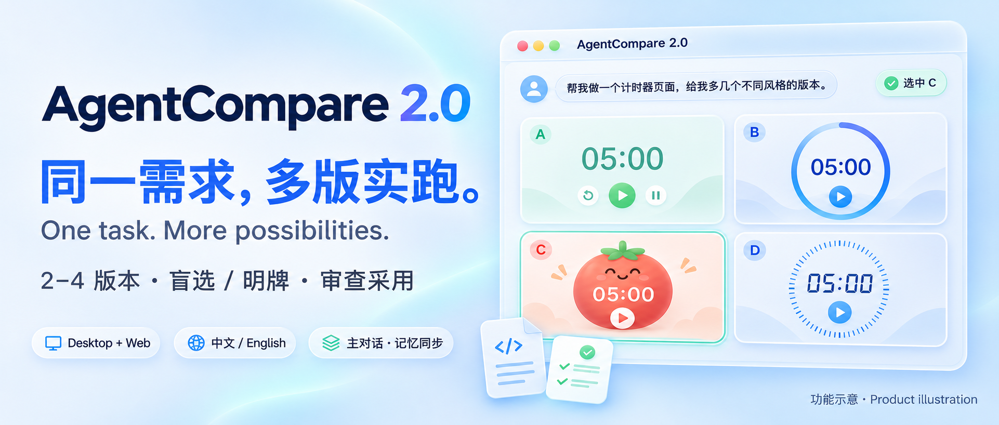
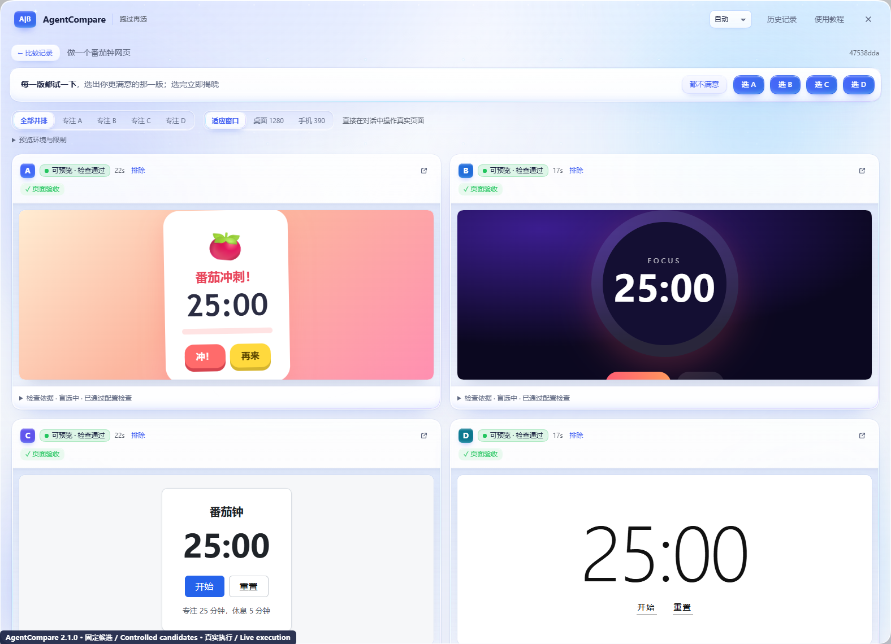
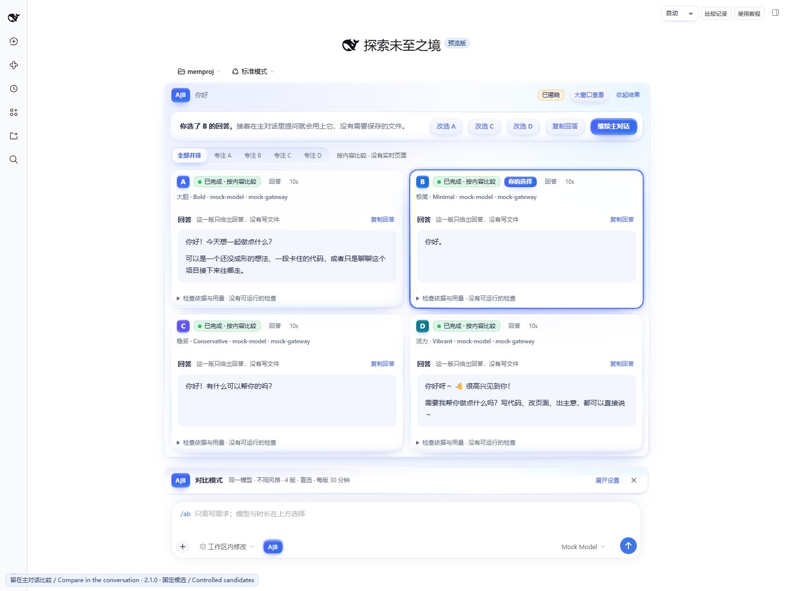
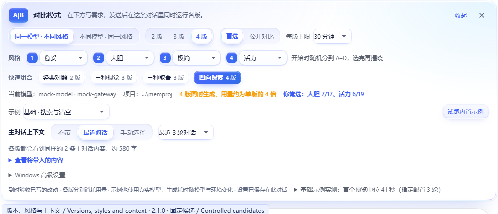
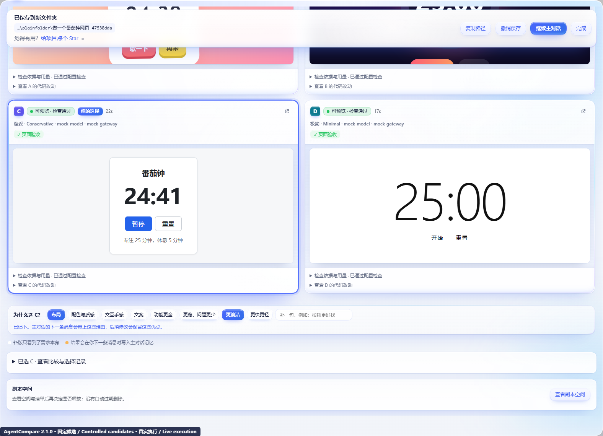
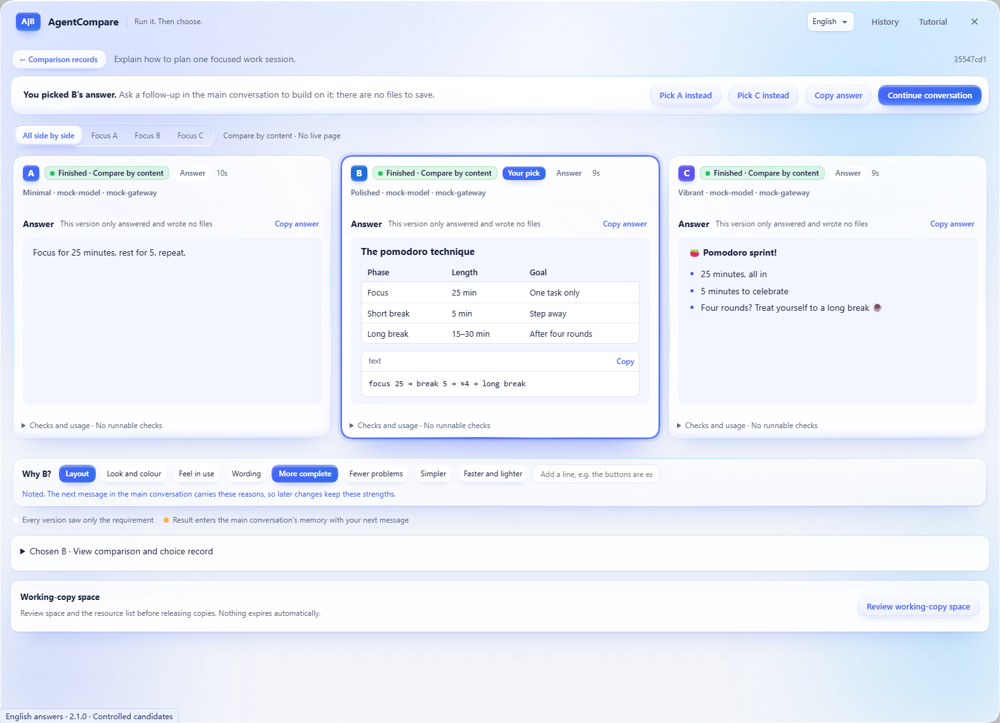
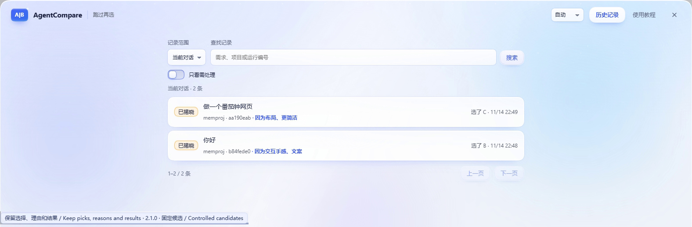
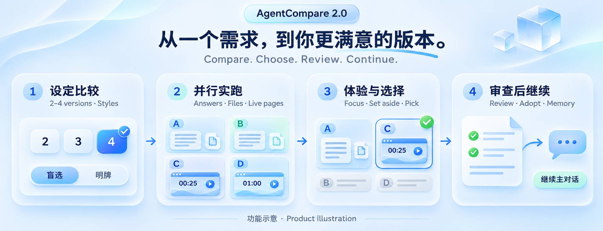

# AgentCompare 2.0 · 图片与界面 / Gallery

在 DSH Desktop 与 Web 的主对话里比较 2–4 版回答、文件或网页。选择风格、盲选或公开对比，选完说明理由，再继续主对话；文件写回前先审查，保留撤销与恢复入口。

Compare 2–4 answers, files or live pages in the main conversation on DSH Desktop and Web. Choose styles, compare blind or openly, keep reasons for the pick, and review before adoption. Chinese and English interfaces are included.

图库按“是什么 → 实际比较 → 主对话 → 设置 → 保存与撤销 → English → 历史 → 流程”排列。前两张用于小卡片展示。首图和流程图是功能示意，另外六张为固定候选在真实 DSH Web 宿主中的桌面尺寸界面，不代表外部模型的生成质量或速度。

The first and last images are product illustrations. The six interface captures use controlled candidates in an isolated DSH Web profile at desktop window sizes. They show real pages, answers and persisted records, not an external-model benchmark. No user Desktop profile was used for these captures.

## 1. 同一需求，2–4 版真跑 / One task, 2–4 versions

## 2. 四版页面直接操作 / Four independently interactive pages

## 3. 打招呼得到四种回答 / A greeting answered four ways

在可以构建的 Vite 项目里发「你好」，四版按各自风格直接回答，不改文件、不构建。/ "你好" (hello) sent from a Vite project that can be built: four versions answer in their own styles, with no files changed and nothing built.

## 4. 版本、风格与上下文 / Versions, styles and context

## 5. 保存、撤销和选择理由 / Save, undo and reasons for the pick

## 6. 英文回答并排比较 / Compare English answers

## 7. 查找历史，保留选择与理由 / Find history, picks and reasons

## 8. 设定、实跑、选择、采用 / Set up, run, choose and adopt

## 同步与数据 / Sync and statistics

- [screenshots.json](../screenshots.json) gives catalogs the eight ordered HTTPS image URLs. The versioned paths replace the earlier two-image gallery.
- [Capture manifest](../assets/readme/gallery-2.0/manifest.json) records image hashes, dimensions, kinds and runtime identity. Images stay outside the npm runtime package.
- [GitHub Stars](https://github.com/lijiaqi-AI-Product-Manager/dsh-agent-compare/stargazers) and [npm downloads](https://www.npmjs.com/package/dsh-agent-compare) are independent live statistics. README badges query their respective sources; catalog cards may have their own refresh schedules. A missing value means unknown, not zero. Downloads count package requests, not unique users.
- Publishing a repository update does not prove a downstream catalog has refreshed. The public image URLs and each displayed listing must be checked separately.

Gallery runtime: 2.1.0, DSH 0.2.2-rc.1, Edge 157; 95 installed runtime files match source 2b5c992. All six interface captures were taken on 2026-11-14 (local date) with controlled candidates and no external-model calls. Local paths are hidden and capture captions are added.
